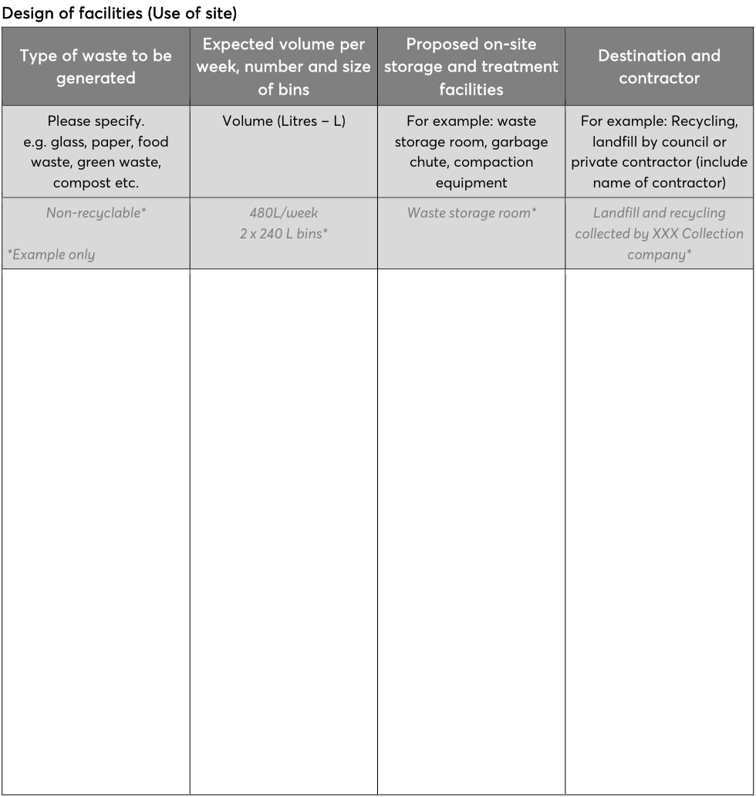

### 16.0 STAGE THREE – DESIGN OF FACILITIES (USE OF SITE)

To be completed for all proposals including change of use, fit out as well as alterations and additions

• Applicants should refer to Councils Waste Management Guidelines for New Development Applications for specific requirements related to the type of development proposed. This is available on Councils website.

• Guidance on determining bin size and service arrangements for different sizes of residential development is also available on Council’s website.

• In the case of change of use, fit out as well as alterations and additions, if the proposal involves existing waste management practices then full details of current methods are to be provided.

• All proposals are to show the waste storage areas on plan drawings which should accompany your application.

Design of facilities (Use of site)

> [Picture on page 44: a picture, saved as a picture (images/part-12-appendices-page-44-14.gif, 150 dpi).]

| Type of waste to be generated | Expected volume per week, number and size of bins | Proposed on-site storage and treatment facilities | Destination and contractor |
|---|---|---|---|
| Please specify. | Volume (Litres – L) | For example: waste | For example: Recycling, |
| e.g. glass, paper, food |  | storage room, garbage | landfill by council or |
| waste, green waste, |  | chute, compaction | private contractor (include |
| compost etc. |  | equipment | name of contractor) |
| Non-recyclable* | 480L/week 2 x 240 L bins* | Waste storage room* | Landfill and recycling collected by XXX Collection |
| *Example only |  |  | company* |

Describe how you intend to ensure on-going management of waste on-site (e.g. lease conditions, caretaker, strata manger) as well as provide details of how the bin store area complies with councils bin storage area requirements relevant to the type of proposed development.
