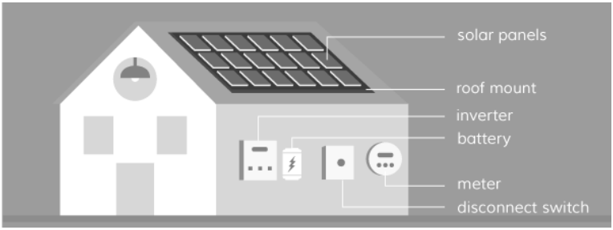
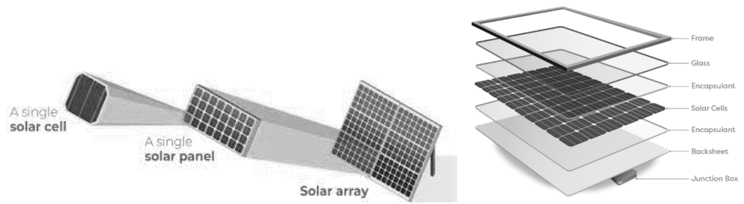

### 1.0 GENERAL HERITAGE PRINCIPLES FOR SOLAR ENERGY SYSTEM

#### INSTALLATION (PANELS ARRAY AND EQUIPMENT)

Council encourages the sensitive installation of solar energy systems (solar panels and equipment) on heritage items and within conservation areas as long the proposal protects heritage values and maintains the integrity, the significance, and the character of the area.

Solar Energy System installation does not qualify for an exemption, heritage minor works (HMW) application or local heritage fund (LHF) application.

Before any work is carried out, applicants will need to submit a Development Application (DA) and obtain consent to install the solar energy system (PV panels and associated equipment) in heritage conservation areas, special character areas and on LEP’s heritage listed items.

What is a solar energy system?

Solar energy systems include a few key components: a solar array (collection of multiple solar panels), racking and mounting equipment, inverters, a disconnect switch, and, optionally, a solar battery. The system convert sunlight captured through photovoltaic cells within a solar array located over existing roofs into electrical energy. This energy converted in electricity can be stored in batteries.

> [Picture on page 52: a picture, saved as a picture (images/part-12-appendices-page-52-23.gif, 150 dpi).]

Source: https://news.energysage.com/solar-panel-setup-what-you-need-to-know/

What are solar photovoltaic panels?

Solar panels are aluminium framed and encapsulated photovoltaic cells assembled over a back sheet and protected by tempered glass. Each panel requires a junction box as part of a photovoltaic (PV)

HERITAGE INFORMATION: TERMS, RESPONSIBILITIES AND PROCEDURES

electricity generating system which also includes fixings, conduit and other equipment like inverters and batteries.

> [Picture on page 53: a picture, saved as a picture (images/part-12-appendices-page-53-4.gif, 150 dpi).]

Source: https://www.cleanenergyreviews.info/blog/solar-panel-components-construction
