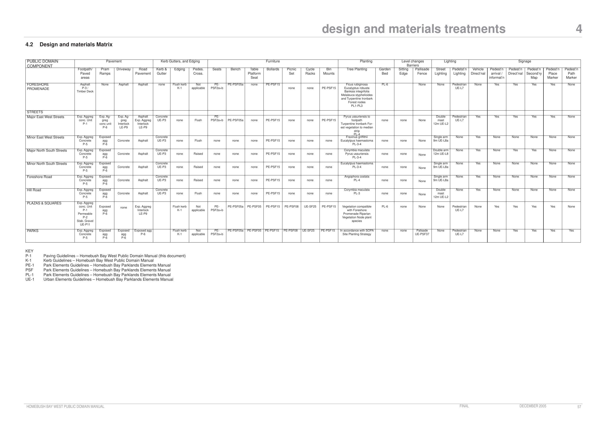

### 4                       design & materials treatments

#### Services / Infrastructure

Services provisions to streetscape have a significant impact on the quality of street environment through both the immediate appearance of services or service lids, or through the damage to road and footpath pavements caused when random authorities works are carried out. Key principles for the ‘low impact’ integration of necessary services and infrastructure elements within public domain areas are:

1\. Under-grounding of overhead services carried out where feasible to major street corridors to reduce visual intrusion and enhance aerial amenity for street trees

2\. New developments to integrate under-grounding of services and infrastructure as part of planning

Paving infill lid in unit pavement

3\. Where possible identify design schemes for at least full street blocks, and liaise with service authorities to determine renewal or amplification requirements and incorporate these works into programming prior to pavement renewal

4\. Provide common texture and shape to electricity service covers (i.e. during upgrade projects)

5\. Provide lids to Telstra pits with paving infill to match adjoining pavement The provision of stormwater drainage to streetscape improvement zones can also be problematic in particular at footpath widening where no underground stormwater services are available. Key principals for consideration of stormwater drainage in streetscape design are:

Paving infill lid in asphalt

6\. Provide a common theme to all stormwater inlet sump and channel lids / grates to paved areas

7\. Connect rooftop downpipe to underground stormwater in public domain upgrade works

8\. Incorporate natural disposal and surface drainage techniques where possible to urban spaces and open spaces

9\. Incorporate water sensitive urban design and technology to treatment of road stormwater runoff

10\. Incorporate porous pavements and on site detention to carpark areas to reduce urban stormwater runoff

Steel pit cover

#### Stormwater Management

It is proposed that to the major east west streets and major North South streets (northern zones) where central median zones are provided, that planted areas allow water to re-enter the groundwater system. All hardstand runoff is to be collected by the stormwater system and directed (where appropriate) to the WRAMS water recycling system. As the public domain strategy incorporates some deciduous plantings it is important that leaves from these trees do not enter the bay during Autumn months.  Leaves are a major source of Eutrophication (de oxygenisation) of aquatic habitat. Filter meshes should be fitted to stormwater inlet pits to prevent leaf transport, and subject to regular maintenance during critical months of the year.

### design & materials treatments                       4

### 4.2 Design and Materials Matrix

The matrix provided at 4.2 summarises the design and materials recommendations for each of the public domain components.  Where a particular item is not relevant to a streetscape element the matrix identifies “none” (not applicable).

> [Picture of page 59: a large table printed sideways, saved as a picture (images/volume-02-public-domain-manual-page-59.gif, 150 dpi) so its rows and columns stay readable.]

> Words printed in the table (copied from the PDF line by line, columns separated by |):
> design and materials treatments | 4
> 4.2 | Design and materials Matrix
> PUBLIC DOMAIN | Pavement | Kerb Gutters, and Edging | Furniture | Planting | Level changes | Lighting | Signage
> COMPONENT | Barriers
> Footpath/ | Pram | Driveway | Road | Kerb & | Edging | Pedes. | Seats | Bench | Table | Bollards | Picnic | Cycle | Bin | Tree Planting | Garden | Sitting | Pallisade | Street | Pedetst’n | Vehicle | Pedest’n | Pedest’n | Pedest’n | Pedest’n | Pedest’n
> Paved | Ramps | Pavement | Gutter | Cross. | Platform | Set | Racks | Mounts | Bed | Edge | Fence | Lighting | Lighting | Direct’nal | arrival / | Direct’nal | Second’ry | Place | Path
> areas | Seat | informat’n | Map | Marker | Marker
> FORESHORE | Asphalt | None | Asphalt | Asphalt | none | Flush kerb | Not | PE- | PE-PSF05a | none | PE-PSF15 | Ficus rubiginosa | PL-6 | None | None | Pedestrian | None | Yes | Yes | Yes | Yes | None
> PROMENADE | P-3 / | K-1 | applicable | PSF2a+b | none | none | PE-PSF15 | Eucalyptus robusta | UE-L7
> Timber Deck | Banksia integrifolia
> Melaleuca styphelioides
> and Turpentine Ironbark
> Forest nodes
> PL1-PL3
> STREETS
> Major East West Streets | Exp. Aggreg | Exp. Ag- | Exp. Ag- | Asphalt | Concrete | PE- | Pyrus ussuriensis to | Double | Pedestrian | Yes | Yes | Yes | Yes | Yes | None
> conc. Unit | greg | greg | Exp. Aggreg | UE-P3 | none | Flush | PSF2a+b | PE-PSF05a | none | PE-PSF15 | none | none | PE-PSF15 | footpath | none | none | None | mast | UE-L7
> P-1 | conc unit | Interlock | Interlock | Turpentine Ironbark For- | 12m UE-L2
> P-6 | LE-P9 | LE-P9 | est vegetation to median
> strip
> PL-4
> Minor East West Streets | Exp. Aggreg | Exposed | Concrete | Fraxinus griffithii | Single arm | None | Yes | None | None | None | None | None
> Concrete | agg | Concrete | Asphalt | UE-P3 | none | Flush | none | none | none | PE-PSF15 | none | none | none | Eucalytpus haemastoma | none | none | None | 9m UE-L8a
> P-5 | P-6 | PL-3-4
> Major North South Streets | Exp. Aggreg | Exposed | Concrete | Corymbia maculata | Double arm | None | Yes | None | Yes | Yes | None | None
> Concrete | agg | Concrete | Asphalt | UE-P3 | none | Raised | none | none | none | PE-PSF15 | none | none | none | Pyrus ussuriensis | none | none | None | 12m UE-L8
> P-5 | P-6 | PL-3-4
> Minor North South Streets | Exp. Aggreg | Exposed | Concrete | Eucalytpus haemastoma | Single arm | None | Yes | None | None | None | None | None
> Concrete | agg | Concrete | Asphalt | UE-P3 | none | Raised | none | none | none | PE-PSF15 | none | none | none | PL-3-4 | none | none | None | 9m UE-L8a
> P-5 | P-6
> Foreshore Road | Exp. Aggreg | Exposed | Concrete | Angophora costata | Single arm | None | Yes | None | None | None | None | None
> Concrete | agg | Concrete | Asphalt | UE-P3 | none | Raised | none | none | none | PE-PSF15 | none | none | none | PL-4 | none | none | None | 9m UE-L8a
> P-5 | P-6
> Hill Road | Exp. Aggreg | Exposed | Concrete | Corymbia maculata | Double | None | Yes | None | None | None | None | None
> Concrete | agg | Concrete | Asphalt | UE-P3 | none | Flush | none | none | none | PE-PSF15 | none | none | none | PL-3 | none | none | None | mast
> P-5 | P-6 | 12m UE-L2
> PLAZAS & SQUARES | Exp. Aggreg
> conc. Unit | Exposed | none | Exp. Aggreg | Flush kerb | Not | PE- | PE-PSF05a | PE-PSF05 | PE-PSF15 | PE-PSF08 | UE-SF25 | PE-PSF15 | Vegetation compatible | PL-6 | none | None | None | Pedestrian | None | Yes | Yes | Yes | Yes | None
> P-1 | agg | Interlock | K-1 | applicable | PSF2a+b | with Foreshore | UE-L7
> Permeable | P-6 | LE-P9 | Promenade Riparian
> P-2 | Vegetation Node plant
> Stab. Gravel | species
> UE-P11
> PARKS | Exp. Aggreg | Exposed | Exposed | Exposed agg | Flush kerb | Not | PE- | PE-PSF05a | PE-PSF05 | PE-PSF15 | PE-PSF08 | UE-SF25 | PE-PSF15 | In accordance with SOPA | none | none | Palisade | None | Pedestrian | None | None | Yes | Yes | Yes | Yes
> Concrete | agg | agg | P-6 | K-1 | applicable | PSF2a+b | Site Planting Strategy | UE-PSF37 | UE-L7
> P-5 | P-6 | P-6
> KEY
> P-1 | Paving Guidelines – Homebush Bay West Public Domain Manual (this document)
> K-1 | Kerb Guidelines – Homebush Bay West Public Domain Manual
> PE-1 | Park Elements Guidelines – Homebush Bay Parklands Elements Manual
> PSF | Park Elements Guidelines – Homebush Bay Parklands Elements Manual
> PL-1 | Park Elements Guidelines – Homebush Bay Parklands Elements Manual
> UE-1 | Urban Elements Guidelines – Homebush Bay Parklands Elements Manual
> HOMEBUSH BAY WEST PUBLIC DOMAIN MANUAL | FINAL | DECEMBER 2005 | 57

### public domain guidelines

### 5

#### Introduction

The design principles outlined previously set in place broad recommendations for public domain design and materials treatments.

Public domain projects should be undertaken with a holistic integrated approach to include:

• pavement / kerbs

• furniture

• drainage

• services

• planting Ideally streetscape works should cover a full street block in project scope (or more) as funding allows. The following design guidelines outline public domain design solutions to be followed in planning and implementation of works through Homebush Bay West.  These should be read in conjunction with SOPA’s Homebush Bay Parklands and Urban Elements Manuals which define a range of materials and treatments applicable to Homebush Bay West as outlined in the reference list for each element category. Guidelines included in this document and in the Parklands and Urban Elements Manuals do not provide definitive construction information, and are aimed at providing a reference for site specific design to be applied to individual sites.  It is also proposed that the guidelines set will be expanded / supplemented over time as projects develop additional design responses applicable to broader application. The guidelines package includes a number of guidelines derived from the Sydney Olympic Park Urban and Parklands Elements Design Manual

### public domain guidelines                           5 P

#### Pavement

| No | Guideline | Purpose |
|---|---|---|
| P-1 | Exposed Aggregate Concrete Unit pavement – reconstituted stone | Major east west streets |
| P-2 | Permeable pavement | Large plazas / courtyards / thresholds |
| P-3 | Asphalt Pavement | Foreshore promenade |
| P-4 | Tactile paving | To crossings, major driveways and other pedestrian hazards |
| P-5 | Exposed aggregate in situ concrete | To footpaths to all streets (other than major East West) |
| P-6 | Pram Ramps | a. To major East West b. To all other streets |
| UE-P9 | Interlocking concrete unit pavement | Driveways to Major East West Sts |
| UE-P11 | Stabilised gravel pavement | To plazas and parks under seating areas (ie. Not in line of pedestrian travel |

#### Note:

P-….... refers to this Homebush Bay West Public Domain Manual UE-….. refers to design guidelines derived from the Sydney Olympic Park  Urban Elements Manual PE-….. refers to design guidelines derived from the Sydney Olympic Park Parkland Elements Manual

#### Honed Concrete Unit Pavement

### public domain guidelines                         P-1

> [Picture on page 62, not reproduced as text; see the original PDF.]

> [Picture on page 62, not reproduced as text; see the original PDF.]

#### Principles

• Provision of a high quality design finish to priorify pedestrian areas

• Hard wearing and cleanable surface to high use areas

• Potential for layouts to reinforce public domain design themes integrated with built form, plantings, and furniture elements

• Unit pavement is adaptable to lifting for services works / other repairs

• Carry unit pavement through service lid covers

#### Materials

• 400x400 mm banding / margin, 400x600 mm exposed aggregate unit pavement to meet class W or X slip resistance as applicable to use

- 40mm thickness to pedestrian areas

- 60mm thickness to vehicular areas

Colours:

- Colours to reflect natural materials character (sandstone, shale)  eg. greys / sand colors

- Darker colors / tones to outdoor areas to reduce staining impact

#### Permeable Pavement

### public domain guidelines                         P-2

> [Picture on page 63, not reproduced as text; see the original PDF.]

Permeable pavement -drainage  aggregate voids

#### Principles

222x110x60 mm concrete unit paver headercourse (colour to match permeable paving units) or flush concrete kerb

TYPICAL PLAN (not to scale)

> [Picture on page 63, not reproduced as text; see the original PDF.]
> Words printed on the picture (copied from the PDF):
> drainage voids  filled to
> top with 2-5mm aggregate
> fall
> Bedding layer
> (5-7 mm aggregate
> 100mm
> Permeable base
> (crushed aggregate)
> Dense - low

• Subject to site conditions permeable pavement can facilitate a range of methods in disposal of runoff:

- Retention in subsurface storage zone and infiltration to groundwater

Permeable pavement -

- Infiltration of normal volumes/ drainage of peak volumes to storage ponds of stormwater system.

• Provide permeable pavement where compatible with site conditions and subgrade to carpark areas and shared vehicle/pedestrian zones.

permeability base

#### Materials

TYPICAL CROSS SECTION (not to scale)

Recommended permeable pavement units and colours are as listed:

Rocla “Ecotrihex” 75mm paving units (unhoned)

Note: The above information is indicative only.  permeable pavement is to be specified and installed to site specific engineering design and to council approval

Colours: to match plaza pavement colours

#### Asphalt pavement

### public domain guidelines                         P-3

> [Picture on page 64, not reproduced as text; see the original PDF.]

> [Picture on page 64, not reproduced as text; see the original PDF.]

Existing asphalt pavement with granite banding adjoining PAYCE development

#### Principles

• Asphalt is a primary pedestrian path material through Sydney Olympic Parklands - provides continuity

• Continues a legible theme from the existing waterfront to the Payce development

• Smooth pedestrian / cycle surface with minimal glare generation

• Ability to relay asphalt when required over concrete base to renew surface

#### Materials

- AC5 wearing course (with Carborundum admixture) over AC10 intermediate course)

- Concrete basecourse for maximum stability and durability

#### Tactile Paving

### public domain guidelines                         P-4

> [Picture on page 65, not reproduced as text; see the original PDF.]

> [Picture on page 65, not reproduced as text; see the original PDF.]

#### Principles

• Use tactile tiles / units to meet design requirements of AS 1428-4 (2002)

Source:  AS 1428-4 (2002)

### public domain guidelines                         P-5

> [Picture on page 66, not reproduced as text; see the original PDF.]

#### Exposed Aggregate Insitu Concrete

> [Picture on page 66, not reproduced as text; see the original PDF.]

#### Principles

• Use path as edge definition between maintained grass and mass planted areas where practicle

• Path surface to be exposed aggregate for visual enhancement / identity

• All concrete works to carried out in accordance with AS 3600:1994

#### Materials

10-20mm aggregate Sample panel to be provided

### public domain guidelines                           5 K

#### Kerbs, gutter and edges

#### No Guideline

#### Purpose

K-1 Exposed aggregate concrete edge As edge to garden bed and gravel

areas adjoining grassed areas

UE-P3 Concrete kerb and gutter

All streets

#### Note:

P-….... refers to this Homebush Bay West Public Domain Manual UE-….. refers to design guidelines derived from the Sydney Olympic Park Urban Elements Manual PE-….. refers to design guidelines derived from the Sydney Olympic Park Parkland Elements Manual

### public domain guidelines                         K-1

> [Picture on page 68, not reproduced as text; see the original PDF.]
> [Picture text on page 68 is stored in the PDF without readable letters (no character map), so it could not be copied; see the original PDF.]
> Words printed on the picture (copied from the PDF):
> 100
> 150
> 50mm sand bed
> In situ concrete flush kerb

#### Exposed Aggregate Concrete Edge

> [Picture on page 68, not reproduced as text; see the original PDF.]

Garden bed or tree pit

Turfed or gravel area

#### Materials

Provide Quartz / Basalt aggregate mix (50/50) and lightly rinse / sponge concrete finish to exposed aggregate

- provide construction joints every 3 metres

### public domain guidelines                         5 FU

#### Furniture

| No | Guideline | Purpose |
|---|---|---|
| PE-PSF02a+b | Seats | Major east west streets Foreshore promenade Plazas / squares Parks |
| PE-PSF05a | Bench | Major east west streets Plazas / squares Parks |
| PE-PSF05 | Table / platform seat –1750mm square | Plazas / squares Parks |
| PE-PSF06 | Promenade edge (timber baulk seat – note – a concrete seat in similar fashion to PSF06 may also be applicable) | To edge of foreshore promenade |
| PE-PSF08 | Picnic set | Plazas / squares Parks |
| PE-PSF15 | Bollards | All streets Foreshore promenade Plazas / squares Parks |
| UE-SF25 | Bike Racks | Plazas / squares Parks |
| PE-SF21 | Bin Mounts | Plazas / squares Parks |

#### Note:

UE-….. refers to design guidelines derived from the Sydney Olympic Park  Urban Elements Manual PE-….. refers to design guidelines derived from the Sydney Olympic Park  Parkland Elements Manual

### public domain guidelines                            5 L

#### Lighting

| No | Guideline | Purpose |
|---|---|---|
| UE-L2 | 12m Double arm street lighting mast with double banner fixing | Central medians of major east west streets |
| UE-L8a | 9m Single arm street lighting mast | Major north south streets Minor east west streets Minor north south streets Foreshore Streets |
| UE-L3 | 12m Single arm street lighting mast with single banner fixing | Hill Road |
| UE-L7 | 7m pedestrian pole top light | Major east west streets Major north south streets Minor east west streets Foreshore promenade Plazas sqaures Parks |

#### Note:

UE-….. refers to design guidelines derived from the Sydney Olympic Park  Urban Elements Manual PE-….. refers to design guidelines derived from the Sydney Olympic Park  Parkland Elements Manual

### public domain guidelines                         5 PL

#### Planting

| No | Guideline | Purpose |
|---|---|---|
| PL-1 | Structural soil materials | All street tree planting |
| PL-2 | Tree pit preparation and drainage | All tree planting |
| PL-3 | Staking and tree guards | All tree planting |
| PL-4 | Kerbside tree planting in paving | Street tree planting |
| PL-5 | Kerbside tree planting in grass | Street tree planting |
| PL-6 | Garden beds | Foreshore promenade Plazas and squares parks |

#### Note:

P-….... refers to this Homebush Bay West Public Domain Manual UE-….. refers to design guidelines derived from the Sydney Olympic Park  Urban Elements Manual PE-….. refers to design guidelines derived from the Sydney Olympic Park  Parkland Elements Manual

#### Structural Soil Materials

### public domain guidelines                         PL-1

> [Picture on page 72, not reproduced as text; see the original PDF.]
> [Picture text on page 72 is stored in the PDF without readable letters (no character map), so it could not be copied; see the original PDF.]
> Labels printed on the map (copied from the PDF, in no particular order):
> 4000x2000x1000mm depth · excavation for · tree planting · Thickened edge · slab under · pavement and · pit edge · Tree pit in pavement · surfacing · Footpath · pavement · Tree watering box in · adjacent pavement · Fortecon layer · between slab and · structural · soil mix · 500 · link channel · slope · 1200 · slab opening · Subsoil drainage · line connected to · stormwater drainage · 4000 · planting excavation · Structural soil - refer · specification notes · this page · Corrugated ag line · 3500 length wrapped · around rootball · and capped · Rip base and sides · of tree pit 200 mm · 150mm depth blue metal · drainage material with · filter fabric over

> [Picture on page 72, not reproduced as text; see the original PDF.]

#### Principles

• Provide structural soil treatment to all new planting pits within paved footpath areas, to overcome limitations of organic mixes to support pavement above tree pit. Paving traditionally limited to outside surface opening area.

2000 wide x 500 deep link channel between trees

• Connect street tree planting pits with a water permeable channel along the inside of the kerb line (2000x500mm), back filled with structural soil

TYPICAL CROSS SECTION:  TREE PIT IN PAVEMENT - STRUCTURAL SOIL AND KERB TRENCH TREATMENT (not to scale)

> [Picture on page 72, not reproduced as text; see the original PDF.]
> Labels printed on the map (copied from the PDF, in no particular order):
> 4000 · 2000x500 mm link · trench between · tree pits · 2000 · 4000x2000x1000 mm · tree pit where · achievable · Tree pit opening in · pavement surfacing · refer guideline 5-7 · gutter · kerb

• Deep rip subsoil to sides and bottom of tree pit prior to backfilling with structural soil mix.

TYPICAL PLAN:  TREE PIT IN PAVEMENT - STRUCTURAL SOIL AND KERB TRENCH TREATMENT (not to scale)

### public domain guidelines                         PL-2

> [Picture on page 73, not reproduced as text; see the original PDF.]
> Labels printed on the map (copied from the PDF, in no particular order):
> Staking where required · refer guideline 5-5 · Mulch as required · refer guideline 5-3 · Rip sides of pit to 100mm · planting mix as specified · Filter fabric to base · and sides - overlap 150mm · at joints · 1.5 x rootball depth · Subsoil drainage line · connected to s/w services · 150 mm depth blue metal · drainage layer · Rip base  of pit to · 150mm depth · 800 MIN · Note: · refer also to guideline 5-2 · structural soils for tree · planting in pavement to · metropolitan and · district streets · (not to scale) · Tree pit opening treatment · as applicable · Staking where required · 150 mm depth blue metal · drainage layer · Kerb works to · edge of tree pit · subject to · structural · design · Structural soil · planting medium · nominal 1200(x1200mm length) · 1000 · 150 · 150 · Rip base  of pit to · 150mm depth · Filter fabric to base · and sides - overlap 150mm · at joints · Subsoil drainage line · TYPICAL CROSS SECTION

Tree pit preparation and

#### drainage

> [Picture on page 73, not reproduced as text; see the original PDF.]

#### Principles

TYPICAL CROSS SECTION TREE PIT TO SOFT LANDSCAPED AREA

• Tree pit preparation to road footpath areas should occur during preparation of pavement subgrades to enable connection of subsoil drainage to stormwater services and installation of structural soils.

• Tree pit excavation to required sizes to be carried out along with ripping of subgrade and sides of pit (as per cross section).

• Install irrigation infrastructure, blue metal drainage layer and subsoil drainage line (with connection to S/W infrastructure).

• Back fill tree pits with structural soil mix

• Cover tree pit with plywood during footpath pavement works for public safety and to prevent disturbance of planting mix.

• Connect tree pit irrigation infrastructure to trickle emitters.

connected to s/w services

TREE PIT AGAINST KERB (not to scale)

#### Staking and tree guards

### public domain guidelines                         PL-3

> [Picture on page 74, not reproduced as text; see the original PDF.]

> [Picture on page 74, not reproduced as text; see the original PDF.]
> Labels printed on the map (copied from the PDF, in no particular order):
> Temporary tree guard · set into ground 1500mm · timber medium dressed · hw 5mm chamfer all · edges paint finish timber · bracket primer & 2 coats · of gloss black · Hessian webbing · Temporary timber · tree guard - 3 nos. · 100x100x3000 hw posts · 150x38mm rails checked · 500 · 1000 · 5mm thick 60x60mm · section right angle · galvanised steel · edge (asphalt · pavements only) · TYPICAL CROSS SECTION:  TIMBER STAKES TO TREE PITS TO · OPEN SPACES/ CIVIC/ STREET SQUARES · (not to scale) · 1200 · 50mm hessian webbing · ties to tree & fixed to · tree guard · 1150 · tree in centre of · tree pit · 200x50x1mm galvanised · sheet corner brackets/ · fix through rails to post · min. 4 nos. 75x5mm · galvanised screws/ · bracket all corners · Temporary timber tree · guard - 3 nos.100x100x3000 · hw posts 150x38mm rails · checked to posts · 150x38mm rails · checked to · posts

#### Principles

to posts

• Where planting of 200L or under is provided to street or open space areas within paving - provide timber tree guard for establishment period as a minimum

(ie. 2 years to maximum 5 years).

300x600mm paving trim (paved areas only)

TYPICAL PLAN/ CROSS SECTION:  TIMBER STAKES TO TREE PITS TO OPEN SPACES/ CIVIC/ STREET SQUARES (not to scale)

### public domain guidelines                         PL-4

> [Picture on page 75, not reproduced as text; see the original PDF.]
> Labels printed on the map (copied from the PDF, in no particular order):
> 1200 1200 · 1200 · 1200 · 1200 · Tree pit channel · extended for · length of planting · subject to · services · Staking where required · refer guideline 5-5 · Kerb works to · edge of tree pit · subject to · structural · design · nominal 1200(x1000mm length) · Unit pavement on concrete · basecourse or insitu concrete · pavement · (not to scale) · Staking where required · refer guideline 5-5 · Kerb works to · edge of tree pit · subject to · structural · design · nominal 1200(x1000mm length) · Unit pavement on concrete · basecourse or insitu concrete · pavement · 1000 · 150 · 150

Kerbside tree planting in

#### paving

> [Picture on page 75, not reproduced as text; see the original PDF.]

PLAN - TREE PIT SET BACK ADJOINING KERB nts

PLAN - TREE PIT SET BACK FROM KERB nts

TYPICAL CROSS SECTION TREE PIT SETBACK FROM KERB

TYPICAL CROSS SECTION TREE PIT ADJOINING KERB (not to scale)

#### Kerbside in turf

### public domain guidelines                         PL-5

> [Picture on page 76, not reproduced as text; see the original PDF.]

> [Picture on page 76, not reproduced as text; see the original PDF.]
> Labels printed on the map (copied from the PDF, in no particular order):
> 1200 · Varies · 2000 · TYPICAL PLAN: · TREE PLANTING IN GRASS · (not to scale) · provide edge thickening · of path slab subject to · site specific engineering · advise · property · boundary · 2000 · 1200 · . · concrete · footpath · Tree pit preparation · as per PL-2 · TYPICAL CROSS SECTION:

footpath pavement

concrete kerb and gutter

75mm pine bark mulch to groundcover planting

note:  tree pit to take up full width of turf

50x50x2400mm hardwood stakes

Flush concrete edge

property boundary

turfed area

Tree guard as per PL-3

50mm wide hessian

apply mulch and form shallow dish drain to base of plant

backfill planting mix to finish flush with base of plant excavate planting hole with surrounding soil levels 200mm deeper and 600mm wider than rootball size

rip subgrade to 150mm

TREE PLANTING IN GRASS (not to scale)

### public domain guidelines                         PL-6

Garden Bed preparation and

#### planting

> [Picture on page 77, not reproduced as text; see the original PDF.]

5-15 litre garden bed planting. for larger plantings

> [Picture on page 77, not reproduced as text; see the original PDF.]
> [Picture text on page 77 is stored in the PDF without readable letters (no character map), so it could not be copied; see the original PDF.]
> Words printed on the picture (copied from the PDF):
> (refer guideline pl.5)
> Max 1:3 fall

prepare planting hole 150mm deeper than root ball

75mm horticultural grade pine bark mulch

300mm planting mix. add fertiliser as required

75

150

300

Cultivate base to 150mm depth

Ensure base of garden bed drains freely either by grade or through subsoil drainage (refer guideline d.2)

### public domain guidelines                       5 FBL

#### Fences, barriers, level changes

#### No Guideline

PE-PSF06 Foreshore promenade seating edge Refer to Section 5 FU Furniture Guidelines

UE-SF37 Palisade Fence

#### Note:

UE-….. refers to design guidelines derived from the Sydney Olympic Park  Urban Elements Manual PE-….. refers to design guidelines derived from the Sydney Olympic Park  Parkland Elements Manual

### public domain guidelines                           5 S

#### Signage

Refer to Wayfinding Strategy Report (May 2004) for Signage Types

### public domain guidelines                         5 SI

#### Services and infrastructure

#### No Guideline

#### Purpose

SI-1 Telecommunications pit with infill paving lid

Major east west streets (unit paving) All other streets (concrete infill) Foreshore promenade Plazas / squares

SI-2 Electrical pit

All streets

SI-3 Stop cock, hydrant and QCV valves Major east west streets (unit paving)

All other streets (concrete infill) Foreshore promenade Plazas / squares

SI-4 Stormwater drainage inlets to pedestrian areas

Foreshore promenade Plazas / squares

#### Note:

SI-….... refers to this Homebush Bay West Public Domain Manual UE-….. refers to design guidelines derived from the Sydney Olympic Park  Urban Elements Manual PE-….. refers to design guidelines derived from the Sydney Olympic Park  Parkland Elements Manual

### public domain guidelines                         SI-1

> [Picture on page 81, not reproduced as text; see the original PDF.]

Telecommunications pit with

#### infill paving

> [Picture on page 81, not reproduced as text; see the original PDF.]

#### Principles

• Services and infrastructure openings have a significant impact on the quality of the streetscape through their visibility and proliferation of different lid types.

• Incorporate services renewal amplification requirements into streetscape improvement programes to prevent later conflicts.

• New streetscape developments to integrate location of services and infrastructure with streetscape design.

• Telstra to check and approve condition of all service pits prior to replacement of service covers and repaving.

• Provide paved infill lids to single and double Telstra pits to match adjoining pavement material/ pattern.

• Adjust pit frames where pavement levels are changed.

#### Materials

Cast Iron frame: Wangaratta Industries WT5 and WT2 (10mm thick heavy duty galvanised steel) or equivalent. Paving: To match surrounding pavement material and pattern (expoxy glue to manufacturers specifications) Where asphalt pavement is laid Use Black Cast Iron Lid in levi of paving infill lid

#### Electrical pits

### public domain guidelines                         SI-2

> [Picture on page 82, not reproduced as text; see the original PDF.]

> [Picture on page 82, not reproduced as text; see the original PDF.]

#### Principles

• To provide consistent visual and maintenance treatment to footpath service pits.

• Provide asphalt infill lid where asphalt is being replaced.

• Provide steel pit lids to pits in old asphalt subject to future refurbishment.

### public domain guidelines                         SI-3

> [Picture on page 83, not reproduced as text; see the original PDF.]

#### Stop cock, hydrant and QCV valves

#### Principles

• New streetscape developments to integrate location of services and infrastructure with streetscape design.

• Incorporate services renewal application requirements into streetscape improvement programes to prevent later conflicts.

• Provide stop tap covers within granite, exposed aggregate, or asphalt paving. Ensure engraving is oriented to be perpendicular to street kerb alignment.

#### Materials

Lid covers: Mascot Engineering cast iron lid with engraved labelling (or equivalent).

### public domain guidelines                         SI-4

> [Picture on page 84, not reproduced as text; see the original PDF.]
> [Picture text on page 84 is stored in the PDF without readable letters (no character map), so it could not be copied; see the original PDF.]
> Words printed on the picture (copied from the PDF):
> FALL
> FALL
> FALL
> FALL
> FALL
> FALL

Stormwater drainage to

#### pedestrian areas

> [Picture on page 84, not reproduced as text; see the original PDF.]

FOOTPATH PAVEMENT FALL TO KERB AND GUTTER WHERE POSSIBLE

INCORPORATE ON SITE SOAKAGE PITS WHERE POSSIBLE

MINIMISE PAVED AREA DRAINING TO DRAINAGE PIT INLETS

#### Principles

FALL

TYPICAL PIT ARRANGEMENT - SQUARES AND COURTYARDS (not to scale)

• Provide stormwater drainage to pedestrian paved areas where no underground stormwater services are available.

STORM DRAINAGE INLET LID

PAVING AS SPECIFIED

100

• Footpath/ pedestrian pavements to fall to kerb and gutter other than where levels make this physically impossible.

FALL

40

MORTAR  BED AS SPECIFIED AROUND PIT LIDS.

450

100

50

• Foothpath cross falls to be even across foothpath of:

CONCRETE SUBCOURSE BY COUNCIL TO ENGINEERS DETAILS.

- minimum  1:70

50mm CHEMICAL BOLT TO SLAB

FALL

PIPE TO DRAINAGE INFRASTRUCTURE

75

100

VARIES > 3.0m

TYPICAL SECTION:  INLET PIT (not to scale)  All dimensions in millimeters

- maximum 1:40 gradient.

• Where falls to kerb and gutter are not possible provide surface inlet pits servicing the minimum surface catchment possible.

TYPICAL PIT ARRANGEMENT FOOTPATH WIDENING  AND EXTENSIONS (not to scale)

• Paving levels to allow for escape of storm water to kerb and gutter below adjoining floor levels should drainage pits become blocked.

• Incorporate on site infiltration where possible to squares and large paved areas to reduce gross volume of stormwater runoff.

466mm 450mm

• Provide continuity of pit types stormwater inlet sumps and channel lids and grates to pavement areas.

• Connect rooftop down pipe drainage to underground stormwater in public domain upgrade works.

TYPICAL PLAN: INLET PIT TO PAVEMENT (not to scale)

#### Materials

Grates: ‘Gatic heavy duty’ types: H601K and H600DF (or equivalent)
