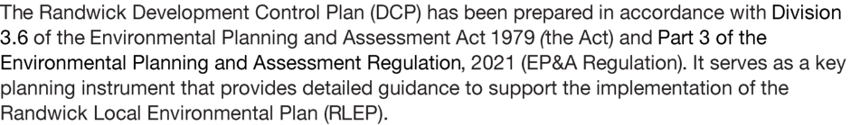
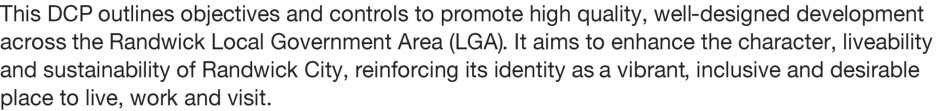
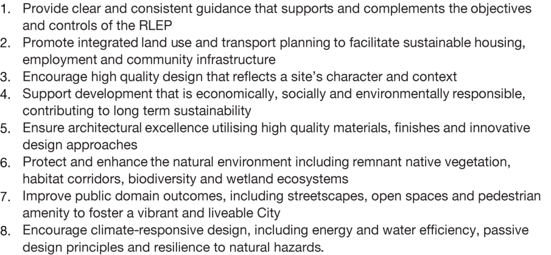
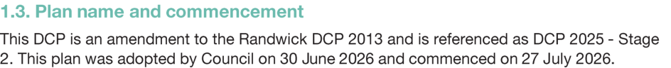
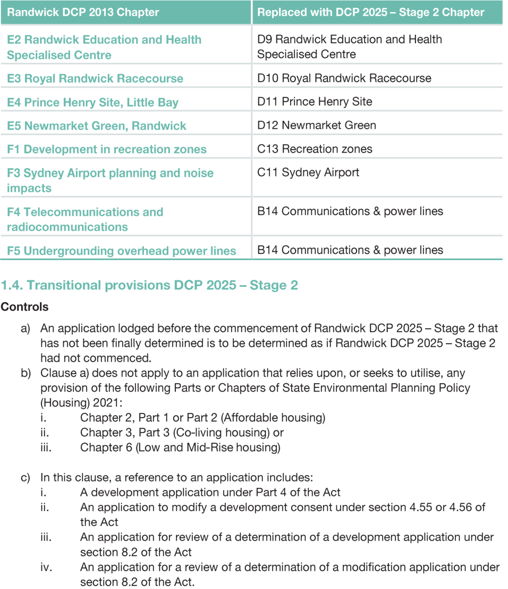

## 1. About this DCP

### 1.1. Purpose of this p lan

> [Picture on page 5: a picture, saved as a picture (images/part-a1-welcome-page-5-3.gif, 150 dpi).]

Th e Randwick Development Control Plan (DCP) has been prepared in accordance with Division

3.6 of the Environmental Planning and Assessment Act 1979 (

the Act) and Part 3 of the

Environmental Planning and Assessment Regulation , 2021 (

EP&A Regulation) . It serves as a key

planning instrument that provides detailed guidance to support the implementation of the Randwick Local Environmental Plan ( R LEP).

> [Picture on page 5: a picture, saved as a picture (images/part-a1-welcome-page-5-11.gif, 150 dpi).]

This DCP outlines objectives and controls to promote high quality, well - designed development across the Randwick Local Government Area (LGA) . It aims to enhance the character, liveability and sustainability of Randwick City, reinforcing its identity as a vibrant , inclusive and desirable place to live, work and visit. The plan is intended to assist:

• A pplicants in preparing Development Applications ( DA )

• Council officers in assessing proposals

• Community members in making informed submissions on applications .

Compliance with the provisions of this DCP does not necessarily guarantee that consent to a DA will be granted. This DCP supersedes all previous versions, including the Randwick DCP 2013 and the Stage 1 DCP update of 2023 and applies to all land within t he Randwick LGA .

### 1.2. Objectives

The objectives of this DCP are to:

> [Picture on page 5: a picture, saved as a picture (images/part-a1-welcome-page-5-25.gif, 150 dpi).]
> Words printed on the picture (title and legend, copied from the PDF):
> employment and community infrastructure
> design approaches

1\. Provide clear and consistent guidance that support s and complements the objectives and controls of the R LEP

2\. Promote integrated land u se and transport planning to facilitate sustainable housing ,

3\. Encourage high quality design that reflects a site’s character and context

4\. Support development that is economically, socially and environmentally responsible, contributing to long term sustainability

5\. E nsure architectural excellence utilising high quality material s , finishes and innovative

6\. P rotect and enhance the natural environment including remnant native vegetation, habitat corridors, biodiversity and wetland ecosystems

7\. Improve public domain outcomes, including streetscapes, open spaces and pedestrian amenity to foster a vibrant and liveable City

8\. Encourage climate - responsive design, including energy and water efficiency, passive design principles and resilience to natural hazards .

> [Picture on page 5: a picture, saved as a picture (images/part-a1-welcome-page-5-39.gif, 150 dpi).]
> Words printed on the picture (title and legend, copied from the PDF):
> - Stage

### 1.3. Plan n ame and c ommencement

This DCP is an amendment to the Randwick DCP 2013 and is referenced as DCP 2025

2\. This plan was adopted by Council on 30 J une 202 6 and commenced on 2 7 July 2026 . The following sections of the Randwick DCP 2013 are repealed and replaced with the following chapters:

| Randwick DCP 2013 Chapter | Replaced with DCP 2025 – Stage 2 Chapter |
|---|---|
| A1 Introduction | A1 Welcome |
| B1 Design | Repealed B1 Local character areas |
| B2 -Heritage | B2 Heritage |
| B3 Ecologically sustainable development | B3 Sustainability & resilience |
| B4 Landscaping & biodiversity | B4 Landscaping & biodiversity |
| B5 Preservation of trees and vegetation | B5 Preservation of trees and vegetation |
| B7 Transport, Traffic, parking and access | B7 Transport, Traffic, parking and access |
| B8 Water Management | B8 Water Management |
| B9 Management plan | B9 Management plan |
| B10 Foreshore scenic protection area | B10 Foreshore scenic protection area |
| B11 Development in laneways nominated for widening | B11 Laneway widening |
| C1 low density residential | C1 low density residential |
| C2 Medium density residential | C2 Medium density residential |
| C3 Adaptable and universal housing | C3 Universal & accessible housing |
| C4 Boarding houses | C4 Co -living & boarding houses |
| D1 Kensington centre | D1 Kensington & Kingsford (K2K) |
| D2 Kingsford centre | D1 Kensington & Kingsford (K2K) |
| D4 Maroubra Junction centre | D3 Maroubra Junction |
| D6 General controls | D4 Local centres |
| D7 Maroubra Beach centre | D6 Maroubra Beach |
| D8 The Spot, Randwick | D7 The Spot |
| D9 Amusement centres | C5 Amusement centres |
| D10 Backpackers’ accommodation | C12 Visitor & tourist accommodation |
| D11 Child care centres | C6 Child care centres |
| D12 Footpath dining and trading | C7 Footpath dining & trading |
| D13 Late night trading | C8 Night time economy |
| D14 Sex services premises | C9 Sex services premises |
| D15 Industrial areas | C10 Industrial areas |
| E1 Bundock Street, Randwick | D8 Defence Site |

> [Picture on page 7: a picture, saved as a picture (images/part-a1-welcome-page-7-1.gif, 150 dpi).]
> Words printed on the picture (title and legend, copied from the PDF):
> D10 Royal Randwick Racecourse
> D11 Prince Henry Site
> D12 Newmarket Green
> C13 Recreation zones
> C11 Sydney Airport

#### Randwick DCP 2013 Chapter

#### Replaced with DCP 2025 – Stage 2 Chapter

D9 Randwick Education and Health
