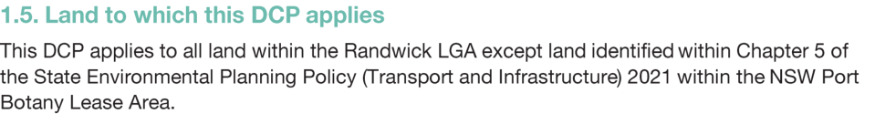
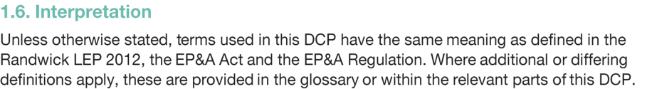
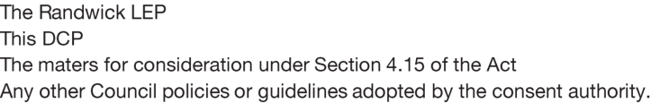
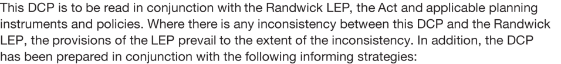
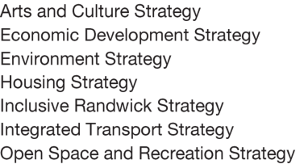
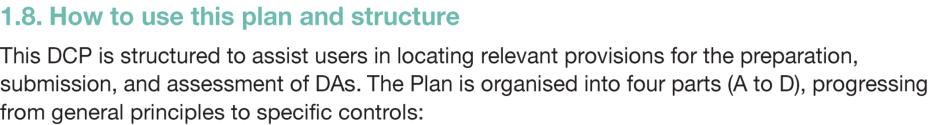
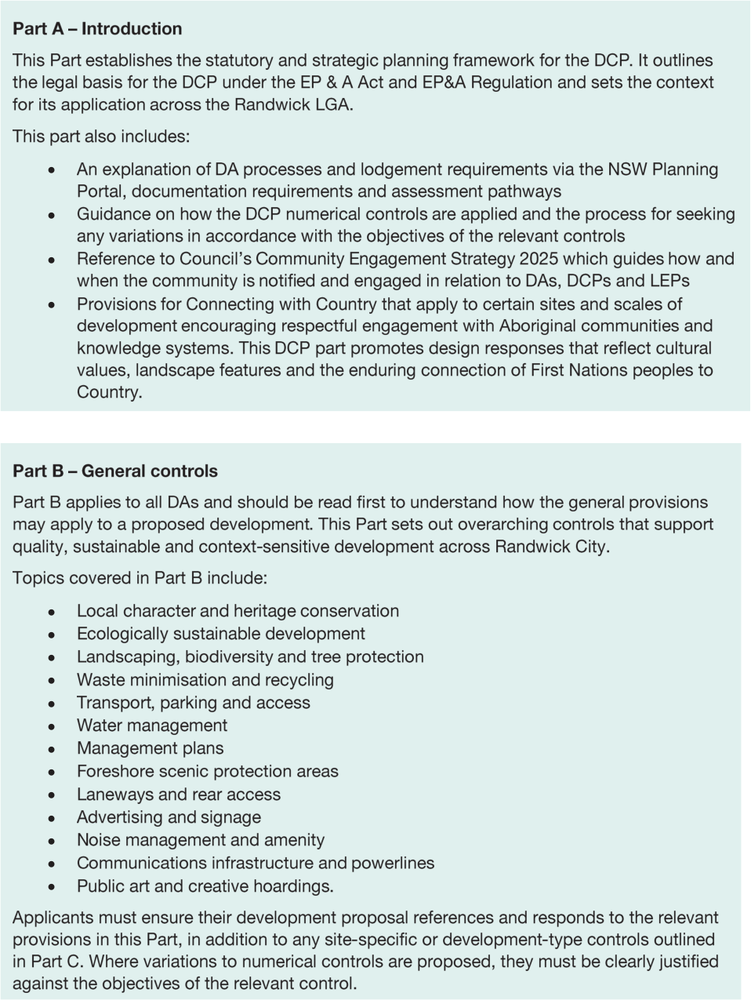
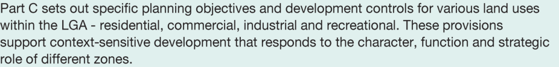
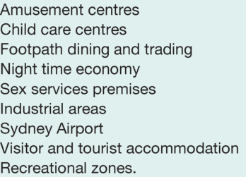
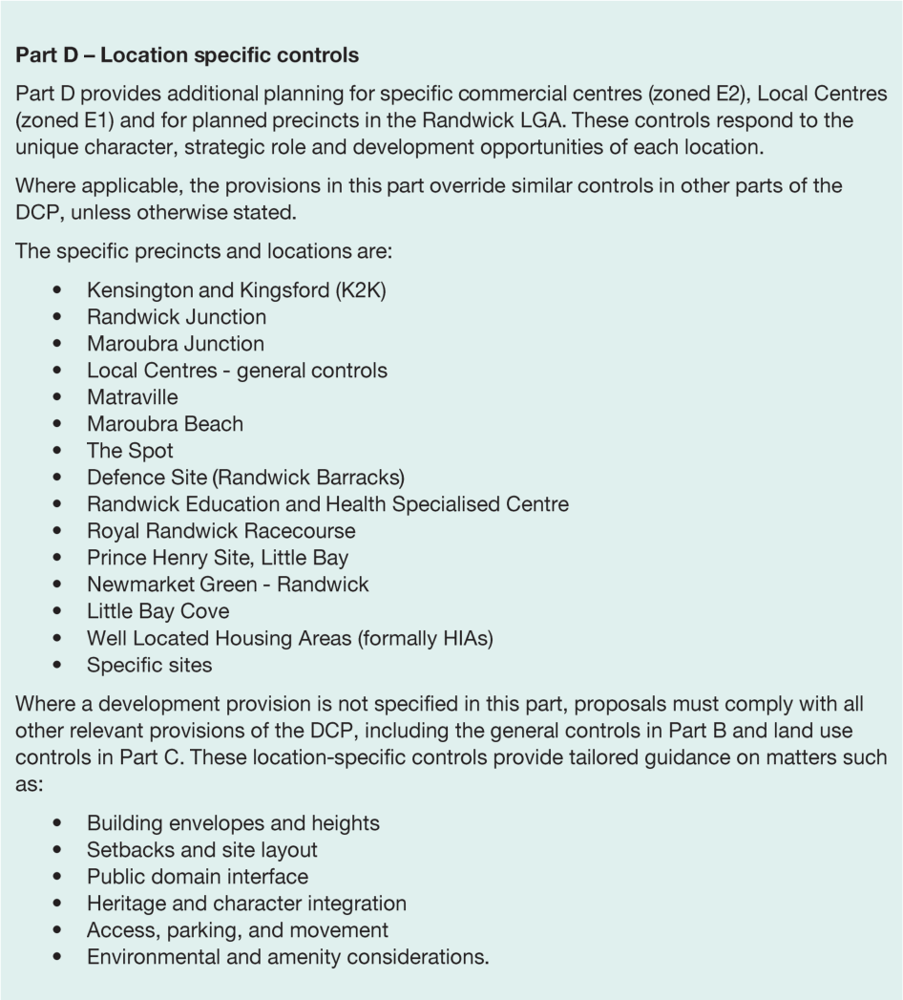

#### F5 Undergrounding overhead power lines

#### 1.4. Transitional p rovisions D CP 2025 – Stage 2

#### Controls

a) An application lodged before the commencement of Randwick DCP 2025 – Stage 2 that has not been finally determined is to be determined as if Randwick DCP 2025 – Stage 2 had not commenced .

b) Clause a) does not apply to an application that relies upon, or seeks to utilise, any provision of the following Parts or Chapters of State Environmental Planning Policy (Housing) 2021:

i. Chapter 2, Part 1 or Part 2 (Affordable housing)

ii. Chapter 3, Part 3 (Co - living housing) or

iii. Chapter 6 ( Low and Mid - Rise housing )

c) In this clause, a reference to an application includes:

i. A development application under Part 4 of the Act

ii. An application to modify a development consent under section 4.55 or 4.56 of

iii. An application for review of a determination of a development application under section 8.2 of the Act

iv. An application for a review of a determination of a modification application under section 8.2 of the Act.

> [Picture on page 8: a picture, saved as a picture (images/part-a1-welcome-page-8-1.gif, 150 dpi).]

### 1.5. Land to which this DCP applies

This DCP applies to all land within the Randwick LGA except land identified within Chapter 5 of the State Environmental Planning Policy (Transport and Infrastructure ) 2021 within the NSW Port Botany Lease Area.

> [Picture on page 8: a picture, saved as a picture (images/part-a1-welcome-page-8-6.gif, 150 dpi).]

### 1.6. Interpretation

Unless otherwise stated, t erms used in this DCP have the same meaning as defined in the Randwick LEP 2012, t he EP&A Act and the EP&A Regulation. Where additional or differing definitions apply, these are provided in the glossary or within the relevant parts of this DCP. A reference in this DCP to any legislation, planning instruments or Australian Standard include any amendment s, replacement s or updates to those documents . Each DA will be assessed having regard to :

> [Picture on page 8: a picture, saved as a picture (images/part-a1-welcome-page-8-14.gif, 150 dpi).]
> Words printed on the picture (title and legend, copied from the PDF):
> • T he R andwick LEP
> • T his DCP
> • T he maters for consideration under Section 4.15 of the Act
> • A ny other Council policies or guidelines adopted by the consent authority.

### 1.7. Relationship to other plans

> [Picture on page 8: a picture, saved as a picture (images/part-a1-welcome-page-8-16.gif, 150 dpi).]

This DCP is to be read in conjunction with the Randwick LEP , the Act and applicable planning instruments and policies. Where there is any inconsistency between this DCP and the Randwick LEP, the provisions of the LEP prevail to the extent of the inconsistency . In addition, the DCP has been prepared in conjunction with the following informing strategies:

> [Picture on page 8: a picture, saved as a picture (images/part-a1-welcome-page-8-21.gif, 150 dpi).]
> Words printed on the picture (title and legend, copied from the PDF):
> • Arts and Culture Strategy
> • Economic Development Strategy
> • Environment Strategy
> • Housing Strategy
> • Inclusive Randwick Strategy
> • Integrated Transport Strategy
> • Open Space and Recreation Strategy

> [Picture on page 8: a picture, saved as a picture (images/part-a1-welcome-page-8-22.gif, 150 dpi).]

### 1.8. How to use this plan and structure

This DCP is structured to assist users in locating relevant provisions for the preparation, submission, and assessment of DA s. The Plan is organised into four parts (A to D), progressing from general principles to specific controls: Part A – Introduction Part B – General Controls Part C – Land Use Controls Part D – Location Specific Controls . This structure is designed to support a logical and user - friendly approach to navigating the DCP, ensuring clarity for applicants, Council officers, and community members. Council’s website contains easy to follow information on the six stages in the life of a DA involving preparation, lodgement, assessment, determination and consent.

> [Picture on page 9: a picture, saved as a picture (images/part-a1-welcome-page-9-1.gif, 150 dpi).]
> Words printed on the picture (title and legend, copied from the PDF):
> • An explanation of DA processes and lodgement requirements via the NSW Planning
> • Guidance on how the DCP numerical controls are applied and the process for seeking
> • Reference to Council’s C ommunity E ngagement Strategy 2025 which guides how and
> • Provisions for Connecting with Country that apply to certain sites and scale s of

#### Part A – Introduction

This Part establishes the statutory and strategic planning framework for the DCP . It outlines the legal basis for the DCP under the EP & A Act and EP&A Regulation and sets the context for its application across the Randwick LGA. This part also includes:

Portal, documentation requirements and assessment pathways

any variations in accordance with the objectives of the relevant controls

when the community is notifi ed and engaged in relation to DAs, DCPs and LEPs

development encouraging respectful engagement with Aboriginal communities and knowledge systems. This DCP part promotes design responses that reflect cultural values, landscape features and the enduring connection of First Nations peoples to Country .

> Words printed on the picture (title and legend, copied from the PDF):
> • L ocal character and heritage conservation
> • E cologically sustainable development
> • L andscaping , biodiversity and tree protection
> • W aste minimisation and recycling
> • T ransport , parking and access
> • W ater management
> • M anagement plans
> • F oreshore scenic protection areas
> • L aneway s and rear access
> • A dvertising and signage
> • N oise management and amenity
> • C ommunications infrastructure and powerlines
> • P ublic art and creative hoardings .

#### Part B – General controls

Part B applies to all DAs and should be read first to understand how the general provisions may apply to a proposed development . This Part sets out overarching co ntrols that support quality, sustainable and context - sensitive development across Randwick City. Topics covered in Part B include:

Applicants must ensure their development proposal references and responds to the relevant provisions in this Part, in addition to any site - specific or development - type controls outlined in Part C. Where variations to numerical controls are proposed, they m ust be clearly justified against the objectives of the relevant control.

#### Part C – Land use controls

> [Picture on page 10: a picture, saved as a picture (images/part-a1-welcome-page-10-2.gif, 150 dpi).]

Part C sets out specific planning objectives and development controls for various land uses within the LGA - residential, commercial, industrial and recreational. These provisions support context - sensitive development that responds to the character, function and strategic role of different zones. This Part includes controls for:

#### Residential Development

Residential controls are structured around two primary zon es:

- L ow D ensity Residential, such as dwelling houses

- M edium D ensity R esidential , such as multi - unit housing and apartments . Additional provisions apply to:

- U niversal, adaptable and accessible housing,

- C o - living and boarding houses .

#### C ommercial , general industrial and recreational land use s

Land use controls are provided for a range of non - residential development types, including :

> [Picture on page 10: a picture, saved as a picture (images/part-a1-welcome-page-10-17.gif, 150 dpi).]

• Amusement centres

• Child care centres

• Footpath dining and trading

• Night time economy

• Sex services premises

• Industrial areas

• Sydney A irport

• Visitor and tourist accommodation

• Recreational zones . The land use controls provide guidance on key planning elements such as:

• B uilding envelopes and design

• S etbacks and site layout

• O pen space and landscaped area

• C ar parking and access

• E nvironmental amenity . All development proposals must address the relevant provisions in this Part, in conjunction the general controls under Part B. Where variations to controls are proposed, they must be clearly justified against the objectives of the applicable provisions.

> [Picture on page 11: a picture, saved as a picture (images/part-a1-welcome-page-11-1.gif, 150 dpi).]
> Words printed on the picture (title and legend, copied from the PDF):
> Randwick Barracks )

#### Part D – Location s pecific controls

Part D provides additional planning for specific c ommercial c entres ( zoned E2), Local Centres (

z oned E1) and f or planned precincts in the Randwick LGA . These controls respond to the unique character, strategic role and development opportunities of each location. Where applicable, the provisions in this p art override similar controls in other parts of the DCP , unless otherwise stated . The specific precincts and locations are:

• Kensington and Kingsford (K2K)

• Randwick Junction

• Maroubra Junction

• Local Centres - g eneral controls

• Matraville

• Maroubra Beach

• The Spot

• Defence Site (

• Randwick Education and Health Specialised Centre

• Royal Randwick Racecourse

• Prince Henry Site , Little Bay

• Newmarket Green - Randwick

• Little Bay Cove

• Well Located Housing Areas (formally HIAs)

• Specific sites Where a development provision is not specified in this part, proposals must comply with all other relevant provisions of the DCP, including the general controls in Part B and land use controls in Part C. These location - specific controls provide tailored guidance on matters such as:

• Building envelopes and heights

• Setbacks and site layout

• Public domain interface

• Heritage and character integration

• Access, parking, and movement

• Environmental and amenity considerations .
