## 2. Development a pplications

### 2.1. What is a DA?

A Development Application (DA) is a n application that seeks consent to carry out development under the EP&A Act. Development may include:

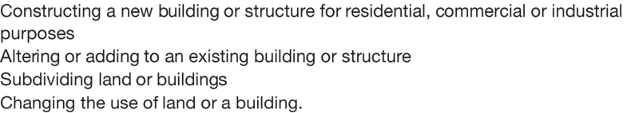

> [Picture on page 12: a picture, saved as a picture (images/part-a1-welcome-page-12-5.gif, 150 dpi).]
> Words printed on the picture (title and legend, copied from the PDF):
> • Constructing a new b uilding or structure for residential, c ommercial or industrial
> purposes
> • S ubdividing land or building s
> • C hanging the use of land or a building .

• A lter

ing or addi ng to a n existing building or structure

To lodge a DA , applicants must submit a completed DA form along with relevant supporting documentation, including (at minimum):

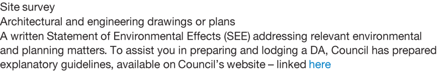

> [Picture on page 12: a picture, saved as a picture (images/part-a1-welcome-page-12-10.gif, 150 dpi).]
> Words printed on the picture (title and legend, copied from the PDF):
> • S ite survey
> • A rchitectural and engineering drawings or plans
> • A written S tatement of Environmental Effects (SEE) addressing relevant environmental

and planning matters . To assist you in preparing and lodging a DA, Council has prepared explanatory guidelines , available on Council’s web site – linked here

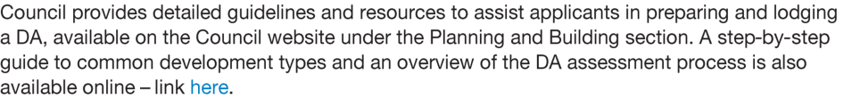

> [Picture on page 12: a picture, saved as a picture (images/part-a1-welcome-page-12-13.gif, 150 dpi).]

Council provides detailed guidelines and resources to assist applicants in preparing and lodging a DA, available on the Council website under the Planning and Building section. A step - by - step guide to common development types and an overview of the DA asse ssment process is also available online – link here . DAs are assessed on their merits under the requirements of Section 4.15 of the Act which requires, among other things consideration of :

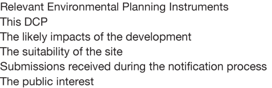

> [Picture on page 12: a picture, saved as a picture (images/part-a1-welcome-page-12-20.gif, 150 dpi).]
> Words printed on the picture (title and legend, copied from the PDF):
> • R elevant Environmental Planning Instruments
> • T his DCP
> • T he likely impacts of the development
> • T he suitability of the site
> • S ubmissions received during the notification process
> • T he public interest

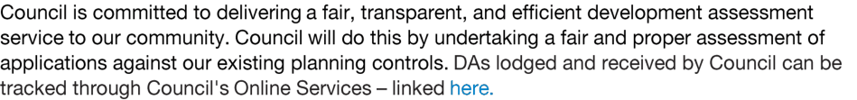

> [Picture on page 12: a picture, saved as a picture (images/part-a1-welcome-page-12-21.gif, 150 dpi).]

Council is committed to delivering a fair, transparent, and efficient development assessment service to our community. Council will do this by undertaking a fair and proper assessment of applications against our existing planning controls. DAs lodged and received by Council can be tracked through Council's Online Services – linked here .

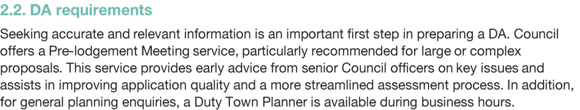

> [Picture on page 12: a picture, saved as a picture (images/part-a1-welcome-page-12-26.gif, 150 dpi).]

### 2.2. DA requirements

Seeking accurate and relevant information is an important first step in preparing a DA. Council offers a P re - lodgement M eeting service, particularly recommended for large or complex proposals . This service provides early advice from senior Council officers on key issues and assists in improving application quality and a more streamlined assessment process. In addition, f

or general planning enquiries, a Duty Town Planner is available during business hours. Applicants should refer to the following Council resources:

• The Pre - Development Application Guide

• Development Application Guide

• Development A pplication (DA) Form and Checklist .

These resources are available on - line – linked here , or at Council’s Customer Service Centre . A complete DA submission typically includes:

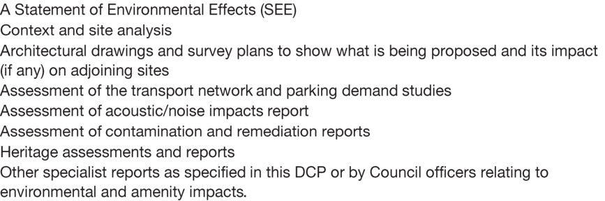

> [Picture on page 13: a picture, saved as a picture (images/part-a1-welcome-page-13-3.gif, 150 dpi).]
> Words printed on the picture (title and legend, copied from the PDF):
> • A Statement of Environmental Effects (SEE)
> • C ontext and site analysis
> • A rchitectural drawings and survey plans to show what is being proposed and its impact
> • Assessment of t he transport network and parking demand studies
> • Assessment of acoustic/noise impacts report
> • Assessment of contamination and remediation reports
> • H eritage assessments and reports
> • O ther specialist reports as specified in this DCP or by Council officers relating to

(if any) on adjoining sites

environmental and amenity impacts .

Depending on the development type the following may also be required:

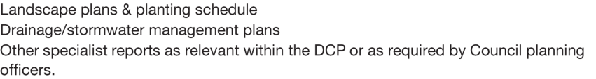

> [Picture on page 13: a picture, saved as a picture (images/part-a1-welcome-page-13-7.gif, 150 dpi).]
> Words printed on the picture (title and legend, copied from the PDF):
> • Landscape plans & planting schedule
> • Drainage/stormwater management plans
> • Other specialist reports as relevant within the DCP or as required by Council planning
> officers.

All DAs are expected to comply with the National Construction Code (NCC) and relevant Australian Standards (AS) .

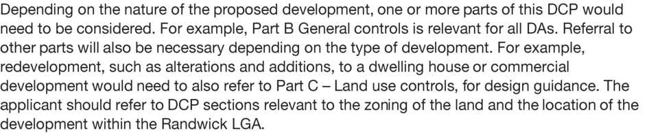

> [Picture on page 13: a picture, saved as a picture (images/part-a1-welcome-page-13-10.gif, 150 dpi).]

Depending on the nature of the proposed development, one or more p arts of this DCP would need to be considered. For example, Part B General c ontrols is relevant for all DAs. Referral to other p arts will also be necessary depending on the type of development. For example, redevelopment , such as alterations and additions , to a dwelling house or commercial development would need to also refer to Part C – Land use controls , f or design guidance . The a pplicant should refer to DCP sections relevant to the zon ing of the land and the location of the development within the Randwick LGA . Once the plans and SEE have been prepared , a DA form will need to be completed, and all material lodged via the NSW Planning Portal – linked here . A formal process of notification and assessment will then follow.

#### Note

Details of the assessment and decision process can be found on Council’s website page ‘ Planning and Development ’ – linked here

### 2.3. DCP f ramework

The provisions of this DCP are structured into two component s :

• Objectives – outlining the desired planning outcomes and guiding principles

• Controls – comprising both numerical standards and qualitative criteria . Some sections may commence with an Explanation section to provide background information and assist in the interpretation of the controls. All DAs must address both t he O bjectives and C ontrols relevant to the development type and location.

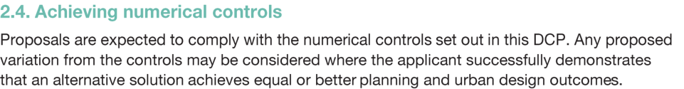

> [Picture on page 14: a picture, saved as a picture (images/part-a1-welcome-page-14-1.gif, 150 dpi).]

### 2.4. Achieving numerical controls

Proposals are expected to comply with the numerical controls set out in this DCP. Any proposed variation from the controls may be considered where the applicant successfully demonstrates that an alternative solution achieves equal or better planning and urban design outcome s . This flexibility acknowledges the unique characteristics of individual sites including:

• Site topography

• Orientation

• Allotment configuration

• Existing structures on site to be retained . Proposals seeking to vary numerical controls must be supported by a robust context and site analysis, and will be assessed against the following criteria:

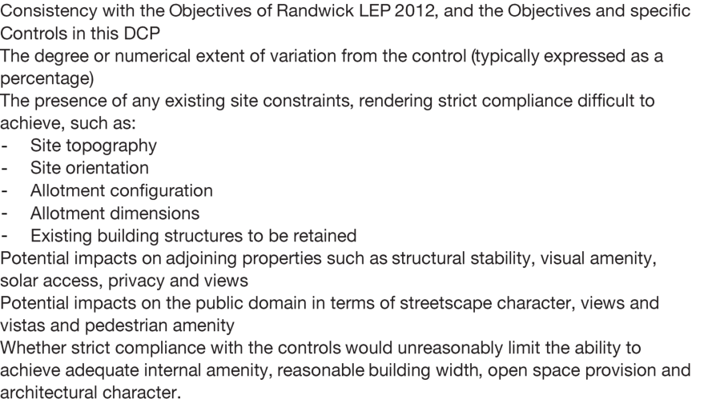

> [Picture on page 14: a picture, saved as a picture (images/part-a1-welcome-page-14-13.gif, 150 dpi).]
> Words printed on the picture (title and legend, copied from the PDF):
> i) Consistency with the O bjectives of Randwick LEP 2012 , and the O bjectives and specific
> ii) The degree or numerical extent of variation from the control (
> typically expressed as a
> percentage)
> iii) The presence of any existing site constraints , rendering strict compliance difficult to
> achieve, such as:
> - Site topography
> - Site orientation
> - Allotment configuration
> - Allotment dimensions
> - Existing building structures to be retained
> iv) Potential impacts on adjoining properties such as structural stability, visual amenity,
> v) Potential impacts on the public domain in terms of streetscape character, views and
> vistas and pedestrian amenity
> vi) Whether strict compliance with the controls would unreasonably limit the ability to

C ontrol s in this DCP

solar access, privacy and views

achieve adequate internal amenity, reasonable building width , open space provision and architectural character.
