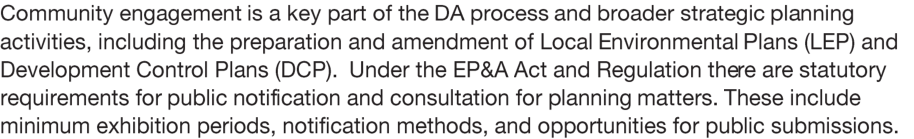
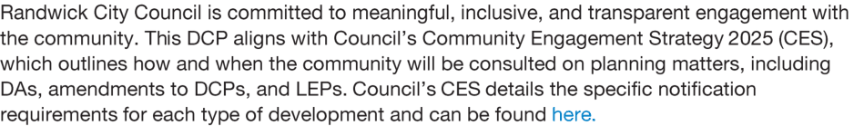

## 3. Community engagement

> [Picture on page 15: a picture, saved as a picture (images/part-a1-welcome-page-15-2.gif, 150 dpi).]

Community engagement is a key part of the DA process and broader strategic pla nning activities, including the preparation and amendment of Local E nvironmental P lans (LEP) and Development Control Plans (DCP ). Under the E P&A Act and Regulation the re are statutory requirements for public notif ication and consultation for p lanning matters. These include minimum exhibition periods, notification methods, and opportunities for public submissions.

> [Picture on page 15: a picture, saved as a picture (images/part-a1-welcome-page-15-8.gif, 150 dpi).]

Randwick City Council is committed to meaningful, inclusive, and transparent engagement with the community. Th is DCP aligns with Council’s Community Engagement Strategy 2025 (CES), which outlines how and when the community will be consulted on planning matters, including DAs, amendments to DCPs, and LEPs. Council’s CES details the specific notification requirements for each type of development and can be found here . All D A s are to comply with Council’s Community Engagement Strategy 2025 ensuring that the community is informed and has the opportunity to participate in shaping the future of Randwick City.

Ra n dwick City Council 1300 722 542 30 Frances Street

council@randwick.nsw.gov.au

Randwick NSW 2031 www.randwick.nsw.gov.au
