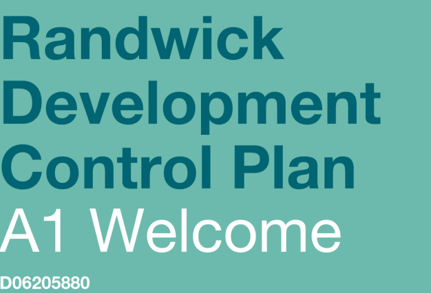
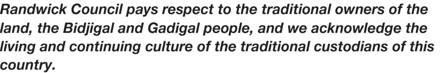
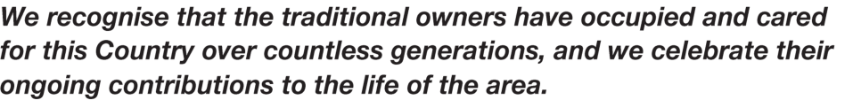

# Randwick Development Control Plan - Part A1 Welcome

> This chapter is split into 5 section file(s), one per numbered heading, in the order they appear in the PDF.

Source PDF: [A1-Welcome-Randwick-DCP-Stage-2_Final.pdf](A1-Welcome-Randwick-DCP-Stage-2_Final.pdf)

#### STRATEGIC PLANNING

> [Picture on page 1: a picture, saved as a picture (images/part-a1-welcome-page-1-2.gif, 150 dpi).]

### Randwick Development Control Plan

### A 1 Welcome

#### D06205880

#### 27 July 2026

#### 1300 722 542 randwick.nsw.gov.au

| File reference | D06205880 | Date | Signature |
|---|---|---|---|
| Prepared by | DA | September 202 4 |  |
| Coordinator Review | DA | 3 November 202 5 |  |
| Manager Review | Stella Agagiotis | June 202 6 |  |

| Contents | Acknowledgement of country 1. About this DCP 1.1. Purpose of this plan 1.2. Objectives 1.3. Plan name and commencement |  | 4 5 5 5 5 |
|---|---|---|---|
|  | 1.4. Transitional provisions DCP 2025 | – Stage 2 | 7 |
|  | 1.5. Land to which this DCP applies |  | 8 |
|  | 1.6. Interpretation |  | 8 |
|  | 1.7. Relationship to other plans |  | 8 |
|  | 1.8. How to use this plan and structure |  | 8 |
|  | 2. Development applications |  | 12 |
|  | 2.1. What is a DA? |  | 12 |
|  | 2.2. DA requirements |  | 12 |
|  | 2.3. DCP framework |  | 13 |
|  | 2.4. Achieving numerical controls |  | 14 |
|  | 3. Community engagement |  | 15 |

### Acknowledgement of country

> [Picture on page 4: a picture, saved as a picture (images/part-a1-welcome-page-4-2.gif, 150 dpi).]

Randwick Council pays respect to the traditional owners of the land, the Bidjigal and Gadigal people, and we acknowledge the

#### living and continuing culture of the traditional custodians of this country.

> [Picture on page 4: a picture, saved as a picture (images/part-a1-welcome-page-4-7.gif, 150 dpi).]

#### We recognise that the traditional owners have occupied and cared

for this Country over countless generations, and we celebrate their ongoing contributions to the life of the area.

<!-- sections -->
## Sections

1. [1 About this DCP](01-about-this-dcp.md)
2. [E2 Randwick Education and Health](02-e2-randwick-education-and-health.md)
3. [F5 Undergrounding overhead power lines](03-f5-undergrounding-overhead-power-lines.md)
4. [2 Development a pplications](04-2-development-a-pplications.md)
5. [3 Community engagement](05-3-community-engagement.md)
