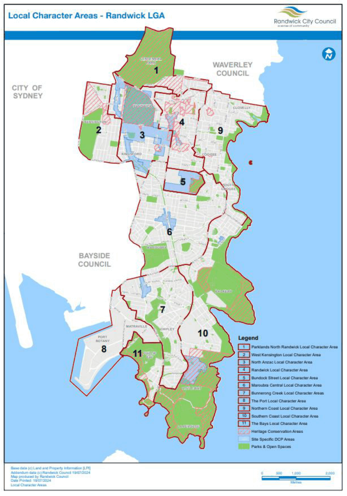

## 1. Introduction

Local character is the identity of a place, and a recognition of what makes a particular neighbourhood distinctive. Character is expressed through the interrelationships between built form and natural elements, in both the public realm and private domain. Character is a rich combination of topography and landscape, the built environment and urban history, culture and operations, including the interplay between buildings, architectural style, subdivision patterns, human activity and natural systems. Neighbourhood character is not a static concept - it is dynamic and evolves over time to meet the changing criteria of both urban and natural environments, including contemporary housing needs and changing demographics. Protecting and enhancing character does not mean preventing change; instead respecting the character of a neighbourhood ensures that development is designed in response to its context, adding further richness, diversity and quality. Reinforcing local character ensures that future built form, open space and community outcomes in our suburbs are informed by, and derived from their location, context and social setting. These objectives are place-based, relevant to, and resonant with the identified local character and the community’s aspirations. This part of the development control plan (DCP) provides strategic guidance for preserving and enhancing local character across the Randwick local government area (LGA). The direction on local character established under this DCP part has been informed by a comprehensive assessment of existing local character, incorporating extensive community engagement. This analysis is documented in Council’s draft Local Character Statements, which serve as the key reference documents guiding the strategic planning framework and development outcomes across the LGA. This DCP part includes locality and desired future character statements, along with supporting principles and guidelines for development within specific areas and neighbourhoods within Randwick City identified by Council. Localities are determined based on their character, including topography, landscape setting, heritage, streetscape, land uses and built form. A range of social, economic and environmental indicators, density analysis and the community’s shared values and f uture aspirations have also been considered for each locality to establish character. Eleven character statements have been prepared across Randwick City, identified as:

| 01 | Parklands North Randwick | 07 | Bunnerong Creek |
|---|---|---|---|
| 02 | West Kensington | 08 | The Port |
| 03 | North Anzac | 09 | Northern Coast |
| 04 | Randwick | 10 | Southern Coast |
| 05 | Bundock Street | 11 | The Bays |
| 06 | Maroubra Central |  |  |

Structure While overarching Character principles are provided for the overall LGA, each local character area (LCA) includes the following considerations and criteria that all development applications (DAs) lodged with Council must respond to:

• Locality statement - describes the geographical boundary of the local character area

• Locality map - illustrates the local character area and identifies park and open space, heritage character areas, and location specific control areas

• Desired future character statement - provides guidance for interpreting and implementing development controls and built form guidelines found elsewhere in this DCP and within the Randwick Local Environmental Plan 2012 (RLEP 2012)

• Key characteristics -

principal conditions that contribute to the area’s unique character

• Development guidelines - outlines specific principles to adopt to protect and enhance the character of an area. The aims are to preserve this character and complement it through exemplary buildings, cohesive landscapes and integrated topography, delivering spatial continuity and visual unity in form, scale and density.

Application of this DCP Part

1\. This Part applies to development that involves changes to the exterior of a building which are visible from the public domain

2\. This DCP part does not apply to land covered by Part D Location Specific Controls of the DCP, outlines distinct character and built form outcomes for specific localities, including:

• Part D10 - Royal Randwick Racecourse

• Part D11 - Prince Henry Site, Litte Bay

• Part D12 - Newmarket Green

• Part D13 - Little Bay Cove

• Part D14 - Well Located Housing Areas

• Part D1 - Kensington and Kingsford

• Part D2 - Randwick Junction

• Part D3 - Maroubra Junction

• Part D5 - Matraville

• Part D6 - Maroubra Beach

• Part D7 - The Spot

• Part D8 - Defence Site

• Part D9 - Randwick Education and Health Specialised Centre

3\. This Part must be read in conjunction with the controls and requirements for heritage items and Heritage Conservation Areas (HCAs) as set out in RLEP 2012 and Part B Heritage of the DCP

4\. An assessment of the proposed development must address the Character Principles, Desired Future Character Statement, Key Characteristics and Development Guidelines. The depth of assessment should be proportionate to the scale of the proposed development

5\. Where a local character area identified under this Part of the DCP overlaps with HCAs and/or Part D Location Specific Controls, DAs must consider the relevant provisions of the HCA and/or Part D locality to guide character and development outcomes within each of these areas

6\. Development must be consistent with both Character Principles and Design Guidelines derived from the character statements of identified character areas, in addition to the requirements of other relevant parts of the DCP.

Locality areas map

Figure 1: Local Character Areas - Randwick LGA

> [Picture on page 8: a picture, saved as a picture (images/part-b1-local-character-areas-page-8-3.gif, 150 dpi).]
