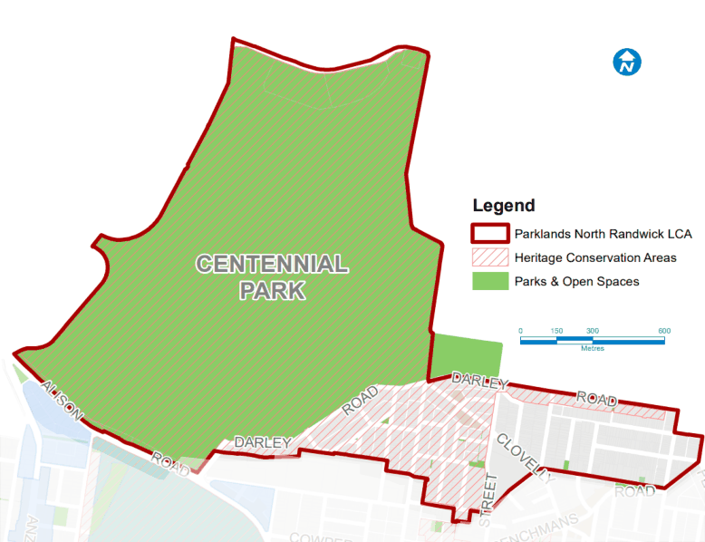

## 4. Parklands North Randwick

### 4.1. Locality statement

Parklands North Randwick Local Character Area (LCA) is situated on the north-western boundary of Randwick City, adjacent to the City of Sydney, Woollahra and Waverley LGAs. The LCA includes the regional open space area of Centennial Park and some residential land in the north of Randwick.

### 4.2. Locality map

Figure 2: The Parklands North Randwick Local Character Area

> [Picture on page 13: a picture, saved as a picture (images/part-b1-local-character-areas-page-13-9.gif, 150 dpi).]

### 4.3. Desired future character

The Parklands North Randwick LCA comprises buildings that contribute to Centennial Parklands and its landscape setting. New buildings or additions are to offer innovative and contemporary design responses while complementing the existing building form and scale of the area to ensure new development sits comfortably within predominantly Federation streetscapes. Consistent front setbacks reinforce the building edge along the streets. Building heights and forms complement rather than dominate the rhythm of development, including roof pitch and massing at ground and upper levels when viewed from the public realm. Materials complement and give appreciation to the predominant construction style and material of the area. Well‐designed gardens contribute to the softening of the streetscape and the leafy character of the precinct, as well as providing important green corridors and links to Centennial Park and Queens Park. They will compliment dwellings and respond to lot sizes, with larger lots providing opportunities for substantial planting that contributes to the existing canopy, including within rear setbacks. Use of sandstone in landscaping, including retaining walls, will complement its use amongst dwellings and where visible within the public domain.

Low or permeable front fences provide views of building facades and front gardens. Where present, car parking structures are located at the rear of buildings with access from rear lanes to provide continuous, uninterrupted footpaths for pedestrian friendly streets. Where car parking occurs in the front setback, hardstand and ancillary structures are recessive to the dwelling and landscape. Clovelly Road will continue to provide small scale commercial uses with opportunities for outdoor dining protected by building awnings.

### 4.4. Key characteristics

a) Spatially generous and dimensionally consistent front setbacks

b) Front gardens in the setbacks that are densely planted while also offering usable spaces

c) Continuous tree canopy along streetscapes and in front and back setbacks

d) Modulated and variegated building forms, rather than monolithic massing

e) Clearly expressed ground-floor building elements with recessive upper storeys

f) Mixed palette of earth and masonry-based materials: brick, sandstone, render, slate and terra cotta.

### 4.5. Development guidelines

Development must comply with Section B1.3 General Development Guidelines. In addition, development in this Local Character Area must satisfy the following:

a) Locality

i. Establish clear connections to Centennial Park and Queens Park and respond to the area’s distinctive topography through landscaping and built form. Design is to reflect the historical development pattern and architectural character of the locality

ii. Preserve and enhance district and street view corridors, including views across Queens Park and Centennial Park.

b) Built form elements

i. Ensure large lots fronting Centennial Park, provide generous front setbacks for substantial formal landscaping with canopy trees.

c) Landscaping

i. Retain mature street trees and extend street tree planting on both public and private land, particularly along streets such as Figtree Avenue, Earl Street, Dangar Street, Stephen Street, Monmouth Street, Castle Street, Challis Street, Mort Street, and Avoca Street, to reinforce the established landscape character, enhance residential amenity and reinforce green grid and biodiversity connections throughout the Local Character Area

ii. Retaining walls and landscaping structures visible to the public domain is required to be constructed of sandstone or brick, and a style that is complementary to both the dwelling style and era, as well as the predominant streetscape.

d) Car parking and movement

i. Design development to support pedestrian and cycle movement throughout the locality, with direct and legible connections to the surrounding street network and nearby open spaces, including Centennial Park and Queens Park

ii. Development adjacent laneways must support these spaces as shared zones for increased pedestrian and cycle permeability by ensuring built form provides passive surveillance, active frontages, and direct access where appropriate

iii. Garages and carports must be positioned and detailed to ensure they do not dominate the dwelling or disrupt the established character of the streetscape. Their placement, scale, and materials are to reinforce the prevailing architectural rhythm and contribute positively to the local context.

e) Land use and subdivision

i. Residential and ancillary development must contribute to the enhancement of rear laneways by promoting pedestrian movement, active frontages, and high-quality residential amenity

ii. Development must retain and expand laneway activation through thoughtful design, landscaping, and passive surveillance.

f) Mixed-use and non-residential development

i. Retain the existing pattern of retail and small-scale commercial uses fronting Clovelly Road

ii. Ground floor retail and small-scale commercial uses are to reinforce the established fine grain lot pattern resulting in narrow shop frontages with awnings

iii. Retail and small-scale commercial uses will meet local convenience demands from the community, including retail, food and beverage services.
