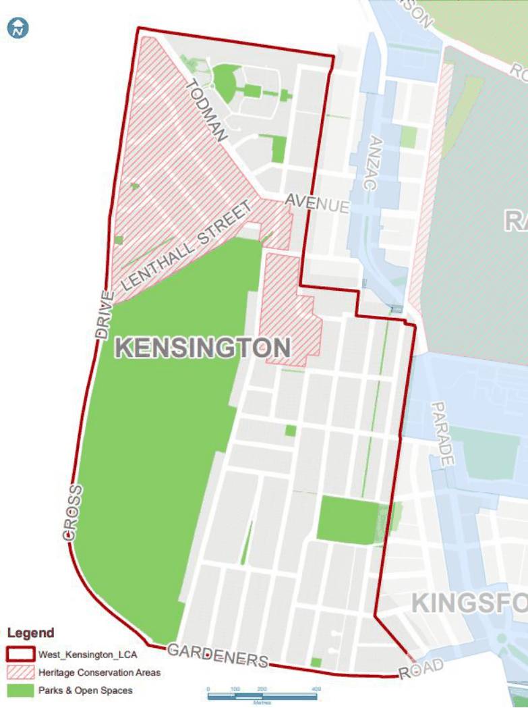

## 5. West Kensington

### 5.1. Locality statement

The West Kensington Local Character Area (LCA) is located on the western corner of the Randwick LGA. It borders the City of Sydney local government area (LGA) to the north-west and Bayside LGA to the south-west. It includes the Australian Golf Course and significant areas of residential land within Kensington and Kingsford west of Anzac Parade.

### 5.2. Locality map

Figure 3: West Kensington Local Character Area

> [Picture on page 16: a picture, saved as a picture (images/part-b1-local-character-areas-page-16-9.gif, 150 dpi).]

### 5.3. Desired future character

The West Kensington LCA comprises buildings that contribute to the West Kensington and Sacred Heart HCAs, as well as respond appropriately to the topography setting that informs the prevalent street and subdivision pattern. New buildings or additions offer innovative and contemporary design responses while complementing the existing building form and scale of the area to ensure new development sits comfortably within predominantly one and two storey Federation and inter-war style streetscapes. Subdivision patterns continue to reflect the established pattern created by the settlement period of the LCA, noting its generous lot sizes and lot widths. Consistent front setbacks reinforce the building edge along streets, particularly where built form changes with topography. Building heights and forms complement rather than dominate the rhythm of development, including roof pitch and massing at ground and upper levels when viewed from the public realm. Materials complement and give appreciation to the predominate construction style and material of the area. Well‐designed gardens contribute to the softening of the streetscape and the leafy character of the precinct, as well as providing important green corridors and links with the Australian Golf Course and parks. Gardens will compliment dwellings and respond to lot sizes and topography with larger lots providing opportunities for substantial planting that contributes to the existing canopy, including within front and rear setbacks. Use of sandstone in landscaping, including retaining walls, will complement its use amongst dwellings and where visible within the public domain. Low or permeable front fences provide views of building facades and front gardens. Where present, car parking structures are located behind the building line. Where car parking occurs in the front setback, hardstand and ancillary structures are designed to be visually recessive, ensuring the dwelling and landscape remain the dominant features. Vistas created by the unique topography and subdivision pattern are retained and enhanced, particularly local views to Sacred Heart Monastery and district views across the LGA and beyond. Small scale commercial uses that serve the requirements of the local community are encouraged where historically located at street corners and along streets.

### 5.4. Key characteristics

a) Spatially generous and dimensionally consistent front setbacks

b) Front gardens in setbacks are visually and spatially connected to each other, and connected to the street, only separated by low brick walls

c) Continuous tree canopy along the street verge, with footpaths adjacent to property

d) Clearly expressed ground-floor building elements with recessive upper storeys

e) Modulated and variegated building forms, rather than monolithic massing

f) Generous spacing between adjacent buildings allow spatial and visual connections to densely planted back garden landscapes.

### 5.5. Development guidelines

Development must comply with Section B1.3 General Development Guidelines. In addition, development in this Local Character Area must satisfy the following:

a) Locality

i. Establish clear connections to the Australian Golf Course, Kensington and local parks, and respond to

the area’s distinctive topography through landscaping and built form

ii. Preserve and enhance district and street view corridors, including views to the Sacred Heart Monastery and across the LGA.

b) Landscaping

i. Retain mature street trees and extend tree planting within streetscapes, particularly along Shaw Avenue, Leonard Avenue, Eastern Avenue, Cottenham Avenue, Day Avenue, Tedwin Avenue, Milroy Avenue, and Balfour Road, to reinforce the established landscape character, enhance residential amenity and reinforce green grid and biodiversity connections

ii. Retaining walls and landscaping structures visible to the public domain is required to be constructed of sandstone, and a style that is complementary to both the dwelling style and era, as well as the predominant streetscape.

c) Car parking and movement

i. Integrate pedestrian and cycle movement with the surrounding street and open space network, including Kensington Park, Kingsford and Kensington Town Centres, as well as UNSW

ii. Utilise local streets as thoroughfares for increased pedestrian and cycle permeability away from higher order roads.

d) Land use and subdivision

i. Retain the existing and historical pattern of retail and small-scale commercial uses fronting Todman Avenue, Borrodale Road, Lenthal Street and Gardeners Road.

e) Mixed-use and non-residential development

i. Ground floor retail and small-scale commercial uses are to reinforce the established fine grain lot pattern resulting in narrow shop frontages with awnings

ii. Retail and small-scale commercial uses will meet local convenience demands from the community, including retail, food and beverage services.
