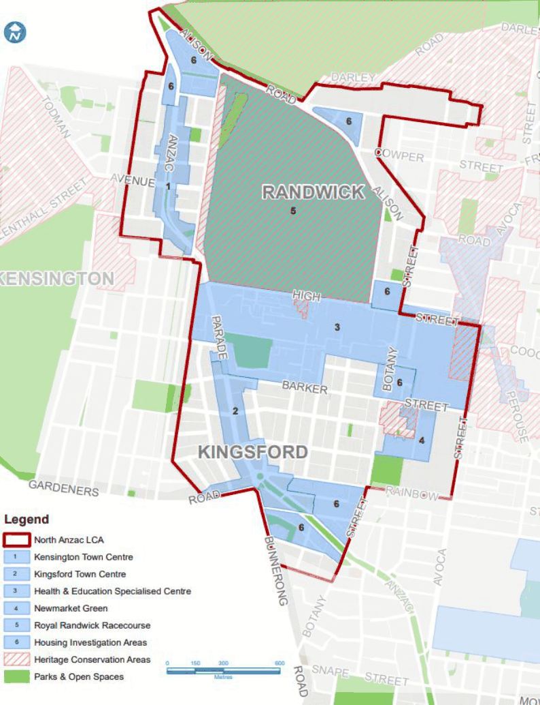

## 6. North Anzac

### 6.1. Locality statement

The North Anzac Local Character Area (LCA) is the economic heart of Randwick, including the centres and surrounding areas of Kensington and Kingsford, Royal Randwick Racecourse and the Randwick Health and Education Precinct comprising of UNSW Sydney and the Randwick Hospitals Campus including the Prince of Wales Hospital, the Prince of Wales Private, the Sydney Children’s Hos pital and the Royal Hospital for Women.

### 6.2. Locality map

Figure 4: The North Anzac Local Character Area

> [Picture on page 19: a picture, saved as a picture (images/part-b1-local-character-areas-page-19-10.gif, 150 dpi).]

### 6.3. Desired future character

The Randwick Health and Education Precinct is set to remain a leading hub for health, education, and innovation in Australia, driving employment and economic growth in Randwick City. It will play a key role in shaping future development and land use within the North Anzac LCA, alongside the Kensington and Kingsford town centres, and the Royal Randwick Racecourse. Serviced by the light rail and bus network, development of the Randwick Health and Education Precinct will align with the outcomes envisaged for Kensington and Kingsford town centres, including new commercial and residential developments that activate the commercial centres, whilst providing innovative solutions and a diverse housing provision including affordable housing to meet the needs of the Randwick City community. Residential development is to respond to the LCAs location, including its proximity to open space, services and facilities, public transport and employment supported the Randwick Health and Education Precinct by providing a diverse range of housing to meet the community needs, including shop top housing and residential flat buildings. New development is to promote design excellence, enhance the existing heritage character and promote economic vibrancy within the LCA, including the roles of Kensington and Kingsford centres. Anzac Parade as the main throughfare of the LCA will leverage from new dwellings and student housing to further activate Anzac Parade and connect the two town centres. Nominated Well Located Housing Areas , along with Council’s Kensington to Kingsford (K2K) Strategy, will encourage appropriate and sustainable development by adopting a strategic and coordinated approach to create vibrant precincts where people live, work and visit. The town centres of Kensington and Kingsford will evolve to become iconic destinations with vibrant, bustling streets, diverse businesses and a strong community feel, leveraging off their proximity to the Randwick Health and Education Precinct. Future development is to reinforce opportunities for active transport including separated cycleways along Doncaster Avenue, Houston Road and Sturt Street which will connect with the cycleway on Alison Road, providing a safe connection towards the Sydney central business district (CBD). Additional landscaping and pedestrian facilities will enhance local streetscapes. Well designed bicycle parking facilities will be incorporated around light rail stops to improve public amenity and encourage active travel. Streetscape improvements will enhance the public domain, increasing walkability and support town centres by integrating surrounding health, education, and residential precincts. Further, improvements to the public domain will support the revitalisation of Kensington and Kingsford centres and their commercial core functions, with increased arts and cultural facilities to support the local population and visitors to the area, particularly their night time economies. The a

rea’s unique green character will be enhanced with additional pocket parks, the

preservation and promotion of reserves, as well as the reinstatement of Anzac Parade as a tree lined boulevard, along with increased tree canopy throughout the LCA. Larger landholdings, including UNSW Kensington Campus and Randwick Racecourse will make significant contributions to the establishment of indigenous ecologies with the plantings of local species at varying scales.

### 6.4. Key characteristics

a) Spatially generous and dimensionally consistent front setbacks

b) Front gardens in setbacks are visually and spatially connected to each other, and connected to the street, only separated by low brick walls

c) Building, fences and external spaces respond to local topography, via terraces, step-downs and variegated forms

d) Continuous tree canopy along the street verge, with footpaths adjacent to property

e) Identifiable entries and associated built form elements legible within front gardens

f) Verandas, balconies and sheltered outdoor spaces address front gardens and streets, at both ground floor and upper levels.

### 6.5. Development guidelines

Development must comply with Section B1.3 General Development Guidelines. In addition, development in this Local Character Area must satisfy the following:

a) Locality

i. Development must reinforce the role of Kensington and Kingsford as strategic commercial centres along Anzac Parade

ii. Development must maintain and enhance the relationship to the Anzac Parade light rail corridor and stops

iii. Establish clear connections to formal and informal open spaces, as well as the distinctive topography through landscaping and built form, drawing on the area’s connection to historical development pattern and architecture

iv. Preserve and enhance district and street view corridors from the public domain, streets and lanes, including Alison Road, Meeks Street, High Street, Barker Street, Rainbow Street, Middle Lane and Houston Lane.

b) Built form elements

i. Development adjoining low density residential areas must:

- provide setbacks, stepping and modulation of built form to reduce perceived bulk

- incorporate landscaped buffers to soften the interface

- ensure that building height and scale do not overwhelm or dominate adjoining development

c) Landscaping

i. Retaining walls and landscaping structures visible to the public domain is required to be constructed of sandstone, and a style that is complementary to both the dwelling style and era, as well as the predominant streetscape

ii. Retain and enhance natural landscape features including sloping topography, sandstone or bedrock walls.

d) Car parking and movement

i. Ensure pedestrian and cycle movement throughout the precinct is integrated with the surrounding streets and open space network

ii. Utilise streets as thoroughfares for increased pedestrian and cycle permeability, particularly higher order streets that connect Kingsford and Kensington centres, as well as lower order streets and lanes that connect residential areas with commercial areas, the Randwick Education and Health Specialised Centre, and UNSW

iii. Garages and carports must be positioned and detailed to ensure they do not dominate the dwelling or disrupt the established character of the streetscape. Their placement, scale, and materials must reinforce the prevailing architectural rhythm and contribute positively to the local context.

e) Land use and subdivision

i. Residential and ancillary development is to enhance rear laneways and maintain a high a standard of residential amenity.

f) Mixed-use and non-residential development

i. Residential and ancillary development is to enhance rear laneways and maintain a high a standard of residential amenity

ii. Ground floor retail and small scale commercial uses are to reinforce the established fine grain lot pattern resulting in narrow shop frontages with awnings

iii. Upper-level massing of new developments is to ensure building facades have a clear and legibility street wall height of a pedestrian scale.
