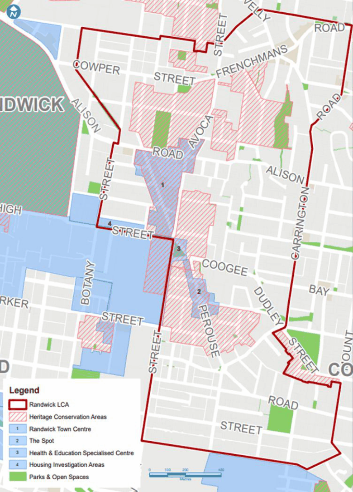

## 7. Randwick

### 7.1. Locality statement

Randwick Local Character Area (LCA), situated on an elevated plateau in the northern part of Randwick City, is one of the oldest areas of the LGA. Bounded by Avoca and Botany Street to the west, Carrington Road to the east, Bundock Street to the South and Gilderthorpe and King Street to the north. This area features divers landscapes and historic built form, notably Fred Hollows Reserve, Alison and High Cross Parks, Randwick Junction Town Centre, and The Spot.

### 7.2. Locality map

Figure 5: Randwick Local Character Area

> [Picture on page 23: a picture, saved as a picture (images/part-b1-local-character-areas-page-23-10.gif, 150 dpi).]

### 7.3. Desired future character

Randwick will be a diverse and vibrant area that recognises its historical importance as a centre of administration, commercial and civic function with a diversity of land uses. Randwick Junction will be the primary centre and support increased opportunities for housing as part of new mixed-use developments. The Spot will function as one

Randwick’s main entertainment districts, with a

continuing concentration of restaurants, cafés and services leveraging opportunities to sustain its dynamic status during day and night. Frenchmans Road commercial centre will continue to provide retail and hospitality services at a smaller, intimate village scale. Each commercial centre will retain 2-3 storey street wall heights to provide pedestrian scale and retain existing built form. The environment will be aesthetically pleasing and welcoming for both visitors and residents, achieved through streetscape enhancements that form an integral part of

Council’s broader

strategy for open space and tree planting. Pedestrian and cycling safety along Avoca Street and its surroundings are prioritised which is essential to create a liveable and accessible community. Larger lots will provide opportunities for planting of large canopy trees within front and rear setbacks. Smaller lots will provide front gardens that are enhanced by low and permeable fencing to provide connections with the street and adjoining public domain. View corridors across the Coogee Basin and south to Maroubra Junction, as well as internal vistas provided by the street pattern is maintained. New developments incorporate consistent front setbacks to reinforce the building edge along streets, ensuring a cohesive streetscape that contribute the overall aesthetics and walkability of the area. Built form responds to and conforms with the varied topography. The use of natural building materials, such as sandstone, are incorporated into sites where they interface with the public domain. Car parking structures and driveways within the front setback are to be minimised to ensure streetscapes characterised by building facades, front fencing, gardens and street tree planting is reinforced. Building heights and forms are carefully considered to complement the surrounding built form reflecting roof pitches and architectural styles

that define the area’s character . Construction

materials are selected to complement and reflect the predominant construction style and materials of the street and local area. The aim is to preserve and harmonize with local heritage and surrounding land uses in terms of sense of continuity and visual unity, form, scale, and density, safeguarding the unique character of the LCA. The tree canopy cover across the region further contributes to the overall greenery, promoting a healthier and more sustainable environment. Embracing art and culture as key elements in both Randwick Junction and The Spot fosters a vibrant community identity. An inclusive urban environment is created by promoting active transport opportunities throughout the area.

### 7.4. Key characteristics

a) Identifiable entries and associated built form elements legible within front gardens

b) Building, fences and external spaces respond to local topography, via terraces, step-downs and variegated forms

c) Generous spacing between adjacent buildings allow spatial and visual connections to densely planted back garden landscapes and local parks and reserves

d) Verandas, balconies and sheltered outdoor spaces address front gardens and streets, at both ground floor and upper levels.

e) Compressed front gardens within reduced setbacks contribute to street panting and public amenity

f) Car parking entries, driveways and carport structures integrated into built form and landscape spaces.

### 7.5. Development guidelines

Development must comply with Section B1.3 General Development Guidelines. In addition, development must satisfy the following:

a) Locality

i. Establish clear visual and physical connections to formal and informal open spaces, including Alison Park and Fred Hollows Reserve, through building siting, orientation, landscaping and pedestrian access. Development must respond to the area’s topography and reinforce the established streetscape pattern and architectural character of the locality

ii. Preserve and enhance key views from and across the public domain, such as district and street view corridors across Coogee basin and to Maroubra Junction.

b) Built form elements

i. Ensure larger lots, provide generous front setbacks for substantial formal landscaping with canopy trees

c) Landscaping

i. Retain existing retaining walls in the public and private domain where they form part of the historical subdivision pattern, respond to the natural topography, or contribute to the built form character of the locality

ii. Retaining walls and landscaping structures visible to the public domain is required to be constructed of sandstone, and a style that is complementary to both the dwelling style and era, as well as the predominant streetscape

iii. Retain and enhance natural landscape features including sloping topography, sandstone or bedrock walls.

d) Car parking and movement

i. Ensure pedestrian and cycle movement throughout the precinct is integrated with the surrounding streets and open space network

ii. Design development to support pedestrian and cycle movement throughout the locality, with direct and legible connections to the surrounding street network and nearby open spaces, including Alison Park, Fred Hollows Reserve and Bangor Park

iii. Utilise streets as thoroughfares for increased pedestrian and cycle permeability, particularly higher order streets that connect the commercial centres of Frenchmans Road, Randwick Junction and The Spot

iv. Garages and carports must be positioned and detailed to ensure they do not dominate the dwelling or disrupt the established character of the streetscape. Their placement, scale, and materials must reinforce the prevailing architectural rhythm and contribute positively to the local context.

e) Land use and subdivision

i. New development must reinforce the scale, rhythm, and orientation of the surrounding built form

ii. Retain the existing and historical pattern of retail and commercial uses within Randwick Junction, The Spot and Frenchmans Road commercial centres

iii. Residential and ancillary development enhance rear laneways and maintain a high standard of residential amenity

iv. Maintain and support a diverse mix of land uses. Development must respond to the established land use pattern and reinforce the presence of residential, commercial, community, c

ivic, and recreational uses that reflect the neighbourhood’s diverse

residential and employment demographics, social, cultural, and economic identity.

f) Mixed-use and non-residential development

i. Retain the existing pattern of retail and small-scale commercial uses fronting Clovelly Road, Frenchmans Road, Carrington Road and Canberra Street

ii. Ground floor retail and small-scale commercial uses are to reinforce the established fine grain lot pattern resulting in narrow shopfront articulation

iii. Awnings must be provided to street frontages of commercial premises along Clovelly Road, Frenchmans Road, Carrington Road and Canberra Street to support pedestrian amenity and streetscape continuity

iv. Where existing built form, heritage constraints or architectural design limit the provision of awnings, development must demonstrate how alternative design responses maintain a consistent and coherent street frontage

v. Retail and small-scale commercial uses will meet local convenience demands from the community, including retail, office, food and beverage services.
