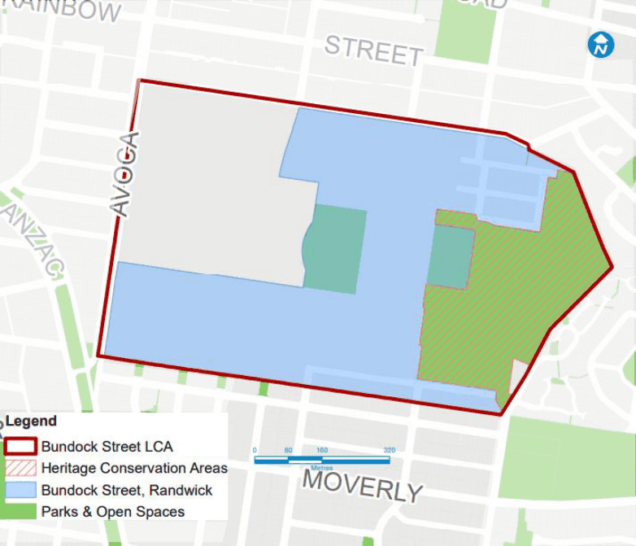

## 8. Bundock Street

### 8.1. Locality statement

The Bundock Street Local Character Area (LCA) is situated in the middle of the Randwick LGA and includes two significant local items, the Army Barracks and the Randwick Environment Park. It is bounded by Avoca Street to its west, Bundock Street to its north, and residential areas to its east and south.

### 8.2. Locality map

Figure 6: Bundock Street Local Character Area

> [Picture on page 27: a picture, saved as a picture (images/part-b1-local-character-areas-page-27-9.gif, 150 dpi).]

### 8.3. Desired future character

The future character of the LCA will reflect its purpose and function for defence employment and training, housing, environmental sustainability, recreation, as well as community and Council employment and education uses. New developments compromise the delicate balance of the Environment Park safeguarding its biodiversity and ensuring the continuation of its communal spaces with improved accessibility for the wider community. The objective is to preserve the ecological and social qualities of the Environment Park, whilst supporting greater interaction with surrounding areas. The Community Centre provides valuable space for community focused recreational, educational and arts programs with a focus on sustainability.

The accessibly of the LCA is improved by creating a north-south connection through the LCA. It will support greater interaction between the facilities and activities of the Environment Park and surrounding areas. In line with the ecological sensitivity of the LCA, mature trees are preserved, not only for their intrinsic value but also to provide vital support for the local wildlife. New developments create seamless and contextually appropriate architectural blend with the surrounding structures in terms of building heights, front setback, roof pitch, building materials. Well‐designed gardens and low garden fences will contribute to the softening of the streetscape and the unique green character of the LCA, as well as providing important green corridors and links to nearby Environment Park. A sizeable portion of the Bundock Street LCA is captured by both heritage conservation area (HCA), and site-specific development outcomes. Future development is expected to be consistent with the desired the future character, objectives and planning controls set out in Part

D8 - Defence Site, of the DCP. Future development must also give consideration to the heritage provisions and attributes identifies across the site, including the objectives and provisions outlined in Part B2

– Heritage of the DCP.

### 8.4. Key characteristics

a) Continuous tree canopy along the street verge and within street, with footpaths adjacent to property

b) Generous spacing between adjacent buildings allow spatial and visual connections to densely planted back gardens, local parks and landscape reserves

c) Car parking entries, driveways and carport structures integrated into built form and landscape spaces

d) Identifiable entries and associated built form elements legible within front setbacks

e) Buildings and sheltered outdoor spaces address open space and streets, at both ground floor and upper levels.

### 8.5. Development guidelines

Development must comply with Section B1.3 General Development Guidelines. In addition, development must satisfy the following:

a) Locality

i. Establish a connection to formal and informal open spaces, as well as the distinctive topography through landscaping and built form, drawing on the area’s connection to the environment and defence uses

ii. Preserve and enhance street view corridors from the public domain.

b) Built form elements

i. Development shall respect the predominant building height and streetscape presentation

ii. Setbacks shall enable substantial landscaping and planting of canopy trees

iii. Building massing and scale must be complimentary to the height, bulk and form of surrounding development

iv. Massing of new development is to be setback from boundaries to ensure appropriate and sympathetic alignment with adjoining sensitive land uses.

c) Landscaping

i. Retain established trees within the public and private domain, and include perimeter planting to increase shade and amenity, provide green links and visual buffers to adjacent sensitive land uses

ii. Retain and extend street tree plantings on all streets to enhance the streetscape character, provide green links and improve pedestrian amenity

iii. Fencing shall be transparent to maintain visual connection between the site and the street

iv. Ensure new planting responds to and supports the areas biodiversity

v. Maintain and enhance the landscape characteristics of the site, ensuring new development does not diminish the ecological significance of the area

vi. Landscaping is to be used with fencing to soften and provide variation to solid construction.

d) Materiality

i. Ensure external materials, finishes and architectural detailing reflect the coastal character of the locality and are compatible with surrounding built form and heritage significance, while incorporating durable and sustainable design outcomes.

e) Car parking and movement

ii. Facilitate and improve pedestrian and cycle movement throughout the LCA, ensuring connections to defence, civic and commercial uses, adjacent streets and residential areas

iii. Ensure car parking is provided on-site and vehicular entry/exit locations clearly visible

iv. Pedestrian movement to and from sites must be clear and legible from the street and separate from vehicular entries.

f) Land use and subdivision

i. New development is to relate to the envisaged development pattern, lot size and arrangement for the LCA

ii. Ensure the areas ability to function for defence purposes, including its associated development is retained

iii. Ensure the location and scale of commercial uses are complementary to the areas residential, civic, community and recreational uses.

g) Mixed-use and non-residential development

i. Development associated with defence uses across the LCA, including campus style buildings, must be designed to integrate with both existing built form and future development within the LCA. Such development must demonstrate responsiveness to adjacent development patterns, including building typologies, street layouts, and open space networks, while also accommodating projected growth and land use transitions

ii. Building layout, scale, and setbacks must respond to adjacent development patterns, both existing and proposed

iii. Designs must support permeability and open spaces. Development proposals must demonstrate adaptability to evolving land uses and contribute positively to the public realm, ensuring long-term integration with surrounding residential uses.
