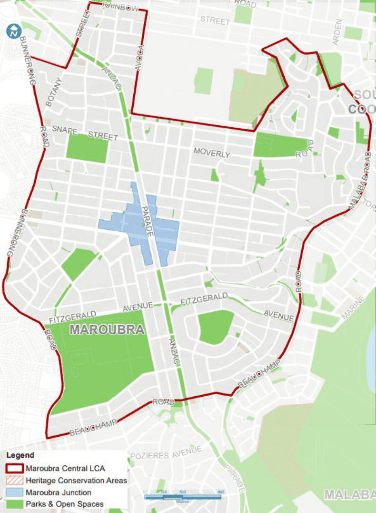

## 9. Maroubra Central

### 9.1. Locality statement

The Maroubra Central Local Character Area (LCA) is located at the geographical core of the Randwick LGA and covers the inland part of the Maroubra suburb (west of Malabar Rd and north of Beauchamp Rd) to the LGA boundary at Bunnerong Road. It includes the regional sport and recreational facility of Heffron Park and Maroubra Junction town centre at the intersection of Anzac Parade and Maroubra Road.

### 9.2. Locality map

Figure 7: The Maroubra Central Local Character Area

> [Picture on page 30: a picture, saved as a picture (images/part-b1-local-character-areas-page-30-10.gif, 150 dpi).]

### 9.3. Desired future character

Maroubra Central LCA will provide a range of housing styles and densities that responds to its diverse community and demographics. New development will capitalise on the flat terrain to improve walking and cycling infrastructure for enhanced connectivity between the LCA and Kingsford Light Rail Station. In other areas to the east where the terrain is more undulating, development will complement the topography rather than amend existing ground levels through excessive cut and fill. Development in these areas will be carefully articulated in terms of bulk and scale to ensure consistency with adjoining development and streetscape, as well as retention of views from public and private land. View corridors east across to Maroubra Beach and west across the LCA, as well as internal vistas provided by the street pattern is maintained. Maroubra Junction town centre will be the primary commercial centre and support increased opportunities for housing as part of new mixed-use developments. New development within the centre will support economic vibrancy along with streetscape and public domain improvements. Active street frontages will ensure the centre functions as a key economic hub of the LCA and provide for enhanced safety and experience for visitors both during the day and night. Smaller commercial centres along Maroubra Road, Anzac Parade and Bunnerong Road will continue to provide retail and hospitality services at a smaller, intimate village scale. Each commercial centre will retain 2 storey street wall heights to provide pedestrian scale and retain existing built form. The establishment of green grid connections enriches the open space network across the LCA, promoting ecological sustainability and a sense of natural continuity. Rear yards of residential lots, as well as public parks will provide opportunities for planting of canopy trees. Street planting will further provide opportunities for increased canopy trees and green links, noting significant mature planting and ecological communities along Anzac Parade. Improved access to Heffron Park will ensure both residents and visitors can enjoy the recreational amenities it offers. The LCA will retain its balanced lot size and frontage character. The distinct built form character of The Coral Sea Estate and surrounding social housing area will be preserved in terms of its subdivision layout following a radial pattern around the park, connected by ring roads. Building heights and forms are carefully considered to complement the surrounding built form integrated by the roof pitch and contextually fitting the predominate architectural style. Construction materials are selected to complement and appreciate the predominant construction style and materials of the street and local area. The use of masonry facades, terracotta tiles and sandstone within fencing and landscaping elements will ensure new development translates with the historic development pattern of the area. Low or permeable front fences provide views of building facades and front gardens. New developments incorporate consistent front setbacks to reinforce the building edge along the streets ensuring a cohesive streetscape that contributes to the overall aesthetics and walkability of the area. The use of natural building materials, such as sandstone, are incorporated into sites where they interface with the public domain. Basement car parking should be non-discernible from the street and not result in building heights and building façade presentations incongruous to the predominant character of the area. Car parking structures and driveways within the front setback are to be minimised to ensure streetscapes characterised by building facades, front fencing, gardens and street tree planting is reinforced. The environment will be aesthetically pleasing and welcoming for both visitors and residents, achieved through streetscape enhancements that form an integral part of

Council’s broader

strategy for open space and tree planting. Pedestrian and cycling safety along Anzac Parade and its surroundings are prioritised which is essential to create a liveable and accessible community. Larger lots will provide opportunities for planting of large canopy trees within front and rear setbacks. Smaller lots will provide front gardens that are enhanced by low and permeable fencing to provide connections with the street and adjoining public domain.

### 9.4. Key characteristics

a) Continuous tree canopy along typically generous street verges, with footpaths adjacent to property

b) Front gardens in setbacks are visually and spatially connected to each other, and connected to the street, only separated by low brick walls

c) Local topographical changes, between properties and streets, is managed with low sandstone retaining walls

d) Verandas, balconies and sheltered outdoor spaces address front gardens and streets, at both ground floor and upper levels

e) A constantly changing skyline of variegated roofscapes defines the streetscapes, generally at 2-3 storeys

f) Car parking entries, driveways and carport structures integrated into built form and landscape spaces.

### 9.5. Development guidelines

Development must comply with Section B1.3 General Development Guidelines. In addition, development must satisfy the following:

a) Locality

i. Establish clear visual and physical connections to formal and informal open spaces, including Snape Park, Nagle Park, Latham Park, Heffron Park, Coral Sea Park and the Anzac Parade corridor, through building siting, orientation, landscaping and pedestrian access. Development must respond to local topography and reinforce the established streetscape pattern and architectural character of the locality

ii. Preserve and enhance key views from and across the public domain, including district and street view corridors, such as views east to Maroubra Beach and west across the LCA and beyond.

b) Landscaping

i. Retaining walls and landscaping structures visible to the public domain is required to be constructed of sandstone, and a style that is complementary to both the dwelling style and era, as well as the predominant streetscape

ii. Retain and enhance natural landscape features including sloping topography, sandstone or bedrock walls.

c) Car parking and movement

i. Ensure development facilitates and improves pedestrian and cycle connectivity between key open spaces areas throughout the Local Character Area, including Snape Park, Latham Park, Nagle Park, Heffron Park and Coral Sea Park

ii. Utilise streets as key movement corridors to support increased pedestrian and cycle permeability, particularly along higher order and commercial streets, including Anzac Parade, Maroubra Road and Fitzgerald Avenue. Development must contribute to safe,

legible and continuous pedestrian and cycle connections between centres, open spaces and surrounding neighbourhoods.

d) Land use and subdivision

i. Retain the existing and historical pattern of retail and commercial uses

ii. Residential and ancillary development must contribute to the enhancement of rear laneways by promoting pedestrian movement, active frontages, and high-quality residential amenity

iii. Development adjacent laneways must incorporate design measures that support laneway activation, landscaping, passive surveillance, and pedestrian amenity

iv. Development is to maintain the diversity of demographics in the area

v. Maintain and support a diverse mix of land uses. Development must respond to the established land use pattern and reinforce the presence of residential, commercial, community, and recreational uses that reflect the neighbourhood’s diverse residential demographics, social, cultural, and economic identity.

e) Mixed-use and non-residential development

i. Retain the existing pattern of retail and small scale commercial uses fronting Maroubra Road, Moverley Road, Avoca Street and Bunnerong Road

ii. Ground floor retail and small scale commercial uses are to reinforce the established fine grain lot pattern resulting in narrow shop frontages with awnings

iii. Retail and small scale commercial uses will meet local convenience demands for retail, food and beverage services.
