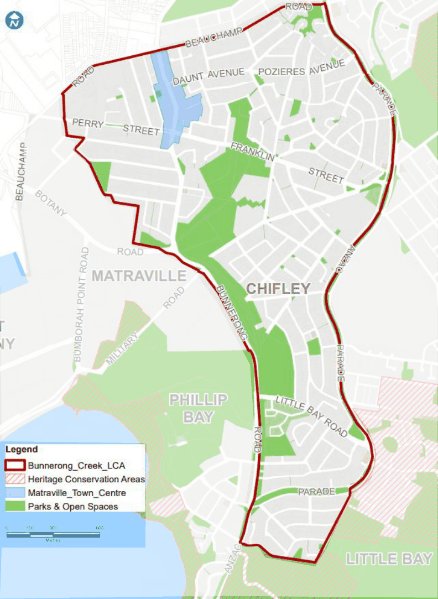

## 10. Bunnerong Creek

### 10.1. Locality statement

Bunnerong Creek Local Character Area (LCA) is located in the south east of the LGA and includes the northern part of Matraville, Chifley and the western part of Little Bay. It is characterised by low density residential housing stock and large areas of open space.

### 10.2. Locality map

Figure 8: Bunnerong Creek Local Character Area

> [Picture on page 34: a picture, saved as a picture (images/part-b1-local-character-areas-page-34-8.gif, 150 dpi).]

### 10.3. Desired future character

The LCA ’s unique landscapes and open space are preserved further. New developments acknowledge and respect the cultural significance of Indigenous landscapes and sites as an integral part of the development, fostering a harmonious coexistence between development and heritage. Building on the existing green grid and biodiversity connections within the LCA will further reinforce the commitment to environmental sustainability and ecological balance. The Bunnerong Creek Area from Barwon Park in the north to Woomera Reserve in the south, including the La Perouse Pony Club and Chifley Sports Reserve, will be protected to maintain the unique remnant coastal creek character of the area. Opportunities for bushland regeneration and improved biodiversity will include:

• Further extension of native vegetation, replacing weeds throughout Bunnerong Road bushland, Wassell Street, Anzac Parade and Woomera Reserve

• Improvement in the ecological condition of creek and riparian zone on the Crown Land between Franklin Street and Bunnerong Road

• Connecting areas of high biodiversity at Kamay Botany Bay National Park (La Perouse), Malabar Headland National Park and Botany Wetlands through strategic habitat reconstruction along the Bunnerong Road and Franklin Street corridors

• Continued mitigation of threats affecting habitat loss and reduced biodiversity. The environment will be aesthetically pleasing and welcoming, achieved through streetscape enhancements that form an integral part of Council ’s broader strategy for open space and environmental restoration. Improvements to the active transport network will make movement across and within the LCA by bicycle more appealing to a wider demographic. Improved accessibility around the coastal area with improved signage and wayfinding will benefit tourists and visitors to the area. Improved pedestrian and bicycle paths along Anzac Parade will provide direct north south connectivity along the edge of the LCA. East west paths that connect into the Anzac Parade route will ensure accessibility around the LCA is strengthened, including connections to Matraville Centre and Botany Bay. Improved signage and wayfinding will benefit both residents and tourist visitors in the area. The maintenance of the predominantly 1-2 storey detached brick bungalow residential character will ensure that new developments seamlessly integrate with the established architectural identity, preserving the community's unique suburban charm reflected in the strong grid subdivision pattern and prevalent lot sizes. Basement car parking should be non-discernible from the street and not result in building heights and building façade presentations incongruous to the predominant character of the area. Car parking and car parking structures are set behind building lines to ensure setback lines of dwellings within the streetscapes are not disrupted and front gardens and landscaping is the predominant feature within the streetscape. Simultaneously, Matraville town centre as the LCAs main commercial centre will evolve into a vibrant community-focused local village that is compact and pedestrian friendly, with plenty of choice in housing styles and affordability, great speciality shopping, and enjoyable walks to parks, sporting and outdoor play areas. New mixed-use development within the centre will seek to improve the economic vibrancy and enhance the public domain with active ground floor day and night uses sustaining a revitalised centre, supported by high quality architecture and high amenity buildings. The LCA’s unique industrial functionality will be preserved. Designated industrial lands which are crucial for supporting the employment of the local population and the establishment of local industry and business are retained. The precinct will maintain a range of small and medium size lots (including strata buildings) to continue to cater for smaller industrial operations. Managing the residential interface is also important to protect residential amenity.

Access and connectivity of industrial lands to the wider LCA and Randwick City will be improved with pedestrian and cycle connections.

### 10.4. Key characteristics

a) Low walled front gardens visually and spatially connected to each other and the street, with large canopy trees within the gardens

b) Generous spacing between adjacent buildings allow spatial and visual connections to densely planted back gardens and local and regional topography and the ocean

c) Parking entries, driveways and carports beside buildings, and set either behind buildings or well back from the street

d) Building entries are distinct from driveways, identifiable within the front gardens and directly address the street

e) The space of the wide streets and generous verges are punctuated by individual high canopy trees, and singular building elements, typically 2 storeys high

f) Verandas, balconies and sheltered outdoor spaces address front gardens and streets, at both ground floor and upper levels.

### 10.5. Development guidelines

Development must comply with Section B1.3 General Development Guidelines. In addition, development must satisfy the following:

a) Locality

i. Ensure view corridors within the Local Character Area and to the coast are maintained from public spaces.

b) Built form elements

i. Development must avoid large, continuous building forms and achieve a fine grain built form that reflects the established subdivision pattern of the Local Character Area. This is to be achieved through:

- articulation of façades, including recesses and projections

- modulation of building width and depth

- variation in roof forms and materials

- clear expression of individual building components

- designing development on consolidated lots to read as multiple smaller built forms

ii. Upper level built form must minimise visual bulk and reinforce the predominant low-scale streetscape character, including through appropriate setbacks from street frontages and site boundaries

iii. Development must provide a graduated transition in scale, bulk and intensity at interfaces with open space, ecological corridors, low density residential areas and industrial land

iv. At interfaces with ecological corridors, public reserves and open space:

- buildings must be set back to accommodate deep soil planting and canopy trees that extend the landscape character of adjoining land

- built form must minimise visual and physical impacts on the ecological setting

v. At residential –industrial interfaces:

- development must incorporate setbacks, landscape buffers and building orientation to minimise impacts from noise, light spill and activity

- building design must incorporate appropriate acoustic mitigation measures, including orientation of habitable rooms, building materials or use of non-habitable spaces as buffers.

c) Landscaping

i. Landscaping is to work in conjunction with built form to provide ecological buffers, visual screening and transition between development and sensitive landscapes, including Bunnerong Creek and associated corridors

ii. Retain and enhance natural landscape features including sloping topography, sandstone or bedrock walls

iii. Development must strengthen connections to adjoining open space and ecological corridors, including the Bunnerong Creek corridor, through building siting, orientation and landscaping that reinforces the subdivision pattern, landscape character and ecological function of the locality

iv. Development must retain and strengthen ecological corridors between identified open space areas through the provision of continuous native planting, with particular emphasis on sites adjoining public open space, drainage corridors and road verges forming part of the Bunnerong Creek landscape system

v. Sites adjoining identified ecological corridors, including the Bunnerong Creek area, Barwon Park, Woomera Reserve and Wassell Street Reserve, must provide deep soil zones that align with adjoining public land and neighbouring properties to facilitate continuous planting and habitat connectivity across boundaries

vi. Where fencing is provided within or adjacent to ecological corridors, it must be designed to be permeable to fauna movement, including through open fencing types, gaps at ground level, or similar design measures

vii. Development adjacent to open space and ecological corridors must minimise hard boundaries and incorporate landscaping that visually and ecologically integrates private land with the adjoining public domain

viii. Landscaping across Local Character Area must prioritise locally endemic species to support biodiversity, habitat creation and ecological resilience

ix. Development adjacent to identified ecological corridor streets (Anzac Parade, Bunnerong Road, Wassell Street) must contribute to continuous canopy planting and landscaping that reinforces the ecological and visual connection of the corridor.

d) Car parking and movement

i. Utilise streets as thoroughfares for increased pedestrian and cycle permeability, such as Anzac Parade, Little Bay Road, Franklin Street, Daunt Avenue and Pozieres Avenue.

e) Land use and subdivision

i. Development is to maintain the existing diversity of population demographics in the Local Character Area through retention of existing land uses

ii. Maintain and support a diverse mix of land uses. Development must respond to the established land use pattern and reinforce the presence of residential, commercial, industrial,

community, and recreational uses that reflect the neighbourhood’s social,

cultural, and economic identity.

f) Mixed-use and non-residential development

i. Retain the existing and historical pattern of retail and commercial uses within the Local Character Area, including those along Anzac Parade and Bunnerong Road

ii. Development must demonstrate alignment between built form and the public domain, ensuring access, sustainability and residential amenity improvements are achieved.
