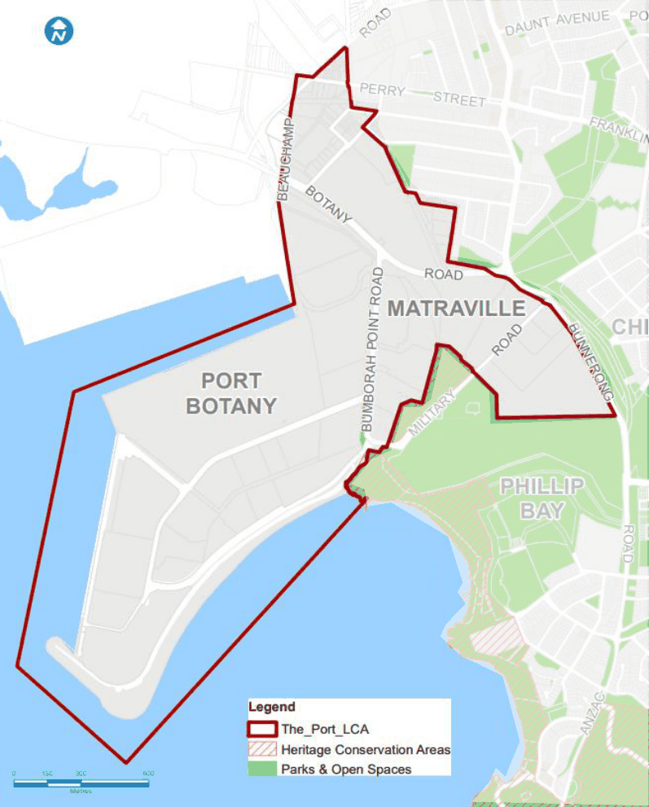

## 11. The Port

### 11.1. Locality statement

The Port Local Character Area (LCA) encompasses the port and industrial land of Randwick City aligning with boundaries established under State Environmental Planning Policy (Transport and Infrastructure) 2021 (Transport and Infrastructure SEPP) for land nominated as Port Botany. The LCA includes the southern section of Brotherson Dock and the Bulk Liquids Berth area and supporting industrial lands. At its southernmost point is Molineux Point which contains a lookout and green space. This DCP Part does not apply to land within the Port LCA that is governed by the Transport and Infrastructure SEPP.

### 11.2. Locality map

Figure 9: The Port Local Character Area

> [Picture on page 38: a picture, saved as a picture (images/part-b1-local-character-areas-page-38-13.gif, 150 dpi).]

### 11.3. Desired future character

The LCA’s unique industrial functionality will be preserved. Designated industrial lands which are crucial for supporting the efficient operation of the port will be maintained. The precinct will retain large lots and avoid strata and small lot subdivision to cater for large and port related industries. New developments will be of a bulk and scale that is compatible with adjoining residential areas and public open space, incorporating generous setbacks and landscaping, including layered planting and canopy trees, to provide a visual buffer between industrial, residential, private and public recreation zones. Landscaping will play a key role in mitigating the visual scale of large industrial buildings and protecting the amenity of adjoining areas. Development must have regard to and not compromise the heritage qualities associated with adjacent heritage conservation areas. New developments preserve the picturesque views extending to Molineaux Point and Botany Bay, protecting the natural beauty of the waterfront. Molineaux Point lookout will be transferred into a significant environmental and scenic site to enhance public spaces while preserving the ecological integrity of the area. Increased tree canopy will promote the greenery and biodiversity of the area. Environmental qualities and marine ecosystems of adjacent Yarra and Frenchmans Bays will not be compromised by new developments. The remnants of a row of Canary Island Palms along McCauley Street are preserved, as are the group of Norfolk Island Palms on the corner of Beauchamp and Botany Roads and Port Jackson Figs on Botany Road. Similarly, remnant Eastern Suburbs Banksia Scrub (ESBS) found around, and mature landscape elements associated with the former Bunnerong Electricity Substation should be preserved. The LCA will achieve a greater accessibility through increasing transportation options, incorporating public transport, walking, and cycling routes to seamlessly connect the community to this waterfront locality. Trucks are the main mode employed to move and deliver products, materials and equipment around the industrial area. The larger sites on Military, Botany and Beauchamp Roads are serviced by large and b-double vehicles, while the smaller operations around Raymond Avenue and Perry Street are serviced by smaller light weight trucks/ vans, and some larger vehicles.

### 11.4. Key characteristics

a) Expansive views to landscape and water between large-scale buildings and at ends of streets

b) Setbacks from street propagate major landscape offerings, with low-level planting, mature canopy trees and water management within the landscape

c) Transparent fences to properties connect internal landscapes to street planting, and mediate scale of development

d) Setbacks between sites manage level changes between sites with heavily planted landscapes, retaining walls and water management

e) Heroic scale of industrial buildings and infrastructure mediated by large openings between them, and equally generous landscapes, including high-level tree canopies

f) Segregated carriageway, cycleway and pedestrian routes, and distinct access points into sites and buildings.

### 11.5. Development guidelines

Development within the LCA will largely be guided by the State Environmental Planning Policy (Transport and Infrastructure) 2021. Development must comply with Section B1.3 General Development Guidelines. In addition, development must satisfy the following:

a) Locality

i. Preserve and enhance street views corridors from the public domain, particularly views to Botany Bay

ii. Ensure that new development does not negatively impact the public domain, public amenity and the enjoyment of public spaces through excessive overshadowing, inappropriate driveway location, vehicle and pedestrian conflict, reduced casual surveillance, and reduced impacts on walkability and opportunities for active transport

iii. Sightlines and connections beyond the site boundaries are important considerations for building placement, orientation, paths of movement and framed views.

b) Built form elements

i. Setbacks shall enable substantial landscaping and planting of canopy trees

ii. Ensure setbacks are consistent with the predominant setting in the street

iii. Building massing and scale must be comparable to surrounding development

iv. Massing of new development is to be setback from boundaries to ensure appropriate and sympathetic alignment with adjoining sensitive land uses

v. Taller building elements must be centred within sites away from site boundaries.

c) Landscaping

i. Retain established trees within the public and private realms and include perimeter planting to increase shade and amenity, provide green links and visual buffers to adjacent sensitive land uses

ii. Retain and extend street tree plantings on all streets to enhance the streetscape character, provide green links and improve pedestrian amenity. Notably along Beauchamp and Botany Roads, and McCauley Street

iii. Fencing shall be transparent to maintain visual connection between the site and the street

iv. Landscaping is to be used with fencing to provide obstruction of views where required for security and/or amenity

v. Establish a connection to adjoining open space, the waterfront and Botany Bay through landscaping and built form, drawing on the area’s topography and coastal setting to reinforce visual relationships and provide a transition between industrial development and surrounding land uses

vi. At interfaces with residential areas and public open space, development must provide setbacks that accommodate deep soil planting and substantial landscaping, including canopy and layered planting, to form an effective visual and environmental buffer and reduce the visual scale and bulk of large buildings.

d) Materiality

i. Ensure materials, finishes and architectural detailing contribute to a sustainable and contemporary built form that responds to the coastal character of the locality

ii. Fences must be of a paling or cyclone style and dark in colour.

e) Car parking and movement

i. Facilitate and improve pedestrian and cycle movement throughout the precinct, particularly along Botany Road, Military Drive and Prince of Wales Drive

ii. Ensure car parking is provided on-site and vehicular entry/exit locations clearly visible

iii. Pedestrian movement to and from sites must be clear and legible from the street and separate from vehicular entries.

f) Land use and subdivision

i. Retain the existing and historical pattern of industrial development associated with the functions of Port Botany.

g) Mixed-use and non-residential development

i. Ensure ancillary retail and commercial uses are at ground level, clearly visible and are safely accessible from the street by pedestrians

ii. Development, including building layout, scale, and setbacks, must demonstrate responsiveness to adjacent development patterns, including building typologies, street layouts, and open space networks

iii. Designs must support permeability and open spaces

iv. Development must demonstrate adaptability to evolving land uses and contribute positively to the public realm, ensuring long-term integration with surrounding uses.
