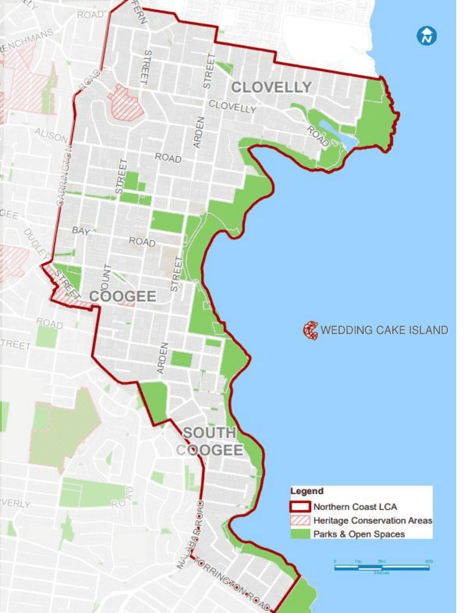

## 12. Northern Coast

### 12.1. Locality statement

The Northern Coast Local Character Area (LCA) is situated on the northern coastal side of the Randwick LGA and incorporates the ocean bays of Clovelly, Gordons, Coogee and Lurline. It includes many significant and iconic open spaces and coastal vistas, the vibrant Coogee town centre and the urbanised coastal areas of Clovelly, Coogee, the east side of South Coogee and a northern section of Maroubra situated around Lurline Bay with their mix of heritage and contemporary built forms. It also includes Wedding Cake Island, a focal viewpoint offshore. The area has an extremely high natural value, landscape relevance and significant vistas.

### 12.2. Locality map

Figure 10: Northern Coast Local Character Area

> [Picture on page 42: a picture, saved as a picture (images/part-b1-local-character-areas-page-42-12.gif, 150 dpi).]
> Words printed on the picture (title and legend, copied from the PDF):
> WEDDING CAKE ISLAND

### 12.3. Desired future character

The Northern Coast LCA comprises buildings that contribute to coastal character and its landscape setting. New buildings or additions offer innovative and contemporary design responses while complementing the existing building form and scale of the area to ensure new development sits comfortably within streetscapes, noting the undulating terrain and prevalence of Federation, Pre-War, Inter-War, Art Deco and mid-century architectural designs. Development will conform to existing landforms rather than amending ground levels through excessive cut and fill. Development will be carefully articulated in terms of bulk and scale to ensure consistency with adjoining development and streetscape, as well as retention of views to the coast and across the LCA from public and private land. Consistent front setbacks reinforce the building edge along the streets. Building heights and forms complement rather than dominate the rhythm of development, including roof pitch and massing at ground and upper levels when viewed from the public realm to contextually fit with the predominate architectural style. Materials complement and give appreciation to the predominate construction style and material of the area. The use of masonry facades, slate and terracotta tiles, as well as sandstone will ensure new development translates with the historic development pattern of the area. Buildings must demonstrate high-quality architectural design that is responsive to the coastal setting, incorporating materials, colours, and forms that reflect and complement the natural landforms, vegetation, and visual qualities of the foreshore landscape. Development should minimise visual intrusion, maintain low-scale built form where appropriate, and integrate sensitively with the topography to preserve the scenic and ecological values of the area. Private gardens will compliment dwellings and respond to lot sizes, with larger lots providing opportunities for substantial planting. Low or permeable front fences provide views of building facades and front gardens. Use of sandstone in landscaping, including fencing and retaining walls, will complement its use amongst dwellings and where visible within the public domain. Where present, car parking structures are located at the rear of buildings with access from rear lanes to provide continuous, uninterrupted footpaths for pedestrian friendly streets. Basement car parking should be non-discernible from the street and not result in the presentation of a 3-storey building where the predominant character of the area is 2-storeys. Where car parking occurs in the front setback, hardstand and ancillary structures are recessive to the dwelling and landscape. The commercial centre of Coogee will be the primary commercial centre within the Northern Coast Local Character Area, supporting mixed-use development, retail, tourism and improved public domain outcomes, while maintaining a strong sense of place and human scale informed by its coastal setting. New development will contribute to day and night-time economic vibrancy and active street frontages, supported by streetscape and public domain improvements. These active street frontages will reinforce the centre

’s role and function as the primary commercial

and mixed‐use activity centre within the Northern Coast LCA, supporting economic vibrancy, improved safety, and enhanced visitor experiences during both day and night. Smaller commercial centres, including those on Clovelly Road, will continue to provide retail, business, and hospitality services that support the local community. Development within all commercial centres will retain predominant building street wall heights to provide pedestrian scale and retain existing built form where historical architecture, including building awnings, roof form and façade detailing contribute to the streetscape. Public open space along the coastline will be prioritised to provide opportunities for planting, recreation and pedestrian movement. Development adjacent areas of public open space will not compromise the enjoyment and amenity received by users, as well as opportunities for the rehabilitation of native fauna and flora.

Improved active transport opportunities, particularly facilitating easy access to the nearby Randwick Health and Education Precinct will improve the connectivity and encourage sustainable and healthy lifestyles.

### 12.4. Key characteristics

a) Front gardens in setbacks provide privacy to residences, but are also visually and spatially connected to the street, only separated by low brick walls

b) Continuous tree canopy along typically generous street verges, with footpaths adjacent to property

c) Built form responds to dramatic changes in site topography, with stepped buildings, multi-level terraces and retaining walls

d) Changes in site and precinct topography, between sites, and between properties and streets, are mediated in the landscape with low sandstone walls

e) Rear lanes are extensively used, for parking and service access, cycling and informal play

f) The interior of aggregated street blocks create a mass shared landscape, providing amenity to all houses in the block, and creating significant habitat pockets

g) Building entries are distinct from driveways, identifiable within the front gardens and directly address the street.

### 12.5. Development guidelines

Development must comply with Section B1.3 General Development Guidelines. In addition, development must satisfy the following:

a) Locality

i. Development must respond to adjoining open spaces and the coastline through siting, orientation, landscaping and built form, drawing on the area’s distinctive topography to reinforce coastal views and the coastal streetscape character

ii. Preserve and enhance key views from and across the public domain, including district and street view corridors, such as views towards and along the coast, public open spaces and prominent landmarks, including Coogee Beach, Goldstein Reserve and St Brigid’s Parish Church .

b) Built form elements

i. Development must minimise building bulk and visual prominence when viewed from the coastline, public reserves, and key public vantage points, including streets that provide views to the coast

ii. Development must not obstruct or visually interrupt identified public view corridors to the coastline, beaches and prominent landmarks, and must be designed to maintain and frame views from streets and public open space

iii. Development must be designed to respond to the natural landform, including stepping built form with the slope of the site, minimising excavation and avoiding large-scale cut and fill that alters the visual expression of the terrain.

c) Landscaping

i. Retaining walls and landscaping structures visible to the public domain is required to be constructed of materials and a style that is complementary to the coastal setting and responsive of natural materials endemic to the area

ii. Retain and enhance natural landscape features including sloping topography, sandstone or bedrock walls

iii. Establish a connection through landscaping , drawing on the area’s distinctive topography and connection to the coastal landscape

iv. Maintain and enhance formal planting, including avenue planting along Arden Street and around Coogee Beach

v. Retain and enhance areas of open space, their accessibility, amenity and ability to support recreational, habitat and biodiversity outcomes

vi. Plant species must be capable of withstanding exposed and windy coastal environments. Where possible, compliment coastal heathland character.

d) Materiality

i. Exterior colour schemes must compliment natural elements in coastal areas.

e) Car parking and movement

i. Utilise streets as thoroughfares for increased pedestrian and cycle permeability, particularly along streets that support commercial and retail premises, provide access to the nearby Education and Health Specialised Centre, as well as coastal open spaces, including Coogee and Clovelly Beaches.

f) Land use and subdivision

i. Where lot subdivision or consolidation occurs, the design of buildings must include modulation to a similar dimension and scale created by the historical subdivision pattern

ii. Retain the existing and historical patterns of retail and commercial uses within the Local Character Area, particularly those along and around Coogee Bay Road and Clovelly Road

iii. Secondary dwellings and ancillary development enhance rear laneways and maintain a high standard of residential amenity

iv. New development must maintain and support a diverse mix of land uses

v. New development must respond to the established land use pattern and reinforce the presence of residential, commercial, community, and recreational uses that reflect the neighbourhood’s social, cultural, and economic identity.

g) Mixed-use and non-residential development

i. Retain the existing pattern of retail and small scale commercial uses fronting Clovelly Road, Carrington Road, Coogee Bay Road, Dolphin Street, Dudley Street, Havelock Avenue and Malabar Road

ii. Ground floor retail and small scale commercial uses are to reinforce the established fine grain lot pattern resulting in narrow shopfront articulation

iii. Awnings must be provided to street frontages of commercial premises along Clovelly Road, Carrington Road, Coogee Bay Road, Dolphin Street, Arden Street, Dudley Street, Havelock Avenue and Malabar Road to support pedestrian amenity and streetscape continuity. Where this is not feasible due to existing built form, heritage constraints or architectural design, alternative design responses must achieve a consistent and coherent street frontage

iv. Provide active ground floor uses along primary street frontages within local centres, including retail, food and drink premises, and other uses that support the day-to-day needs of residents and visitors.
