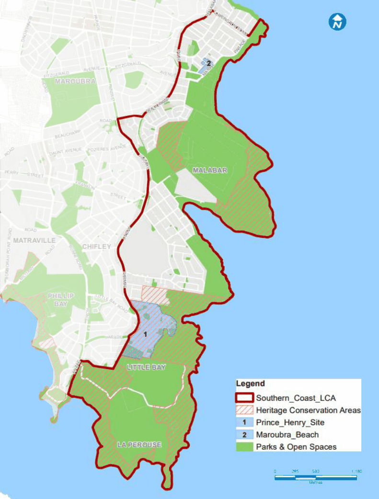

## 13. Southern Coast

### 13.1. Locality statement

The Southern Coast Local Character Area (LCA) stretches from Mistral Point at Maroubra Bay to Congwong Bay. The area is known for its high natural value, landscape relevance, and significant vistas. Key features include Aboriginal cultural places, archaeological sites, landscape heritage, large open spaces, national parklands, dramatic rocky coastlines, bays and beaches. The Local Character Area includes a number of small commercial centres that serve areas of urban development located along the coast.

### 13.2. Locality map

Figure 11: Southern Coast Local Character Area

> [Picture on page 46: a picture, saved as a picture (images/part-b1-local-character-areas-page-46-11.gif, 150 dpi).]

### 13.3. Desired future character

Development which occurs in the Southern Coast Local Character Area (LCA) must be consistent with or seek to achieve the desired future character of the area. The LCA will retain and enhance its large expanses of open space and national parklands, securing these areas as invaluable resources for future. Increased opportunities for bushland and biodiversity are appropriately resources and expanded through:

• restoration efforts at Council managed sites

• mitigating threats to remnant bushland and prioritising restoration and protection work around areas of high biodiversity value

• increase buffer plantings to protect remnant bushland in the Anzac Parade median, Arthur Byrne Reserve, Pioneers Park, Cromwell Park and the Little Bay fauna corridor

• Continue to link patches of remnant bushland through appropriate indigenous plantings and create effective fauna corridors along Anzac Parade road easement. New developments ensure that public views of the ocean remain unobstructed, preserving the distinctive coastal scenery and environment of the LCA. These developments are designed to blend seamlessly with the coastal landscape, enhancing rather than diminishing its natural beauty. Buildings must demonstrate high-quality architectural design that is responsive to the coastal setting, incorporating materials, colours, and forms that reflect and complement the natural landforms, vegetation, and visual qualities of the foreshore landscape. Development should minimise visual intrusion, maintain low-scale built form where appropriate, and integrate sensitively with the topography to preserve the scenic and ecological values of the area. Urban areas are well connected with the coastline through increased green street links focusing on native trees to seamlessly merge coastal and urban environments. Urban areas will maintain a low density, 1 and 2 storey, residential character supported by active transport connections, including cycle paths and links to the coastal walk. The environment will be aesthetically pleasing and welcoming for both visitors and residents, achieved through streetscape enhancements that form an integral part of Council ’s broader strategy for open space and environmental restoration. Improvements to the active transport network will make moving across and within the LCA by bicycle more appealing to a wider demographic. Improved pedestrian and bicycle paths along Anzac Parade will provide direct north south connectivity along the edge of the LCA. East west paths that connect into the Anzac Parade route will ensure accessibility around the coastal area is strengthened, along with improved signage and wayfinding to benefit tourists and visitors in the area. New developments respect the cultural sensitivity and significance of Indigenous landscapes and sites, fostering a harmonious coexistence. Public domain upgrades at commercial centres will be more inviting, contributing to a vibrant community atmosphere, notably at Maroubra Beach. Large-scale redevelopments are approached with a keen understanding of the coastal character, as well as key infrastructure considerations such as public transport access to and within the LCA.

### 13.4. Key characteristics

a) Front gardens are spatial buffers from the wide streets, visually and spatially connected to the street through the use of low masonry walls

b) Front garden planting concentrated to street edge and building edge, leaving large areas of usable space

c) Generous spacing between adjacent buildings allows expansive views to regional landscapes and the ocean

d) Due to the separations noted above, individual buildings act as distinct points in variegated streetscape, differing formally, but all within a consistent height datum

e) Building entries are distinct from driveways, identifiable within the front gardens and directly address the street

f) Coastal landscapes are predominant, in both private and public domain: rolling, undulating topography, and low, dense endemic plants, sparsely punctuated by low-lying trees

g) Verandas, balconies and sheltered outdoor spaces address front gardens and streets, at both ground floor and upper levels.

### 13.5. Development guidelines

Development must comply with Section B1.3 General Development Guidelines. In addition, development must satisfy the following:

a) Locality

i. Establish a connection to formal and informal open spaces and the coastline through landscaping and built form, drawing on the area’s distinctive topography to reinforce the open landscape character and visual connection to surrounding coastal environments

ii. Ensure view corridors within the Local Character Area and to the coast are maintained from public spaces Preserve and enhance key views from and across the public domain, including district and street view corridors, such as views towards and along the coast, public open spaces and prominent landmarks.

b) Built form elements

i. Development must minimise building bulk and visual intrusion when viewed from the coastline, public open space and surrounding landscapes, ensuring built form remains subservient to the dominant coastal setting

ii. Development must not obstruct or diminish public views to and along the coastline, including views from open space, coastal pathways and streets, and must maintain the openness of the coastal landscape

iii. Development must be sited and designed to follow the natural landform, with building elements stepping with the terrain and avoiding extensive cut and fill that would disrupt natural ground levels and coastal landforms.

c) Landscaping

i. Retaining walls and landscaping structures visible to the public domain is required to be constructed of materials and a style that is complementary to the coastal setting and responsive of natural materials endemic to the area

ii. Retain existing landform, natural ground levels and rock formations

iii. Establish a connection through landscaping to formal and informal open spaces, drawing on the area’s distinctive topography, coastal landscape, abundance of open space and the presence of national parklands

iv. Development must incorporate canopy trees within front and rear setbacks

v. Plant species must be capable of withstanding exposed and windy coastal environments. Where possible, compliment coastal heathland character.

d) Materiality

i. Exterior colour schemes must compliment natural elements in coastal areas.

e) Car parking and movement

i. Utilise streets as thoroughfares for increased pedestrian and cycle permeability, particularly along streets that support commercial and retail premises, and access between Maroubra Beach and Coogee Beach to the north

ii. Maintain and enhance pedestrian movement along the coast ensuring access to Maroubra and Malabar Beaches, and Little Bay, as well as connections to Coogee to the north.

f) Land use and subdivision

i. Where lot consolidation or subdivision occurs, the design of new dwellings must be built to a similar dimension and scale that reflects the predominant detached dwelling character

ii. Retain the existing and historical pattern of retail and commercial uses within commercial centres

iii. Maintain and support a diverse mix of land uses

iv. Development must respond to the established land use pattern and reinforce the presence of residential, community, government and recreational uses that reflect the neighbourhood’s social, cultural, historic and environmental identity.

g) Mixed-use and non-residential development

i. Retain the existing pattern of retail and small scale commercial uses fronting Anzac Parade, Prince Edward Street and Bay Parade

ii. Ground floor retail and small scale commercial uses are to reinforce the established fine grain lot pattern resulting in narrow shopfront articulation

iii. Awnings must be provided to street frontages of commercial premises along Anzac Parade and Prince Edward Street to support pedestrian amenity and streetscape continuity. Where this is not feasible due to existing built form, heritage constraints or architectural design, alternative design responses must achieve a consistent and coherent street frontage

iv. Provide active ground floor uses along primary street frontages within local centres, including retail, food and drink premises, and other uses that support the day-to-day needs of residents and visitors.
