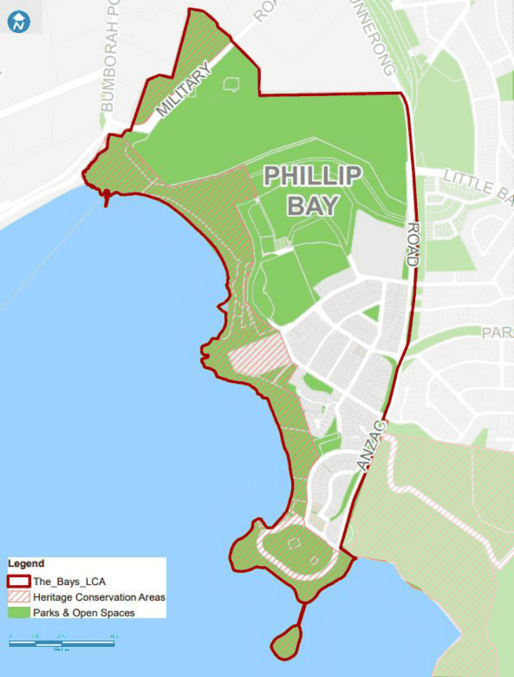

## 14. The Bays

### 14.1. Locality statement

The Bays Local Character Area (LCA) consists of the coastal zone from Bare Island to Bumborah Point including the coastal environments of Botany Bay, including Yarra Bay, Frenchman’s Bay and Bare Island. Its eastern boundary follows Anzac Parade and Bunnerong Road and it is bordered by the industrial area of Port Botany to the north and west. It includes the La Perouse neighbourhood centre, Chinese Market Gardens, Yarra Bay Bicentennial Park, Eastern Suburbs Memorial Park and a pocket of residential zoned land east of Bunnerong Road. Key features of The Bays LCA include the Aboriginal Community’s unbroken connection to the land, that can be traced to 7,500 years, the rich variety of marine and estuarine habitats , being First Nation’s Gamay Sea Country, and the heritage significance as a first contact area.

### 14.2. Locality map

Figure 12: The Bays Local Character Area

> [Picture on page 50: a picture, saved as a picture (images/part-b1-local-character-areas-page-50-14.gif, 150 dpi).]

### 14.3. Desired future character

The character of The Bays LCA will be established by the protection of its natural landscapes, indigenous storytelling and connection to country, views across the LCA and along the coast, as well as historical built form and landscapes. It will celebrate its relaxed coastal charm and develop an authentic brand which strengthens its coastal and indigenous identity. Preservation of the area

’s unique biodiversity and continued protection and rehabilitation of its

landscapes and ecosystems will ensure the conservation of local flora and fauna, including:

• improvements to the existing green grid and biodiversity corridors

• extension of native vegetation throughout the Yarra Bay Bicentennial Park

• connecting dune vegetation between Bumborah Point and western edge of Yarra Beach

• mitigating threats affecting remnant bushland The establishment of green grid connections will enrich the open space network across the LCA, promoting ecological sustainability and a sense of natural continuity. Rear yards of residential lots, as well as public parks will provide opportunities for planting of tree species endemic to the

area. Street planting will further provide opportunities for increased canopy trees and green links, noting significant mature planting and ecological communities along coastal zones. Improved access to La Perouse Park will ensure both residents and visitors can enjoy the recreational amenities it offers. Aboriginal heritage and culture and significant sites will be respected in new developments adhering the cultural richness of the area and the local indigenous population’s connection to country. The existing character of La Perouse will be enhanced by maintaining the low-density detached dwelling scale at 1 to 2 storey building heights. New dual occupancy and semi-detached infill development will present as a single dwelling to the street to ensure this characteristic is achieved. Built form will seamlessly integrate with the coastal character, ensuring that developments coexist with, and enhance the natural beauty of the surroundings. Development will complement the topography rather than amend existing ground levels through excessive cut and fill. Development in will be carefully articulated in terms of bulk and scale to ensure consistency with adjoining development and streetscape, as well as retention of views from public and private land. View corridors to Botany Bay and across the LCA are maintained. Front fences are discouraged to promote the coastal landscape setting. In the absence of fences, front boundaries will be delineated with landscaping. Where front fences are proposed, they will be low, permeable, and integrated with vegetation endemic to the area to ensure structures at the interface with the street are non-discernible. La Perouse neighbourhood centre (generally bounded by Anzac parade, Endeavour Avenue and Goorawahl Avenue) is the primary commercial centre and will support increased opportunities for greater economic vibrancy as a result of transport access to the area and tourism opportunities, capitalising on the Kurnell to La Perouse ferry service. The neighbourhood centre will be characterised by its nil street setbacks and 2-3 storey elevation along Anzac Parade and Endeavour Avenue. It will promote pedestrian activity and street activation, with a focus on retail and hospitality services at ground level to connect with the boatshed café, located between Anzac Parade and the waterfront, to create an intimate coastal village scale. New development will maintain and enhance the landscape quality of streetscapes, particular for streets that provide a visual connection to the coastline and Botany Bay. New developments incorporate consistent front setbacks to reinforce the building edge along streets, ensuring a cohesive streetscape that contributes to the overall aesthetics and walkability of the area. The use of natural building materials, such as sandstone, are incorporated into sites where they interface with the public domain. Basement car parking should be non-discernible from the

street and not result in the presentation of a 3-storey building heights. Car parking and car parking structures are set behind building lines to ensure setback lines of dwellings within the streetscapes are not disrupted and front gardens and landscaping is the predominant feature within the streetscape. The environment will be aesthetically pleasing and welcoming for both visitors and residents, achieved through streetscape enhancements that form an integral part of Council’s broader strategy for open space and environmental restoration. Improvements to the active transport network will make visiting La Perouse by bicycle more appealing to a wider demographic. Improved accessibility around the coastal area with improved signage and wayfinding will benefit tourists and visitors to the area.

### 14.4. Key characteristics

a) The rolling coastal landscape is the main spatial experience, low-lying hills and valleys undulating towards the coastal cliffs, with views of the ocean omnipresent

b) Built form is a predominant cottage typology, consisting of single-story, flat roof, built form, set well back from wide streets

c) Generous and continuous spatial curtilage around the houses and between houses and the street, typically without walls or fences between properties and between properties and the street

d) There are very few hardscape parking areas or parking structures; and fewer in front of the predominant building alignment

e) The above open spatiality allows for intermittent street parking, in dedicated, brick-paved parallel parking bays along the street

f) The widely separated buildings allow for continuous spatial connection and views across the rolling local landscape, and to the ocean

g) Changes in the gentle rolling topography are expressed across the precinct in natural rock outcroppings and shelves, instead of built-up masonry walls.

### 14.5. Development guidelines

Development must comply with Section B1.3 General Development Guidelines. In addition, development must satisfy the following:

a) Locality

i. Protect views to Botany Bay, Heritage Items and HCAs from the public domain, including but not limited to Goorawahl Avenue, Anzac Parade, Adina Avenue, Adina Way, Murrong Place, Goonda Avenue, Elaroo Avenue, Tasman Street, Oorana Avenue and Canara Avenue

ii. Development in the La Perouse local centre is to support local convenience retail for residents and also attract visitors by providing recreational retail, food and beverage services that respond to the area's coastal location and character.

b) Built form elements

i. Development must minimise building bulk and visual presence within the landscape, ensuring built form does not dominate the open coastal setting when viewed from public spaces along coastal edges and public reserves

ii. Development must not obstruct or fragment expansive public views across the coastal landscape and towards Botany Bay, and must maintain the visual continuity of the open and connected landscape setting both along the coast and to inland open space areas, including Chinese market gardens, Eastern Suburbs Memorial Park, and beyond

to connected open space areas within Bunnerong Creek and Southern Coast Local Character Areas

iii. Development must be designed to respond to the natural topography, stepping with the landform and avoiding built-up platforms, retaining walls or cut and fill that disrupt the natural expression of the rolling coastal terrain

iv. Maintain nil setbacks and 3 storey scaled shop-top housing for development within La Perouse neighbourhood centre, bounded by Anzac Parade, Endeavour Avenue and Goorawahl Avenue.

c) Landscaping

i. Retaining walls and landscaping structures visible to the public domain is required to be constructed of materials and a style that is complementary to the coastal setting and responsive of natural materials endemic to the area

ii. Establish a connection through landscaping to formal and informal open spaces, drawing on the area’s distinctive topography, connection to Botany Bay and national parklands and the broader coastal cultural landscape

iii. Development must incorporate canopy trees within rear setbacks

iv. Front boundary treatments must prioritise landscaping and low planting of locally appropriate species to maintain the open coastal landscape character of the streetscape, respond to natural site topography and support visual and ecological continuity. Solid front fencing is discouraged. Where fencing is provided, it must be visually permeable and designed to allow for fauna movement, including through open fencing types, gaps at ground level or similar measures

v. Development must maintain visual openness and continuity of the coastal landscape across sites, streets and adjoining open space areas.

vi. Landscaping must prioritise locally endemic species and be designed to support ecological connectivity, habitat creation and links between coastal and inland environments

vii. Development adjacent to open space, coastal edges and ecological corridors must minimise hard boundaries and incorporate landscaping that visually and ecologically integrates private land with the public domain.

d) Materiality

i. Ensure external materials and finishes respond to the natural surrounding environment through the use of lightweight construction, recycled materials, sandstone, timber and natural textures

ii. Exterior colour schemes must compliment natural elements in coastal areas.

e) Land use and subdivision

i. Maintain and support a diverse mix of land uses

ii. Development must respond to the established land use pattern and reinforce the presence of residential, community, and recreational uses that reflect the neighbourhood’s social, cultural, historic and environmental identity.

f) Mixed-use and non-residential development

i. Ensure ground floor retail and commercial uses reinforce the small-scale village character of La Perouse. Retail and commercial uses will support both residents and those visiting the area and be complimented with awnings to protect and promote outdoor dining and pedestrian movement

g) Aboriginal cultural landscape

i. Development must demonstrate a considered design response to the Aboriginal cultural landscape of The Bays Local Character Area, including its connection to land, water, topography and views, and must reinforce the cultural and spatial significance of the coastal setting and its continuity as part of a broader cultural landscape

ii. Site planning and landscaping must respond to and reflect the cultural landscape, including through retention of natural landforms, use of locally appropriate plant species, and integration with the open coastal and ecological setting

iii. Major development must incorporate meaningful design responses that recognise and communicate the Aboriginal cultural significance of the locality, including through public art, landscape design, materials or built form elements integrated into the development and public domain

iv. Development must be sited and designed to avoid or minimise impacts on Aboriginal cultural heritage and culturally sensitive areas, and where in proximity, demonstrate a design response that respects and responds to their cultural significance.

1300 722 542

Randwick City Council

30 Frances Street

council@randwick.nsw.g ov.au
