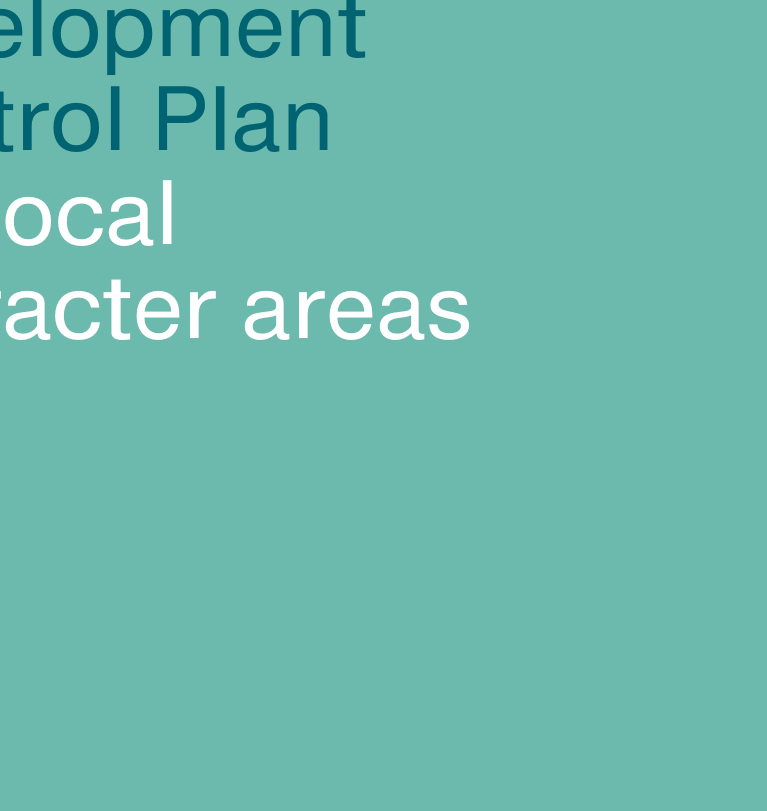

# Randwick Development Control Plan - Part B1 Local character areas

> This chapter is split into 14 section file(s), one per numbered heading, in the order they appear in the PDF.

Source PDF: [B1-Local-character-areas-Randwick-DCP-Stage-2_Final.pdf](B1-Local-character-areas-Randwick-DCP-Stage-2_Final.pdf)

#### STRATEGIC PLANNING

### Randwick

> [Picture on page 1: a picture, saved as a picture (images/part-b1-local-character-areas-page-1-3.gif, 150 dpi).]

### Development Control Plan B1 Local character areas

#### D06205885

#### 27 July 2026

#### 1300 722 542 randwick.nsw.gov.au

| File reference | D06205885 | Date | Signature |
|---|---|---|---|
| Prepared by | PM | June 2026 |  |
| Coordinator Review | David Appleby | October 2025 |  |
| Manager Review | Stella Agagiotis | October 2025 |  |

| Contents | ‘ |  |  |
|---|---|---|---|
|  | 1. | Introduction | 6 |
|  | 2. | Character principles | 9 |
|  | 3. | General Development Guidelines | 10 |
|  | 4. | Parklands North Randwick | 13 |
|  |  | 4.1. Locality statement | 13 |
|  |  | 4.2. Locality map | 13 |
|  |  | 4.3. Desired future character | 13 |
|  |  | 4.4. Key characteristics | 14 |
|  |  | 4.5. Development guidelines | 14 |
|  | 5. | West Kensington | 16 |
|  |  | 5.1. Locality statement | 16 |
|  |  | 5.2. Locality map | 16 |
|  |  | 5.3. Desired future character | 17 |
|  |  | 5.4. Key characteristics | 17 |
|  |  | 5.5. Development guidelines | 18 |
|  | 6. | North Anzac | 19 |
|  |  | 6.1. Locality statement | 19 |
|  |  | 6.2. Locality map | 19 |
|  |  | 6.3. Desired future character | 20 |
|  |  | 6.4. Key characteristics | 21 |
|  |  | 6.5. Development guidelines | 21 |
|  | 7. | Randwick | 23 |
|  |  | 7.1. Locality statement | 23 |
|  |  | 7.2. Locality map | 23 |
|  |  | 7.3. Desired future character | 24 |
|  |  | 7.4. Key characteristics | 24 |
|  |  | 7.5. Development guidelines | 25 |
|  | 8. | Bundock Street | 27 |
|  |  | 8.1. Locality statement | 27 |
|  |  | 8.2. Locality map | 27 |
|  |  | 8.3. Desired future character | 27 |
|  |  | 8.4. Key characteristics | 28 |

| 8.5. Development guidelines | 28 |
|---|---|
| 9. Maroubra Central | 30 |
| 9.1. Locality statement | 30 |
| 9.2. Locality map | 30 |
| 9.3. Desired future character | 31 |
| 9.4. Key characteristics | 32 |
| 9.5. Development guidelines | 32 |
| 10. Bunnerong Creek | 34 |
| 10.1. Locality statement | 34 |
| 10.2. Locality map | 34 |
| 10.3. Desired future character | 35 |
| 10.4. Key characteristics | 36 |
| 10.5. Development guidelines | 36 |
| 11. The Port | 38 |
| 11.1. Locality statement | 38 |
| 11.2. Locality map | 38 |
| 11.3. Desired future character | 39 |
| 11.4. Key characteristics | 39 |
| 11.5. Development guidelines | 40 |
| 12. Northern Coast | 42 |
| 12.1. Locality statement | 42 |
| 12.2. Locality map | 42 |
| 12.3. Desired future character | 43 |
| 12.4. Key characteristics | 44 |
| 12.5. Development guidelines | 44 |
| 13. Southern Coast | 46 |
| 13.1. Locality statement | 46 |
| 13.2. Locality map | 46 |
| 13.3. Desired future character | 47 |
| 13.4. Key characteristics | 48 |
| 13.5. Development guidelines | 48 |
| 14. The Bays | 50 |
| 14.1. Locality statement | 50 |

| 14.2. Locality map | 50 |
|---|---|
| 14.3. Desired future character | 51 |
| 14.4. Key characteristics | 52 |
| 14.5. Development guidelines | 52 |

<!-- sections -->
## Sections

1. [1 Introduction](01-introduction.md)
2. [2 Character principles](02-character-principles.md)
3. [3 General Development Guidelines](03-general-development-guidelines.md)
4. [4 Parklands North Randwick](04-parklands-north-randwick.md)
5. [5 West Kensington](05-west-kensington.md)
6. [6 North Anzac](06-north-anzac.md)
7. [7 Randwick](07-randwick.md)
8. [8 Bundock Street](08-bundock-street.md)
9. [9 Maroubra Central](09-maroubra-central.md)
10. [10 Bunnerong Creek](10-bunnerong-creek.md)
11. [11 The Port](11-the-port.md)
12. [12 Northern Coast](12-northern-coast.md)
13. [13 Southern Coast](13-southern-coast.md)
14. [14 The Bays](14-the-bays.md)
