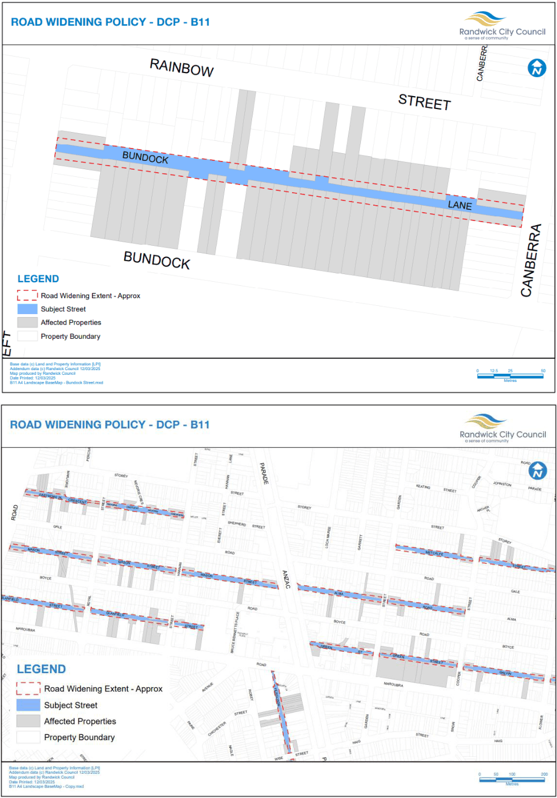
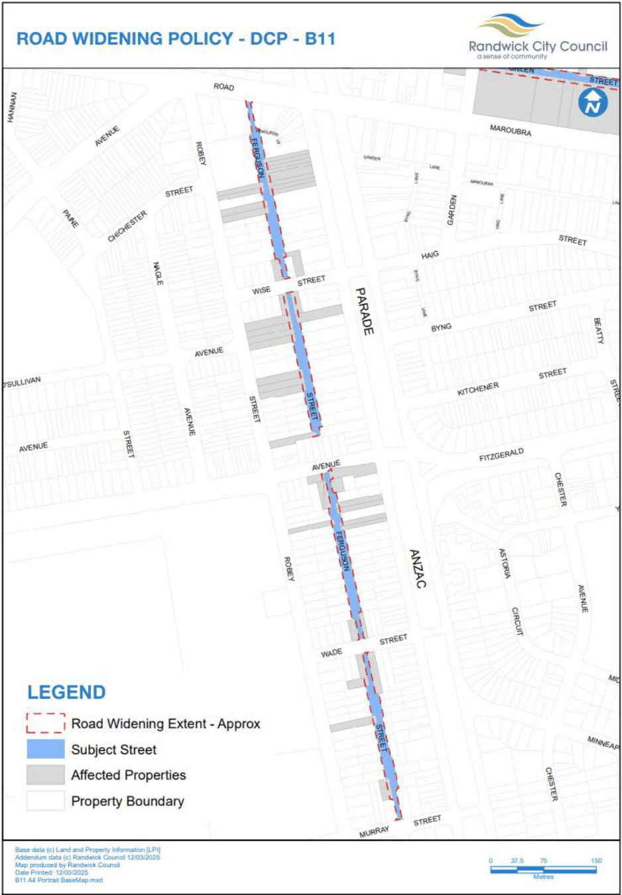

## 3. Mapping

> [Picture on page 6: a picture, saved as a picture (images/part-b11-laneway-widening-page-6-2.gif, 150 dpi).]

> [Picture on page 7: a picture, saved as a picture (images/part-b11-laneway-widening-page-7-1.gif, 150 dpi).]

Randwick City Council 30 Frances Street Randwick NSW 2031

1300 722 542 council@randwick.nsw.gov.au www.randwick.nsw.gov.au
