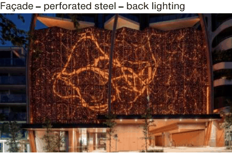
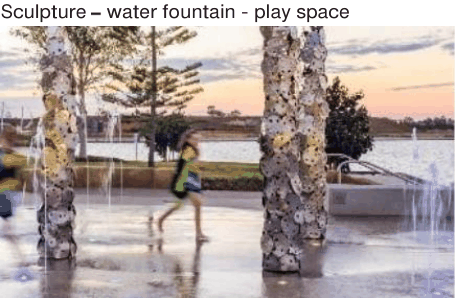
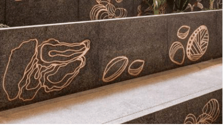
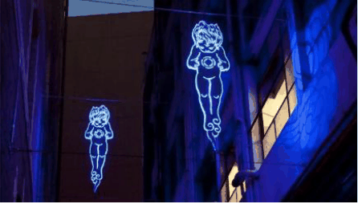
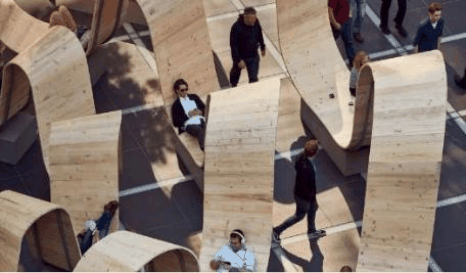
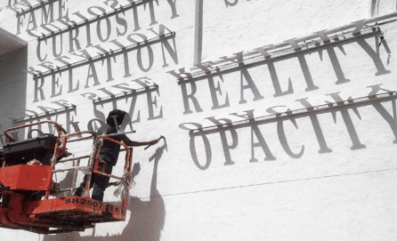

## 1. Introduction

Artwork is crucial for vibrant and liveable places. Inspiring, enriching, and thought-provoking, public artwork enhances cities by bringing meaning to place and amplifying the cultural and social identity which makes areas distinctive and memorable. This builds distinct local character that can attract visitation and revenue to the area. Through commissioning public art and installing Creative Hoardings, development Plays an essential role in creating thriving, engaging, and innovative creative communities. This chapter outlines the ways in which Randwick City Council seeks to grow the creative community in partnership with the private sector. Randwick City Council has a Public Art Advisory Panel (PAAP) and dedicated Council staff who seek to assist the delivery of creative outcomes for our community. Council supports proposals and ideas that are innovative, engaging and visionary. Applicants are encouraged to meet with Randwick City Council Arts and Culture staff as early as possible in the development application (DA) process to best facilitate creative outcomes for the community. This Part of the DCP should also be read in conjunction with:

• Part A

– Introduction

• Part B

– General controls

• Other Parts of the DCP for specific development types, locations, or sites, as relevant to the DA.

The principles and strategic approaches for public art are outlined in Council’s art strategies, policy and plans, including:

• Randwick Arts and Culture Strategy 2022

– 2032

• Randwick City Council Public Art Guidelines

Definitions Creative hoarding refers to the use of artwork or images on hoardings to enhance the streetscape and contribute positively to the public realm during development. Hoarding within this DCP part means any or all the following:

- Type A hoarding

– a solid, closed construction barrier typically made of plywood or

similar durable materials, erected at ground level to fully enclose or isolate a construction site from the public domain.

- Type B hoarding

– a prefabricated, modular gantry-style overhead protective

structure installed above public footpaths or roadways to ensure pedestrian safety during construction or demolition activities, and where necessary, to also enclose a worksite by means of a plywood sheet fence. It is typically constructed using engineered steel frames and assembled in segments to form a continuous elevated barrier. Type B hoardings may be standalone, or integrated with site sheds, offices, or other temporary facilities.

Private domain means areas that are accessible to the public, all, or most of the time, that are on private land that are the responsibility of private landowners, and may include through site links, terraces, footpath widenings, and plazas. Public art refers to art that is in the public realm. It can be any medium that occurs outside a gallery context. Typologies may include permanent, temporary, ephemeral, stand-alone sculpture, site-specific installation, integrated designs, applied wall finishes, performance, discovery works (small scale), kinetic, sound based, digital and multi-media, pavement finishes, light art and projections, banners and flags, billboards, land art, landscape design and cultural plantings, artist-designed playgrounds, as well as other examples. Public art is mostly located in public places and spaces but may also be incorporated into private areas open to the public such as shopping plazas, laneways, parks, town centres, streetscapes, buildings and carparks. Public domain means all publicly accessible areas that are the responsibility of Randwick City Council or the NSW Government, and includes roads, laneways, street footpaths, plazas, through site links, median and landscape strips, carparks, and includes local and regional parks and open spaces. Public Place is defined under the Local Government Act 1993 and includes a road. Road is defined under the Local Government Act 1993 and includes:

(a) highway, street, lane, pathway, footpath, cycleway, thoroughfare, bridge, culvert, causeway, road-ferry, ford, crossing, by-pass and trackway, whether temporary or permanent, and

(b) any part of a road and any part of any thing referred to in paragraph (a), and

(c) anything forming part of a road or any thing forming part of any thing referred to in paragraph (a)

State classified road is defined under the Roads Act 1993, and means:

- a main road

- a highway

- a controlled access road

- a secondary road Note: A full list of classified roads is available on the Transport for NSW website https://www.transport.nsw.gov.au/operations/roads-and-waterways/business-and-industry/partners-and-suppliers/local-government-12-3.

Figure 1: Bloodlines weaving string and water, 2023, Judy Watson. Brisbane, QLD.

> [Picture on page 6: a picture, saved as a picture (images/part-b15-public-art-and-creative-hoardings-page-6-3.gif, 150 dpi).]
> Words printed on the picture (title and legend, copied from the PDF):
> Façade – perforated steel
> – back lighting

Figure 2: Flourish, 2019, Katrina Tyler. Brisbane, QLD.

> [Picture on page 6: a picture, saved as a picture (images/part-b15-public-art-and-creative-hoardings-page-6-6.gif, 150 dpi).]
> Words printed on the picture (title and legend, copied from the PDF):
> Sculpture
> – water fountain - play space

Source: Courtesy Koichi Takada Architects

Source: Courtesy UAP

Figure 3: In Between Two Worlds, Jason Wing,

2013\. Sydney CBD, NSW. Sculpture - suspended lighting

Figure 4: Nura & Garrigarrang (Country & Sea), 2024, Debra Beale. Sydney CBD, NSW. Bronze – seating – ground plane

> [Picture on page 6: a picture, saved as a picture (images/part-b15-public-art-and-creative-hoardings-page-6-15.gif, 150 dpi).]

– wall and

pavement finish

> [Picture on page 6: a picture, saved as a picture (images/part-b15-public-art-and-creative-hoardings-page-6-18.gif, 150 dpi).]

Source: Katherine Griffiths

Source: Courtesy 1 Elizabeth

Figure 5: Time changes everything, 2016, Daku. Lodhi Colony, New Delhi. Typographic sundial

Figure 6: Please Be Seated, 2019, Paul Cocksedge. Broadgate, London, UK. Functional seating – play area – open space

> [Picture on page 6: a picture, saved as a picture (images/part-b15-public-art-and-creative-hoardings-page-6-27.gif, 150 dpi).]

– wall art - letters and

shadows

> [Picture on page 6: a picture, saved as a picture (images/part-b15-public-art-and-creative-hoardings-page-6-30.gif, 150 dpi).]

Source: designboom

Source: Courtesy Broadgate
