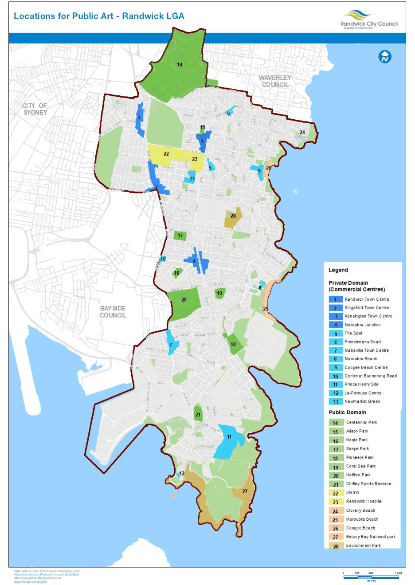

## 2. Public art

Introduction The delivery of public art is an open-ended invitation for the creative community to work with landowners to define public spaces. Public artworks add visual interest, creativity, and vibrancy to our urban fabric, creating local landmarks that foster a sense of place, liveability, and community identity. Artworks created by private development must align with the priorities of the Randwick Public Art Guidelines. Namely, artworks will celebrate local stories, cultures, ambitions and identities. Public art can include works which are permanent, temporary or ephemeral. It could be a standalone sculpture, site-specific installation, integrated designs, applied wall finishes, performance, kinetic, sound based, digital and multi-media, pavement and ground surface finishes, light art and projections, banners and flags, exhibition windows and alcoves, land art, landscape design and cultural plantings, artist-designed playgrounds, as well as other forms. Artworks on private land (the private domain) can also be considered as public art as it can be experienced and enjoyed through being visible to the public (whether incidentally or from being experienced when passing through a development). Privately funded artworks within the private domain complement publicly funded (i.e., Local and State Government) artwork located in the public domain. Consideration may be given to locating privately funded public art within publicly owned land (the public domain), providing the requirements of this DCP are satisfied, and public liability, and ongoing maintenance matters are addressed to the satisfaction of Council, and the Randwick Public Art Advisory Panel (PAAP) where applicable.

Objectives

1\. Specify requirements for the provision of public art in major developments, and all other developments

2\. Ensure artwork is integrated into the design of buildings and publicly accessible areas to enrich the experience of our town centres and neighbourhoods

3\. Support local economies and opportunities for creative industries and artists through improvements to the built environment, private and public places

4\. Achieve a distinct character and identity for town centres and neighbourhoods in the LGA through artwork and creative treatments

5\. Ensure proposals for public art follow the curatorial themes, procedures and processes set out in

Council’s Public Art Guidelines.

Figure 7 illustrates opportunities across the LGA, identified by Council, for the location of artwork in both the public and private domain. It is expected that opportunities in the private domain will mainly occur in commercial centres (blue); however, this does not preclude opportunities in the public domain within centres (blue), as well as within public land noted on Figure 7 as parks and national parks (green), UNSW and Randwick Hospital (yellow), and beaches (tan).

Figure 7: Map of identified locations for artwork within the LGA

> [Picture on page 8: a picture, saved as a picture (images/part-b15-public-art-and-creative-hoardings-page-8-2.gif, 150 dpi).]

Source: Randwick City Council

Controls

a) The controls in this section apply to:

i. Major development proposals valued over $10M located within E2 Commercial Centres and the selected E1 Local Centre zones shown in Figure 7; or

ii. Any other development or masterplan sites across Randwick City valued over $15M

b) Development specified in a) must deliver artwork as part of the development.

Note A minimum allocation of 1% of the estimated development cost should be allocated toward a public art budget. This includes artist and community engagement fees, engineering and manufacture of the artwork but excludes public art consultant fees and installation of the artwork.

c) Public art is to be provided on identified sites, plazas and mid-block links as per the block-by-block controls in Section B of DCP Part D1 Kensington and Kingsford

d) In accordance with the Randwick Public Art Guidelines, a detailed Public Art Proposal is to be prepared by a public art consultant and submitted with the DA. The Public Art Proposal must include:

i. Site analysis, curatorial framework, treatment options, project parameters, community consultation plan, proposed artists, project team, budget allocations

ii. A commitment to submitting to Council key milestone documentation at detailed project phases, in alignment with Council’s review and approval timelines

Note To ensure the delivery of public art is appropriate in its context, applicants and developers are encouraged to engage with Council early in the design development phase of a project (as part of pre-DA discussions), to develop a Public Art Proposal in line with the Public Art Guidelines.

e) Artwork must demonstrate alignment with the Randwick Public Art Guidelines. This may include a reflection of Randwick’s history, culture, and connection to Country

f) Where delivered on private land, artwork must be:

i. Located in a publicly accessible and visible part of the site in order to provide an unobstructed sensory experience of the work

ii. Designed to be integrated into the overall layout of the development

g) To enhance visual amenity and contribute to the public realm, artwork is to be incorporated onto common/ side boundary walls where developments would otherwise result in large, unarticulated facades

h) Where provided in accordance with the Randwick Public Art Guidelines, advice from the Randwick Public Art Advisory Panel (PAAP) must be considered and addressed in the design of the artwork. Documentation of this advice, and response, must be provided in the supporting Public Art Proposal

i) Public art must be entirely free from commercial influence and cannot include any marketing, advertising, or brand alignment, including identifiable brand elements such as logos, trademarks, proprietary typefaces, colour schemes, or imagery associated with commercial entities.
