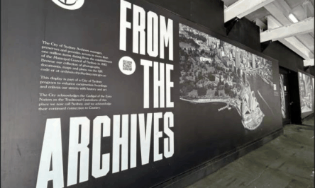
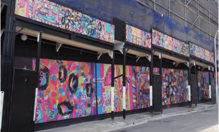

## 3. Creative hoardings

Introduction Consent is required under the Roads Act 1993 and Local Government Act 1993 to erect a hoarding in a public place. Council is responsible for issuing this consent. Hoardings serve as a platform for presenting diverse artwork, graphics, and imagery within the public domain. Figures 8 and 9 provide examples of Creative Hoardings within the City of Sydney. The Creative Hoardings program is a creative response to improving our urban environment during periods of growth and development, facilitating and engaging a sense of place and local identity.

Figure 9: Historic images hoarding display

> [Picture on page 10: a picture, saved as a picture (images/part-b15-public-art-and-creative-hoardings-page-10-11.gif, 150 dpi).]

#### Figure 8: “Fantastical Fabulous Fun”, Rosie

Deacon, Eveleigh Street Redfern, 2020

> [Picture on page 10: a picture, saved as a picture (images/part-b15-public-art-and-creative-hoardings-page-10-14.gif, 150 dpi).]

Source: City of Sydney

Source: Photographer: Katherine Griffiths. City of Sydney

Artwork, or images on hoardings (i.e., creative hoarding) will be required if the proposal meets criteria based on the location of the proposed hoarding, site width, capital investment value (CIV), and the period which the hoarding will be erected. A condition of consent will be included for developments that trigger the requirements for creative hoardings. When a condition of consent triggers a requirement for creative hoardings, the applicant can choose from the following options for selecting artwork:

• Council commissioned artwork

– artwork that has been licensed by Council and is free of

copyright charge for use

• Historic images

– local historic photographic images that have been pre-approved and

sourced from Council archives, relevant to the ward in which the development is taking place. Free of copyright charge for use

• From the collection

– photographic images of special objects held in La Perouse

Museum

• Bespoke artwork

– a unique artwork that has been commissioned directly by the

applicant for their own hoardings. Bespoke commissions are to follow set criteria which outline minimum fees for the artist, reasonable licence terms and conditions, and ensure commissioned artworks meet a high artistic quality. Bespoke artworks must not, in any way, be perceivable as advertising. They must be entirely free from commercial influence and cannot include any marketing, advertising, or brand alignment, including identifiable brand elements such as logos, trademarks, proprietary typefaces, colour schemes, or imagery associated with commercial entities.

Further details and the step-by-step process can be found in the Public Art Guidelines. Details of Council commissioned artwork and historic images

can be viewed on Council’s website .

Objectives

1\. Specify requirements for the provision of public art on hoardings through the Creative Hoardings program

2\. Achieve and reflect a distinct character and identity for town centres and neighbourhoods in the LGA through site specific artwork and creative treatments

3\. To contribute to the visual amenity of the public domain and streetscape during construction phase of development

4\. To discourage bill posters and graffiti at construction sites

5\. To ensure proposals for Creative Hoardings have endorsement from Council Staff regarding placement, quality, artistic vision and compliant installation.

Controls

a) Where an application for a Type A or Type B hoarding is required under the Roads Act 1993, Local Government Act 1993, and by condition of consent, creative hoardings will be required on sites:

i. Zoned E1 Local Centre and E2 Commercial Centre where erected for 8 weeks or more, or

ii. Located along a State classified road where erected for 8 weeks or more, or

b) In any other location, with a frontage of 12m wide or greater, and erected for 12 weeks or more, except where:

i. The capital investment value (CIV) of the work to which the hoarding relates is less than $1 million, or

ii. The land is zoned R2 Low Density Residential, or

iii. Hoarding installations are proposed on minor or secondary roadways such as laneways used primarily for local traffic and where the prevailing from of the laneway consists of rear fences, garages, gates, roller doors and the like.

c) Applications for creative hoardings are to demonstrate compliance with the requirements of

Council’s Public Art Guidelines, including the Terms and Conditions listed therein.

Note Notwithstanding the above requirements, Council may determine that the provision of creative hoardings is required on sites with a street frontage of less than 12m where the scale, duration or nature of construction works is likely to result in a level of impact on the public domain comparable to development on wider sites.

Note In cases where a hoarding is installed on a main frontage of a corner block and the hoarding extends along the side laneway having a width of less than 6m, measured from the property boundaries, graphics must be displayed for the length of at last 5m within the laneway measured from the corner intersection. Where a side laneway width exceeds 6m, graphics must be displayed the full length of the hoarding.

Note Notwithstanding the above requirements, Council may determine that creative hoardings may be unnecessary in particular circumstances.

Randwick City Council 30 Frances Street Randwick NSW 2031

1300 722 542 council@randwick.nsw.gov.au www.randwick.nsw.gov.au
