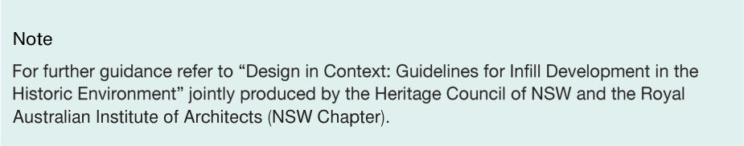
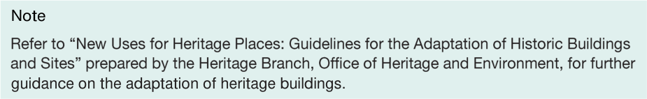

### 1.4. Consent requirements

#### 1.4.1. Development not requiring consent

Heritage Exemption Certificate for maintenance and repair works to Local items listed under the Randwick Local Environmental Plan Maintenance and repair works are encouraged for heritage items and properties in HCAs and may not require development consent from Council if they are of a minor nature and would not adversely affect the significance of the item or HCA. Applicants must consult with Council prior to undertaking any maintenance or repair works to confirm whether development consent (i.e. a Development Application) is required. A written advice must be obtained from Council prior to the commencement of any works. Where it is determined that the proposed works do not require development consent, and relate to a heritage item or property within a Heritage Conservation Area, the applicant must obtain a Heritage Exemption Certificate (HEC) from Council prior to commencing works. A Heritage Exemption Certificate application form can be found on Council’s website or HERITAGE-MINOR-WORKS-WITHOUT-CONSENT.pdf. Maintenance and repairs can include non-structural external works such as:

• Essential maintenance and reinstatement of original heritage features

• Replacing broken windows frames, panes and fly screens

• Minor repairs to roofing, brickwork, timberwork, metal work, fencing and tessellated tiles

• Repainting surfaces which are already painted, including timberwork and metalwork

• Repointing brickwork and masonry Maintenance and repairs can also include non-structural internal works such as:

• Patching, painting and decoration to the interior of the building

• Installation of joinery

• Repairing timber floors

• Plumbing and gas fitting work

• Electrical work and communications cabling

• Installation of insulation Additionally, the installation of solar panels and associated equipment within a HCA may be considered under a HEC, if they provided the works do not involve:

• Solar panels positioned on the primary roofs or verandahs facing/visible from the main street

• Heritage items that form part of a continuous group or row of properties

• Slate or timber shingle roofs

• Complex primary street facing roofs

• Very small primary street facing roofs (smaller than 4m)

• Any works that require structural modifications to support the solar panels

• Any works that involving removal of roof elements, such as chimneys, capping, parapet walls.

Further, the installation of surveillance systems and devices on heritage items and within HCAs may be considered where they:

• are not visible from the public domain

• do not involve alteration, damage or the removal of significant fabric. Any new penetrations must be limited in number and made through non-significant fabric or mortar joints only. Exempt development Under the State Environmental Planning Policy Exempt and Complying Development Codes 2008 (The Codes SEPP) some categories of minor internal works are permitted as Exempt Development for buildings within HCAs, but not for heritage items. The classification of Exempt Development refers to works that have minimal environmental impact and therefore does not require Council’s consent. The Codes SEPP does not permit external building alterations to heritage items or properties located within HCAs. Standard exemption for State Heritage Register items Certain activities and work are exempt from approval under the Heritage Act 1977 for items listed on the State Heritage Register or subject to an interim heritage order. Standard exemptions include maintenance works where t

hese have little to no impact on the item’s

heritage significance and support its ongoing management. These standard exemptions are made under the Heritage Act 1977 and published in the NSW Government Gazette - https://www.environment.nsw.gov.au/topics/heritage/apply-for-heritage-approvals-and-permits/state-heritage-register-items/standard-exemptions Before any activity or work takes place, follow these steps to:

• understand what 'significant fabric' is

• determine if your proposed activity or work can be carried out under a standard exemption and therefore you do not need to lodge an application for approval

• understand how to comply with standard exemption requirements.

Note To determine if a property is heritage listed, search the State Heritage Inventory online database using the Heritage NSW website, or check Schedule 5 of RLEP and Heritage Map. You can also search the Australian Heritage Database for National listings and inquire with Council or Heritage NSW for the most accurate information.

#### 1.4.2. Development requiring consent

A DA is required for the carrying out of development which relates to a heritage item, development in an HCA, Aboriginal place or archaeological site. RLEP Clause 5.10 (2) identifies those instances where development consent is required.

Additionally, it is important to carefully consider the following guidelines for DAs impacting Aboriginal objects and places of cultural significance, historical archaeological sites, and state listed heritage items. Aboriginal objects and places of cultural heritage Aboriginal objects and places provide evidence relating to Aboriginal habitation of an area and are of cultural significance to Aboriginal people because of their spiritual, ceremonial, historic, social or educational values. Aboriginal objects and places are protected under the NSW National Parks and Wildlife Act 1974. Part 4 of Schedule 5 under the RLEP identifies the former Prince Henry Hospital site as an area containing Aboriginal cultural heritage. Other Aboriginal objects and places in Randwick City are not listed in the RLEP due to the sensitive nature of these sites. This is common practice for protecting Aboriginal cultural heritage in NSW. Development consent is required to disturb or excavate land containing Aboriginal objects or an Aboriginal place. It is an offence to harm or desecrate an Aboriginal object or place. If Aboriginal objects are present or likely to be present and an activity will harm those objects, an Aboriginal Heritage Impact Permit (AHIP) will be required. Clause 5.10(8) -Aboriginal Places of Heritage Significance -, Council may require a Statement of Heritage Impact to assist in its consideration of the effect of the proposed development on the cultural significance of the Aboriginal object or place, or to identify the potential for the discovery of Aboriginal cultural heritage on a particular site. As part of the heritage impact assessment, consultation with local Aboriginal groups must be undertaken and the outcomes of such consultation provided to Council with a development application. Historical Archaeological sites Archaeological sites provide physical evidence of the past and can include objects and artefacts from the lives of previous generations, such as tools and household items, as well as remains of early buildings and structures. A number of archaeological sites are listed in Schedule 5 of the RLEP. Archaeological sites or relics that have local or state significance are protected under the NSW Heritage Act 1977. Development consent is required for disturbing or excavating an archaeological site while knowing or suspecting that the work may result in a relic being discovered, exposed, moved, damaged or destroyed. Council may request an archaeological assessment to confirm the likelihood and potential significance of relics on the site and recommend appropriate action in the context of the proposed development. When intending to disturb or excavate land where such archaeological relics have been identified or are considered likely to occur, it is the responsibility of the property owner to seek relevant approvals, including an excavation permit or an exception under Section 139 and Section 140 of the Heritage Act 1977. RLEP Clause 5.10(7) Archaeological Sites outlines consultation requirements with respect to carrying out development on an archaeological site. State Heritage Register items Heritage items of State significance are listed on the NSW State Heritage Register (SHR) and should be identified under Schedule 5 of the RLEP. The NSW Heritage Council is the consent authority for any development proposal affecting SHR Items under the NSW Heritage Act 1977. Consent from the NSW Heritage Council requires either the submission of an Integrated DA, or a prior Section 60 application under the NSW Heritage Act 1977. Applicants are advised to consult with either Council or the Heritage NSW, in relation to works affecting SHR Items.

Note To view the Codes SEPP, refer to www.legislation.nsw.gov.au Further information on permits relating to Aboriginal objects and places of significance, obtaining approvals relating to archaeological sites, and NSW Heritage Register is available from the NSW Department of Environment and Heritage:  www.environment.nsw.gov.au

1.4.3. Development in the vicinity of heritage items and heritage conservation areas All development adjacent to or in the vicinity of a heritage item or HCA must carefully consider its potential impact on cultural significance, fabric, and setting of the item and/or HCA. Applicants should address any potential impacts of the development on a heritage item or HCA and measures to mitigate this impact in their Statement of Environmental Effects and/or Statement of Heritage Impact (SOHI). The proposal must also consider how development may impact on heritage items and HCAs in neighbouring’s LGAs (i.e. Daceyville in Bayside LGA).

#### 1.4.4. Infill buildings

A new building within a heritage conservation area, referred to as an infill building, must be designed to respect and be sensitive to its heritage context.  It should be sympathetic to neighbouring buildings in terms of established setbacks, scale, form and materials. New development must reflect the established site coverage pattern and urban grain of the original subdivision and development of the suburb. In accordance with the Burra Charter principles, infill buildings should be clearly identifiable as contemporary additions and must not attempt to replicate historic buildings or mimic traditional detailing.

> [Picture on page 10: a picture, saved as a picture (images/part-b2-heritage-page-10-22.gif, 150 dpi).]
> Words printed on the picture (title and legend, copied from the PDF):
> Note
> For further guidance refer to “Design in Context: Guidelines for Infill Development in the
> Historic Environment” jointly produced by the Heritage Council of NSW and the Royal

Australian Institute of Architects (NSW Chapter).

#### 1.4.5. Adaptive reuse

Council supports the continuation of the original use of a heritage building as it helps retain the original floorplan, decorative features and enhances cultural significance. However, where continuation is not feasible due to changes in technology and market/social trends, adaptive reuse of a heritage item may be considered acceptable on heritage grounds. Development must comply with the Burra Charter definition and guideline for ‘compatible use’: Compatible use respects the cultural significance of the place and involves no or minimal impact on cultural significance.

Where the original use of a place is of cultural significance it should be retained wherever possible (e.g. Post Office, Bank, Religious, Educational, Library, etc.).

> [Picture on page 10: a picture, saved as a picture (images/part-b2-heritage-page-10-34.gif, 150 dpi).]
> Words printed on the picture (title and legend, copied from the PDF):
> Note
> Refer to “New Uses for Heritage Places: Guidelines for the Adaptation of Historic Buildings
> and Sites” prepared by the Heritage Branch, Office of Heritage and Environment, for further

guidance on the adaptation of heritage buildings.
