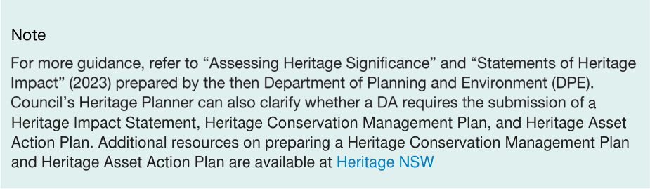

### 1.5. Heritage management documents

Heritage conservation management plans A Conservation Management Plan/Schedule (CMP/S) and/or a Heritage Asset Action Plan (HAAP) may be required where Council considers that the significance of a heritage item or a contributory item and the extent of proposed changes warrant a more detailed and rigorous assessment. A CMP/S or HAAP identify conservation polices and management mechanisms to ensure the cultural significance of a place is retained. They are particularly useful where building fabric has deteriorated, and to facilitate master planning of larger sites and long-term asset management is needed. A CMP/S or HAAP must be prepared by a specialist heritage consultant. RLEP Clause 5.10(6) of the Randwick LEP outlines HCMP/S or HAAP considerations relevant to the CMP/S and HAAP preparation. Statement of Heritage Impact A Statement of Heritage Impact (SOHI)

– also referred to as a heritage impact assessment -

evaluates the extent to which a proposal may affect the significance of a heritage item or HCA. A SOHI must establish the cultural significance of a place, assess the impact of the proposed development on that significance, and propose design and planning measures to mitigate adverse impacts. A SOHI is generally required for development effecting heritage significance of a heritage item or a HCA, archaeological sites, and Aboriginal places and objects. A SOHI may also be required for development adjacent to or in the vicinity of a heritage item or HCA, where there is potential for indirect heritage impact. For major changes or alterations, the required SOHI must be prepared by a specialist heritage consultant who can advise on alternative design solutions to reduce heritage impacts.

> [Picture on page 11: a picture, saved as a picture (images/part-b2-heritage-page-11-26.gif, 150 dpi).]
> Words printed on the picture (title and legend, copied from the PDF):
> Note
> For more guidance, refer to “Assessing Heritage Significance” and “Statements of Heritage
> Impact” (2023) prepared by the then Department of Planning and Environment (DPE).
> Council’s Heritage Planner can also clarify whether a DA requires the submission of a

Heritage Impact Statement, Heritage Conservation Management Plan, and Heritage Asset Action Plan. Additional resources on preparing a Heritage Conservation Management Plan and Heritage Asset Action Plan are available at Heritage NSW
