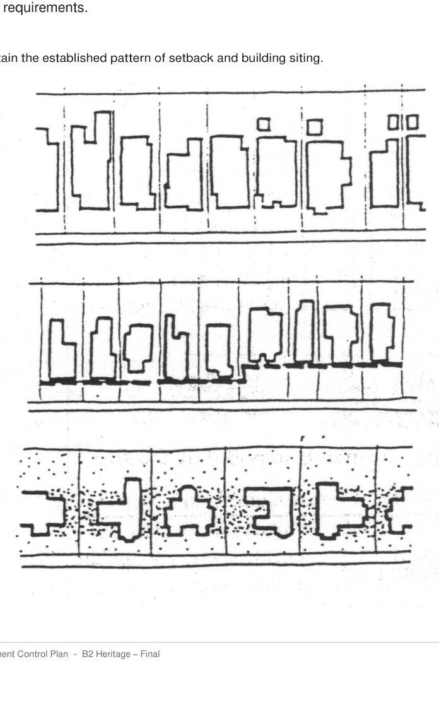

### 2.5. Siting and setbacks

Explanation The setting of a place comprises its immediate and wider environment, which contributes to its cultural significance and distinctive character. This includes built structures, open spaces, landforms, waterbodies, the sky, and views to and from the place, including along cultural routes. The setting also encompasses historical and contemporary relationships – both tangible and intangible that shape and inform the identity and meaning of the place. Front and side boundary setbacks are key elements of the setting and make a significant contribution to the character and significance of heritage items and Heritage Conversation Area. New development should respect and maintain the original setback patterns in order to preserve the established rhythm and spatial relationships between buildings and spaces. Objectives

1\. Conserve and maintain established historic street setback patterns

2\. Ensure heritage items retain an adequate curtilage and landscape setting that supports their significance

3\. Retain the integrity and significance of heritage items, contributory buildings and their settings, and heritage conservation areas, by ensuring the careful siting of new development, including  alterations or additions to existing buildings.

Controls All development

a) Development must align with the predominant front setbacks of the streetscape

b) Side setbacks and rear alignments/setbacks must be consistent with those of adjacent and nearby properties to maintain the established spatial pattern and relationships between buildings and spaces

c) Front and rear setbacks must be sufficient to preserve the existing landscape character of the heritage item or conservation area, including significant landscape features

d) Significant historic subdivision patterns and lot sizes must be retained. Subdivision or site amalgamation involving heritage items or contributory buildings must not compromise the setting or curtilage of buildings on or adjoining the site.

Heritage items and contributory buildings No additional requirements. Non-contributory buildings

> [Picture on page 18: a picture, saved as a picture (images/part-b2-heritage-page-18-15.gif, 150 dpi).]

Figure 7: Maintain the established pattern of setback and building siting.

No additional requirements.
