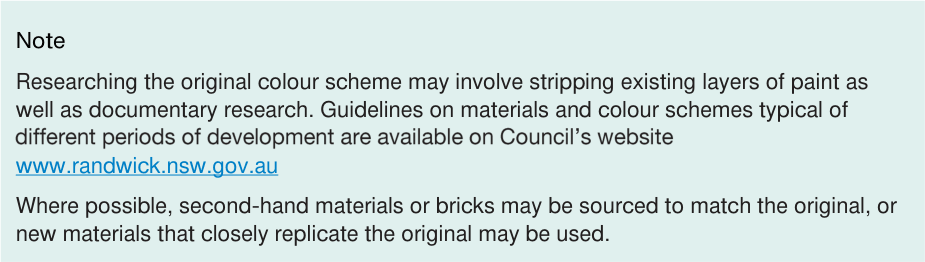

### 2.7. Materials, finishes and colour schemes

Explanation In some cases, the replication of original materials may not be feasible due to limited or no availability. In such instances, replacement materials and colour schemes should be selected to visually relate to or approximate the original building elements in terms of scale, size, style, form and finish. Thoughtful use of colour, particularly in the painting of heritage items and contributory buildings, can enhance their visibility and reinforce their historic character. Original face brickwork is a significant heritage feature and must not be rendered, bagged or painted, as such treatments will detract from and diminish the heritage significance of the building. Objectives

1\. Ensure the selection of materials and colours is informed by the significant fabric and original finishes, and is consistent with those of the heritage item or Heritage Conservation Area

2\. Enhance and maintain the visual quality of heritage items and Heritage Conservation Areas by encouraging the use of colour schemes that are appropriate to their character in all development on or within the vicinity of heritage items and Heritage Conservation Areas.

Controls All development

a) Materials and finishes for external surfaces and for pathways and driveways must be consistent with the character and setting of heritage items or HCAs.

Heritage items and contributory buildings

b) Changes to materials (including roofs and walls) on elevations visible from a public place are discouraged. Original face brickwork or sandstone must not be rendered, bagged or painted. The removal of external brickwork skin is not supported

c) Repairs to external surfaces must use matching materials. For new face brickwork, materials must match the existing colour and texture of the brick, the type of jointing, and mortar colour

d) New or replacement roof materials must match existing materials. Alternative materials may be considered where they are appropriate and sympathetic to the architectural style of the building and the streetscape character

e) Alterations and additions must use materials and colours that are consistent with, or complementary to the original material or colours of the building.

Non-Contributory Buildings

f) New development should consider the original colour schemes of the heritage conservation area to ensure visual cohesion.

> [Picture on page 21: a picture, saved as a picture (images/part-b2-heritage-page-21-1.gif, 150 dpi).]
> Words printed on the picture (title and legend, copied from the PDF):
> different periods of development are available on Council’s website

Note Researching the original colour scheme may involve stripping existing layers of paint as well as documentary research. Guidelines on materials and colour schemes typical of

www.randwick.nsw.gov.au Where possible, second-hand materials or bricks may be sourced to match the original, or new materials that closely replicate the original may be used.
