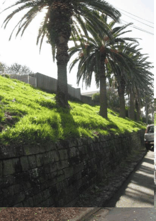
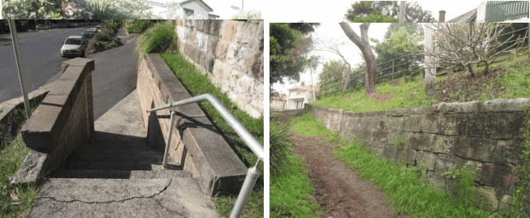

## 3. Landscape elements

Explanation Randwick City’s physical environment comprises a unique and complex pattern of natural and man-made elements. Some of the most identifiable features are the result of the adaptation of buildings and infrastructure to dramatic coastal topography, and of the powerful influence of the sandstone and the sand on which the City is founded and built. These elements include sandstone and brick retaining walls, stairs, embankments, and road cuttings. A number of significant landscape elements are listed as heritage items in Schedule 5 of the RLEP due to their cultural significance. In addition, many landscape elements located within or in the vicinity of, heritage items and Heritage Conservation Areas contribute to the heritage significance of these places, even where they are not individually listed. While many landscape elements are located on Council owned land, both public and private works can impact their heritage value. The following objectives and controls are applicable to all such landscape elements including those that are not individually listed but collectively contribute to the character and identity of Randwick City.

> [Picture on page 31: a picture, saved as a picture (images/part-b2-heritage-page-31-16.gif, 150 dpi).]
> Words printed on the picture (title and legend, copied from the PDF):
> Note
> RLEP Schedule 5
> provide item numbers with an ‘L’ prefix for landscape elements

Objectives

1\. Ensure significant retaining walls and associated landscape elements, including but not limited to individually listed heritage items, are retained and conserved

2\. Ensure contributory landscape elements, including but not limited to individually listed heritage items, are retained and conserved to the greatest extent practicable

3\. Ensure that private works, including the provision of vehicular access, modifications and repairs, do not adversely impact the significance of landscape elements, including but not limited to individually listed heritage items

4\. Ensure infrastructure works do not adversely affect the significance of landscape elements, including but not limited to individually listed heritage items

5\. Ensure repair and maintenance works are undertaken in a timely manner using appropriate materials, methods and techniques

6\. Ensure hilltop landforms, including terracing and retaining walls above road or footpath level, are retained and conserved including but not limited to individually listed heritage items.

Controls

a) Sandstone and brick retaining walls must not be removed or replaced

b) Sandstone and brick retaining walls and natural rock faces must not be modified to accommodate vehicular access

c)  Surface mounted infrastructure including water and gas supply pipes, storm water and sewerage pipes, service conduits and other fixings, must be minimised particularly on sandstone and brick retaining walls

d) Maintenance and repairs must use the same materials and techniques consistent with the original construction, and should be undertaken by suitably experienced tradespeople

e) Reconstruction works must match the existing retaining wall in terms of block size, texture, bond pattern, alignment of blocks, mortar joint colour and capping detail

f) Replacement of associated elements such as handrails, should match existing materials and details

g) Cyclical maintenance programs, including regular inspections, should be established to ensure the ongoing conservation of significant and contributory landscape elements

h) New plantings associated with retaining walls and landscape elements should be consistent with Council’s Street Tree Masterplan and must avoid species that may cause structural damage

i) Retaining walls and natural rock faces on public or private land must not be modified or altered, including but not limited to partial demolition, rendering and painting, or addition of stairs or handrails, without Council advice and approval

j) Landscape elements which are not heritage listed including but not limited to hilltop land formation (such as terracing) and retaining walls above the road/footpath level must be carefully assessed for their contributory heritage value where they may be impacted

k) Traffic, pedestrian management and development works for individual property development at the public-private interface must respect established local character and landscape character elements. Any proposed work should not result in the loss of such character elements. In particular, this applies to such elements as split footpaths, road cuttings and embankments, steps/stairways, retaining walls, established fencing and railing arrangements, stone trim/base elements, stone or brick kerbing and guttering, and natural stone and rock outcrops

l) Sandstone and brick street kerbing and guttering must  be retained and maintained in situ, and, where at risk, salvaged for reuse

m)  Inlaid concrete footpath signage must be protected, retained and maintained. Opportunities to e incorporate street names embedded in footpaths should be supported.

Figures 8: Examples of landscaping elements

> [Picture on page 32: a picture, saved as a picture (images/part-b2-heritage-page-32-35.gif, 150 dpi).]

> [Picture on page 32: a picture, saved as a picture (images/part-b2-heritage-page-32-36.gif, 150 dpi).]
