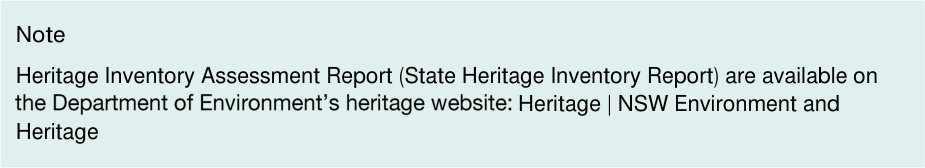

## 4.  Heritage Conservation Areas

This subsection provides an overview of Heritage Conservation Areas (HCAs), including their key character values, and guidelines for managing change. These key values and characteristics, and the guidelines for change that follow, are to be considered in conjunction with:

• the heritage conservation requirements, principles and practices contained in the Burra Charter

• Clause 5.10 of the Randwick Local Environmental Plan

• Heritage Inventory Assessment Reports (State Heritage Inventory) available online via the Heritage NSW website and database, and

• the general guidelines and controls contained in this DCP including but not limited to Part B1 Local Character Statements.

Heritage Conservation Areas exhibit distinctive historic and streetscape qualities that reflect particular phases in the development of Randwick City. Elements that contribute to this special character of HCAs must be retained, and new development must respond to and reinforce/enhance, this established character. Buildings and sites within HCAs are identified on the relevant Council maps as being

contributory, neutral, or detracting to the character and significance of the HCA.

#### General objectives

1\. Development in the vicinity or within the heritage curtilage of a heritage item or an HCA

must

a) be consistent with policy guidelines contained in the Heritage Inventory Assessment Report (State Heritage Inventory) for individual HCAs in addition to the l guidelines and controls contained in this DCP

b) maintain and enhance the key values and characteristics identified in the HCA

’s

statement of significance

c) respect and be compatible with the local character, including architectural style, built form and scale, and subdivision pattern, streetscape character, setbacks, landscape elements, front gardens, fencing, and roofscapes

d) achieve a high standard of architectural design, materials and finishes, and detailing, that complements and reinforces the existing character without replicating historic/heritage styles

e) avoid the introduction of new driveways, garages, carports, or carspaces across the front boundary, forward of the front building line, where such elements are inconsistent with the established character, and historic streetscape, of the area

f) provide appropriate transitions in height and scale, and greater setbacks, between new development and heritage and contributory items and HCAs

g) respond to the prevailing/significant roofscape character, including the use of pitched or gabled roof forms where these are characteristic of the area

h) use materials that are sympathetic to those traditionally used in the HCA including facebrick, sandstone, brick pavers, timber, slate, and corrugated metal roof

i) retain and enhance significant landscape elements, including front gardens, urban/tree canopies, and original landscape features and land formations such as sandstone or brick retaining walls, that contribute to the historic/significant streetscape character.

2\. Any development under SEPP (Housing) within, adjoining, or in the vicinity of an HCA must comply with the objectives and controls in this DCP (Part B2 Heritage) to ensure the significance and character of Randwick’s HCAs are conserved. In particular, development must:

a)  Respond to, reinforce, incorporate and enhance the established significant character of the HCA including its architectural style, built form and scale, and

subdivision pattern, and particularly, historic and significant streetscape, setbacks, landscape elements, front gardens, fencing, and roofscapes

b) Protect the setting and curtilage of heritage items, contributory buildings and HCAs to maintain their visual prominence, and enable the visual appreciation of the buildings in their setting

c) Where development is of a large scale (including midrise and above) demonstrate an appropriate urban design response through:

I. Engagement of a suitably qualified urban designer II. Submission of a Statement of Heritage Impact III. Participation in Council's design review or design excellence process, where required.

Note Chapter 6 relating to low and mid-rise housing in the State Environmental Planning Policy (Housing) 2021 does not apply to land that is a heritage item or on which a heritage item is located. Further Clause 182, Chapter 7 Pattern Book Development, does not apply to:

(c)  land that is a local or State heritage item or on which a local or State heritage item is located,

(d)  land that is identified in an environmental planning instrument as being in a heritage conservation area,

> [Picture on page 34: a picture, saved as a picture (images/part-b2-heritage-page-34-21.gif, 150 dpi).]
> Words printed on the picture (title and legend, copied from the PDF):
> the Department of Environment’s heritage website: Heritage | NSW Environment and
> Heritage

Note Heritage Inventory Assessment Report (State Heritage Inventory Report) are available on

### List of Heritage Conservation Areas

### 4.1 North Randwick Heritage Conservation Area

### 4.2 Old Tote and Figtree Theatre Heritage Conservation Area

### 4.3 Sacred Heart Heritage Conservation Area

### 4.4 West Kensington Heritage Conservation Area

4.5 Botany Bay National Park (Botany Bay National Park, La Perouse Headland, Yarra Bay

and Frenchmans Bay) Heritage Conservation Area
