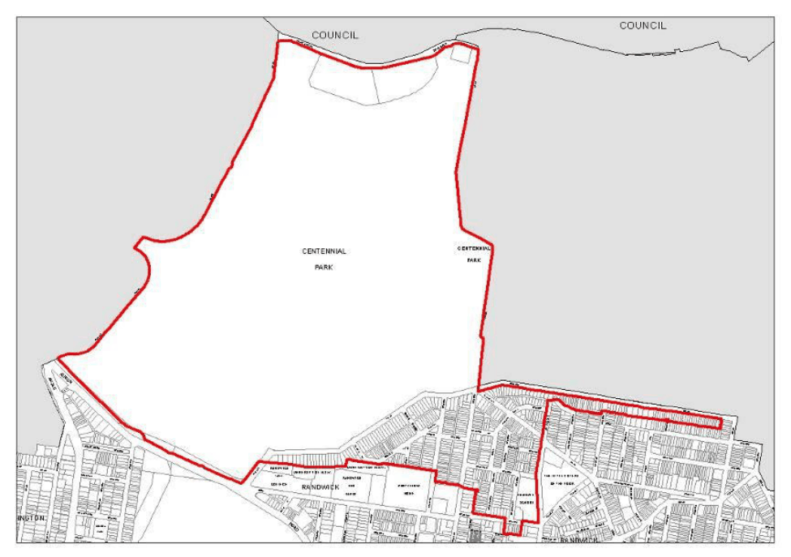
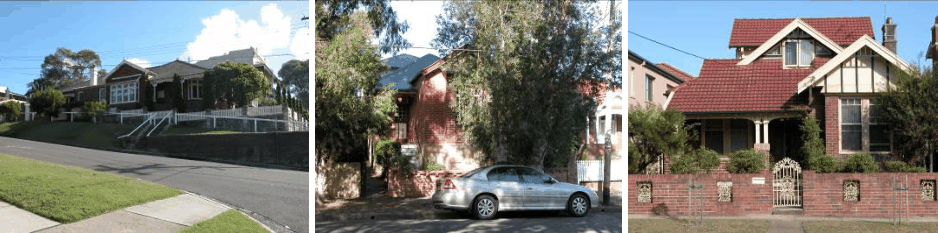
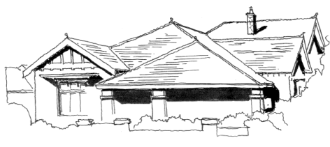
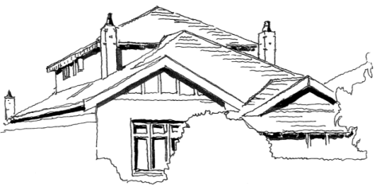
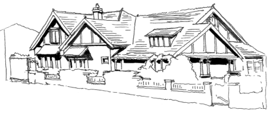

### 4.6 Prince Henry Hospital Site Heritage Conservation Area

### 4.7 Malabar Headland Heritage Conservation Area

### 4.8 Bunnerong Power Station Heritage Conservation Area

### 4.9 Dudley Street Heritage Conservation Area

### 4.10 Gordon Square Heritage Conservation Area

### 4.11 Moira Crescent Heritage Conservation Area

### 4.12 High Cross Heritage Conservation Area

### 4.13 Racecourse Heritage Conservation Area

### 4.14 Randwick Environmental Park Heritage Conservation Area

### 4.15 Randwick Junction Heritage Conservation Area

### 4.16 The Spot Heritage Conservation Area

### 4.17 St Jude’s Heritage Conservation Area

### 4.18 St Mark’s Heritage Conservation Area

### 4.19 Struggletown Heritage Conservation Area

### 4.20 Caerleon Crescent Heritage Conservation Area

### 4.21 Edgecumbe Estate Heritage Conservation Area

### 4.1. North Randwick Heritage Conservation Areas

Federation and Inter-War housing associated with the development of Centennial Park. A large area to the south of Centennial Park, originally reserved for water supply purposes, delaying its release for housing.

> [Picture on page 36: a picture, saved as a picture (images/part-b2-heritage-page-36-5.gif, 150 dpi).]

#### 4.1.1. Character values

Development must retain and enhance the outcomes expressed in the statement of significance for the HCA and as summarised below.

a. Built and Landscape Elements - Original fabric is highly significant and should be maintained. Maintain heritage landscape elements and schemes. Sandstone street kerbing and gutter should be retained in situ, where at risk salvaged for reuse

b. Subdivision

– Subdivision in the area is of varying width and depth. The subdivision and

street layout of the HCA should be preserved

c. Scale and Form - Predominantly single storey and two storey, with higher residential flat buildings in the former quarry site. Detached, semi-detached and attached cottages. Mostly with Victorian/Federation style and streetscape character

d. Siting and Setbacks - Maintain the existing setting of the heritage item, informed by the historic pattern of neighbouring development (form, scale, bulk, setback and height). Minimal front setbacks generally, greater setbacks for larger lots fronting Centennial Park. Front gardens/landscaped setbacks contribute to streetscape and leafy character of the area. Sandstone in landscaping and retaining walls contribute to the character of the area

e. Roofs - Traditional pitched roofs, hipped and gabled forms

f. Materials - Maintain the historic aesthetic/character of the item and area (e.g. paint scheme, materiality, style, landscape elements). Walls of face brickwork, smooth faced red or liver bricks, often with stone footings and stone trim elements. Marseilles pattern terracotta tiles and slate roofing. Further removal of detailed/decorative timber elements or overpainting of face brickwork should be discouraged

n) Detailing - Predominantly timber decoration to verandahs, sunhoods, gables etc. Protect inlaid concrete footpath signage and encourage provision for street names embedded in footpaths

g. Verandahs and Balconies - Verandahs and balconies provide depth to facades, an interface to the street and contribute to dwelling character. Existing verandahs contribute to the building and streetscape character, any new development should be sympathetic

h. Carparking - Generally located in the rear and accessed from rear lanes providing uninterrupted landscaped front garden with human scale and pedestrian friendly streets. Rear lane access to carparks ensures the streetscape character is maintained. This should continue

i. Fences

– Low/dwarf and permeable brick fences, some sandstone and wrought iron or

piked timber fencing. This should be maintained and continue.

Figures 11: Examples of existing character value

> [Picture on page 37: a picture, saved as a picture (images/part-b2-heritage-page-37-22.gif, 150 dpi).]

#### 4.1.2. Guidelines for change

Alterations and additions Alterations and additions should respond to the existing pattern of development, with careful consideration of the setting (form, scale, bulk, setback and height). New alterations and additions should respect the historic aesthetic/character of the item and area (e.g. paint scheme, materiality, style, landscape elements). No development of an inappropriate form and scale should be considered. Scale should be carefully monitored to ensure internal vistas are protected and maintained. If opportunities arise to remove unsympathetic additions, such as modern front fences, and replace with a more sympathetic alternative this should be undertaken. Sympathetic treatments should be outlined and referred to controls in Randwick DCP. Part of the cultural significance of the area is its predominantly single storey scale. Single storey rear additions are therefore preferred so as not to compromise this aspect of significance. The

dwellings are generally modest workers cottages on small blocks, and in order to increase the size of the dwelling, may be necessary to provide some upper-level floor space. The bulk and prominence of any upper-level addition should be minimised however. Any upper-level addition should be set well to the rear to minimise streetscape visibility and retain the integrity of the original roof.

Outbuildings to the rear The scale and bulk of outbuildings to the rear should not dominate the main building on the site. Outbuildings should be of a 1 ½ storey scale with upper floor accommodation within available attic space. The maximum wall height of outbuildings is to be 3.5m and roof pitch is to be consistent with that of the main building on the site.

Carparking Most of the properties within the conservation area have rear lane access allowing for carparking at the rear of the site. Where rear lane access is available, carparking to the front or side of the property will not be supported. New development must not incorporate new driveways, garages, carports, or carspaces across the front boundary, forward of the front building line, where these elements are not supported by historic evidence and uncharacteristic of the area’s established

> [Picture on page 38: a picture, saved as a picture (images/part-b2-heritage-page-38-17.gif, 150 dpi).]

> [Picture on page 38: a picture, saved as a picture (images/part-b2-heritage-page-38-18.gif, 150 dpi).]

> [Picture on page 38: a picture, saved as a picture (images/part-b2-heritage-page-38-19.gif, 150 dpi).]

streetscape.

Figure 9: Additions should utilise attic roof forms located to the rear of the main ridgeline

Figure 10: Additions set back from the existing ridgeline retain the form and detail of the existing residences. Use of simple roof forms and subtle detailing further enhances the relationship of new and existing works.

Figure 11: Additions to the rear of residences on corner sites should provide greater emphasis to the secondary street frontage.
