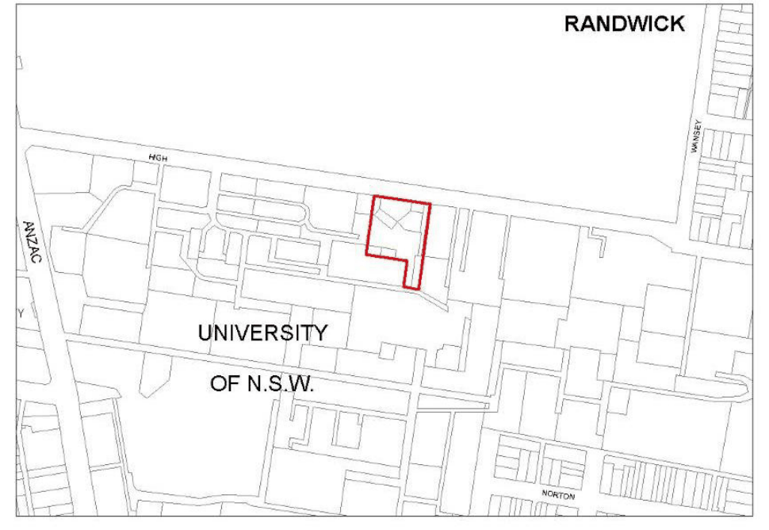

### 4.2. Old Tote/Fig Tree Theatre Heritage Conservation Area

A group of buildings which date from the use of the site as Kensington Racecourse. The Fig Tree Theatre building has also been used as immigration barracks and the home of NIDA. The Old Tote/Fig Tree Theatre heritage conservation area is on the south side of High Street, within the Kensington campus of the University of NSW. It includes three buildings which pre-date the foundation of the University, the Fig Tree Theatre, the White House and the Old Tote.

> [Picture on page 39: a picture, saved as a picture (images/part-b2-heritage-page-39-8.gif, 150 dpi).]

#### 4.2.1. Guideline for change

A conservation management plan should be prepared if any major development is planned for the grounds of the University. The conservation management plan should develop policies for preservation of open space character, interface with surrounding development and adaptive reuse of period buildings, sculptures and monuments/public artworks.
