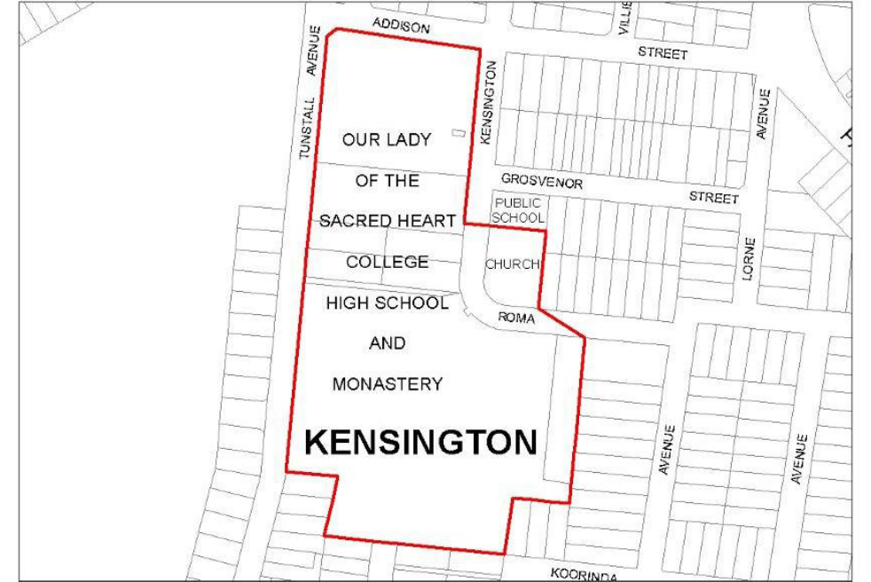

### 4.3. Sacred Heart Heritage Conservation Area

A landmark church precinct which includes the Sacred Heart Monastery and Chapel, Convent and Our Lady of the Rosary Church. A large area of church-owned land bounded by Addison Street in the north, and Tunstall Avenue in the west and extending east of Kensington Road and south of Roma Avenue, Kensington.

> [Picture on page 40: a picture, saved as a picture (images/part-b2-heritage-page-40-6.gif, 150 dpi).]

#### 4.3.1. Guideline for change

A conservation management plan for the church/school precinct should be prepared if any major development is planned by the Church. The conservation plan should develop policies for preservation of significant garden areas and vistas, as well as the period fabric of the buildings.
