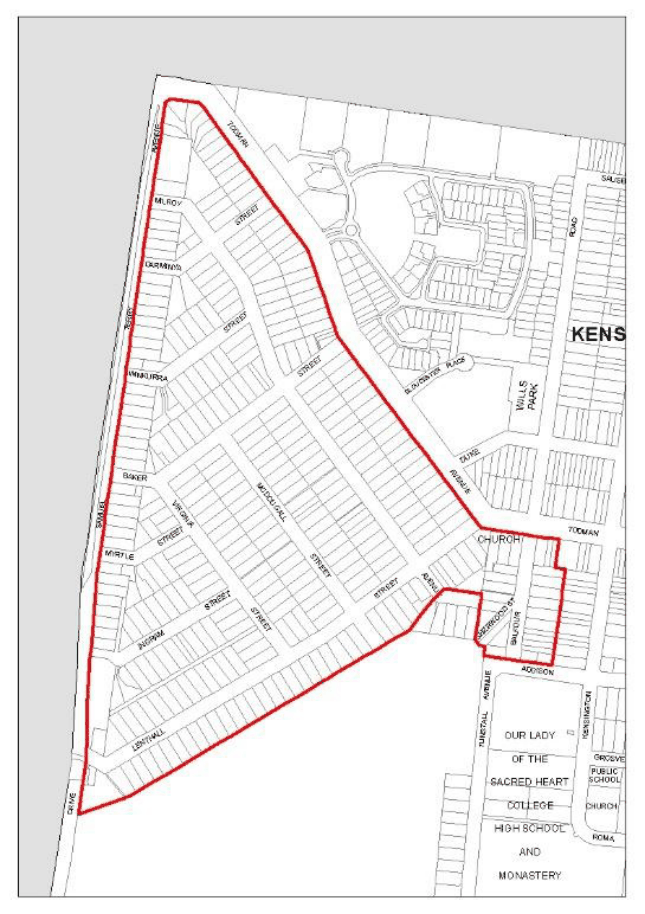

### 4.4. West Kensington Heritage Conservation Area

Highly consistent early twentieth century streetscapes with an unusual triangular street layout. A large area of land generally bounded by Samuel Terry Avenue to the west, Todman Avenue to the north, and the Australian Golf Course to the south.

> [Picture on page 41: a picture, saved as a picture (images/part-b2-heritage-page-41-6.gif, 150 dpi).]

#### 4.4.1. Character values

Development must retain and enhance the outcomes expressed in the statement of significance for the HCA and as summarised below.

a. Subdivision - Unusual triangular street subdivision layout with very consistent lot sizes. The subdivision and street layout of the HCA should be preserved

b. Landscape and public domain elements - Notable street tree canopy in the HCA including but not limited to Milroy Avenue. Consistent generous well established front gardens. Front gardens, steep and undulating topography and palm, pine and fig tree plantings in the parks contribute to the aesthetic quality of the setting. Inlaid concrete

footpath signage has aesthetic significance and should be retained.  Sandstone street kerbing and gutter should be retained in situ, where at risk salvaged for reuse

c. Scale and Form - Large detached houses, predominately bungalows that are single storey and two storeys. Maintain the existing setting of the heritage and contributory items, informed by the historic pattern of neighbouring development (form, scale, bulk, setback and height)

d. Siting and Setbacks - Generous setbacks allow for attractive front gardens. Houses generally well set back from and elevated above street

e. Roofs - Traditional pitched roofs, hipped and gabled forms, including a number of steeply pitched gable roofs

f. Materials - Walls predominantly face brickwork- smooth faced red or liver bricks. Marseilles pattern terracotta tiles and slate roofing

o) Detailing - Predominantly timber decoration to verandahs, sunhoods, gables etc. Heavy brick/timber verandah decoration. Timber and stucco gable decoration. These are largely intact. Maintain the historic aesthetic/character of the item and area (e.g. paint scheme, materiality, style, landscape elements). Removal of detailed/decorative timber elements or painting of face brickwork is not supported. Protect inlaid concrete footpath signage and encourage provision for street names embedded in footpaths

g. Verandahs and Balconies - Verandahs integral to each of the architectural styles which are represented in the area. Front verandahs and balconies provide depth to facades, an interface to the street and contribute to dwelling character

h. Carparking - Generous setbacks allow for car parking to rear and side driveways. Steep topography allows for garages to be provided within a retaining wall, below the level of the house. Most dwellings have independent off-street parking

i. Fences

– Low/dwarf and permeable front fencing. Predominantly dwarf brick fences,

some plain timber picket fences. Fence design varies according to style of dwelling and contributes to the quality of the setting. Many sandstone fences. Original front fences are generally stone and brick

j. Gardens and garden elements - A number of early stable buildings are found in the area, some retaining their original use. Maintain stable buildings, heritage landscape elements and schemes.

#### 4.4.2. Guidelines for change

Alterations and additions Alterations and additions should respond to the existing pattern of development, with careful consideration of the setting (form, scale, bulk, setback and height). New alterations and additions should respect the historic aesthetic/character of the item and area (e.g. paint scheme, materiality, style, landscape elements). If opportunities arise to remove unsympathetic additions, such as modern front fences, and replace with a more sympathetic alternative this should be undertaken. Part of the cultural significance of the area is its predominantly single storey scale. As the dwellings are on generous blocks, it is generally feasible to increase the floor space with a single storey rear addition, without detracting from its garden setting of the dwelling.

Outbuildings to the rear The scale and bulk of outbuildings to the rear should not dominate the main building on the site. Outbuildings should be of a 1 ½ storey scale with upper floor accommodation within available

attic space. The maximum wall height of outbuilding sis to be 3.5m and roof pitch is to be consistent with that of the main building on the site.

Original stables There are a number of original stable buildings in the area, associated with the racecourses which were located in the vicinity. These should be retained and conserved.

Carparking Most of the properties within the conservation area have rear lane access allowing for carparking at the rear of the site. Where rear lane access is available, carparking to the front or side of the property will not be supported. New development must not incorporate new driveways, garages, carports, or carspaces across the front boundary, forward of the front building line, where these elements are not supported by historic evidence and uncharacteristic of the area’s established streetscape.
