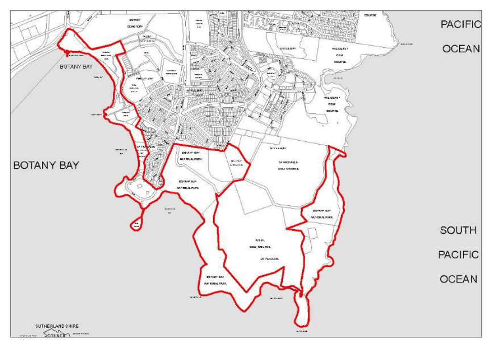

### 4.5. Botany Bay National Park Heritage Conservation Area

The area comprises an extensive stretch of dramatic coastline including several areas of remnant bushland and a number of sites of early Aboriginal and European contact. La Perouse is also the location of one of the oldest urban Aboriginal communities in Australia. The Botany Bay National Park Heritage Conservation Area covers the entire coastal strip facing Botany Bay and the Pacific Ocean, from Yarra Bay to Prince Henry Hospital. The heritage conservation area consists of four precincts: Yarra Bay and Frenchmans Bay; the La Perouse Headland; Botany Bay National Park and Prince Henry Hospital.

> [Picture on page 44: a picture, saved as a picture (images/part-b2-heritage-page-44-10.gif, 150 dpi).]

The majority of the HCA is managed by the NSW Department of Planning and Environment to maintain its natural and cultural heritage values. The parts of the area managed by Council are generally subject to Plans of Management which recognise heritage values. Controls relating to the Prince Henry Hospital site are included in Part E of this DCP. Any development within the area of Botany Bay National Park should refer to any Plans of Management prepared by the NSW Department of Planning and Environment.
