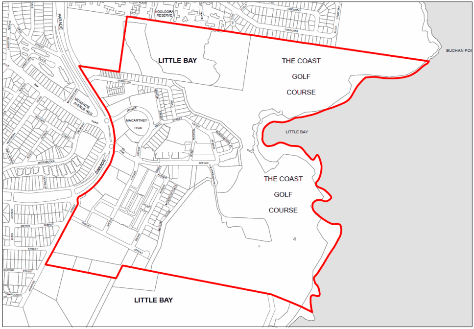

### 4.6. Prince Henry Hospital Heritage Conservation Area

A diverse complex of buildings in a coastal landscape, the hospital played an important role in the treatment of infectious diseases from the 1880s until 1986. The site is important to Aboriginal people and to the many former staff and patients of the hospital, and contains a considerable archaeological resource. The former Prince Henry Hospital is located in the suburb of Little Bay.

> [Picture on page 45: a picture, saved as a picture (images/part-b2-heritage-page-45-8.gif, 150 dpi).]

Refer to the site-specific controls for Prince Henry Site, Little Bay in Part E of this DCP.

#### 4.6.1. Little Bay Geological site

The area consists of a ravine carved out of sandstone at a time of low sea levels before they rose in the mid Miocene. In this ravine beneath a rock ledge are peat and sand deposit of early Miocene (about 22 million years old) The deposits contain geological evidence and pollen evidence of plant species from this time which are no longer found on mainland Australia that represented rainforests growing in a wet climate. The Little Bay Miocene Peat site was listed as a landscape conservation area by the National Trust in 2019.

#### 4.6.2. Character Values

The Little Bay geological site is of remarkably high biogeographical significance as a scientific site for paleo botanical studies as it is the only site containing peat of Miocene age (22 million years before present) known on the coast of New South Wales. This peat contains palaeobotanical evidence of climate conditions, past vegetation and coastal landscape on the east coast of Australia in the early Miocene. The site provides evidence of a sea level in the early Miocene of approximately 26 metres higher than current levels. The site has also been used

through palaeobotanic studies to provide evidence of climatic condition and vegetation patterns of the Miocene within the Sydney basin.

#### 4.6.3. Objectives

Protecting geological diversity as it provides important evidence of past life, natural processes and living things. It is a rare type of geological site and the scientific evidence this site contains is the state significance and maybe of national significance and has the potential or producing research of international significance and has already featured in international journals so it must be conserved for its scientific value for future generations as well as for the present community.

#### 4.6.4. Guidelines for change

Development surrounding the site should respect the character of the place by enhancement and by avoiding impacts on the following:

1\. water quality entering the site

2\. the properties and movement of water (hydrology) to and from the site

3\. the processes that form and develop soils

4\. local wind patterns affecting the site.
