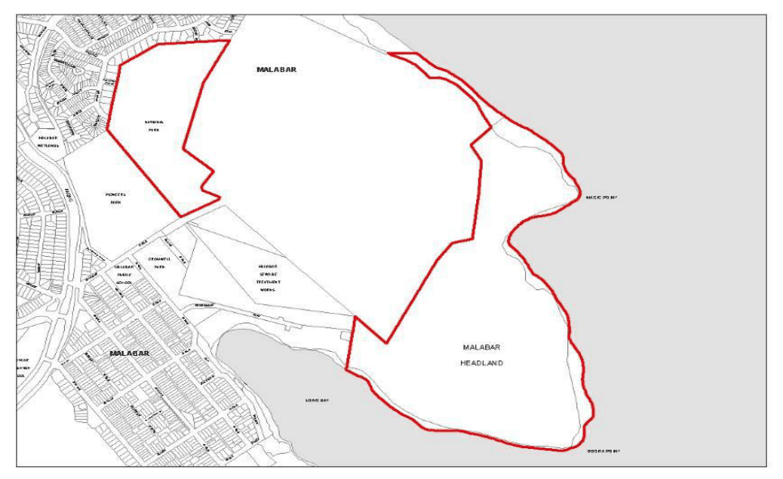

### 4.7. Malabar Headland Heritage Conservation Area

Malabar Headland contains two significant bushland remnants - referred to as the coastal section and the western section. Together, these contain what is probably the largest area of essentially unmodified bushland in Sydney's Eastern Suburbs. The bushland is a significant part of one of two semi-natural corridors between Botany Bay and Port Jackson. The two sections support at least seven distinct plant communities. This diversity of habitats is only matched in the Eastern Suburbs in Botany Bay National Park.

> [Picture on page 47: a picture, saved as a picture (images/part-b2-heritage-page-47-8.gif, 150 dpi).]

A CMP should be prepared if any major development is proposed within the Malabar Headland Conservation Area. The CMP should develop policies relating to scenic value, landscape features, bushland features, and defence fortifications.
