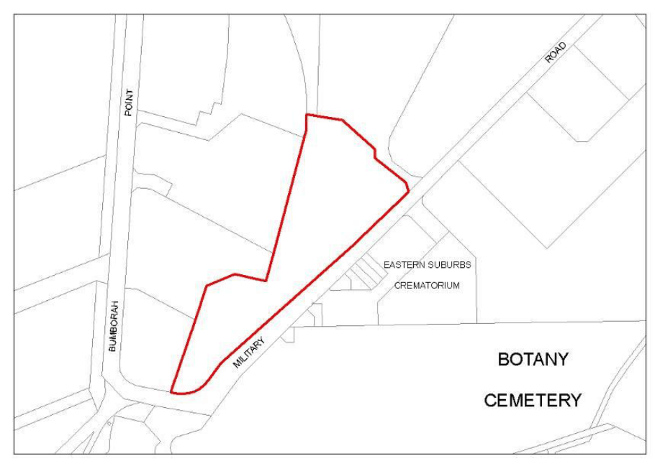
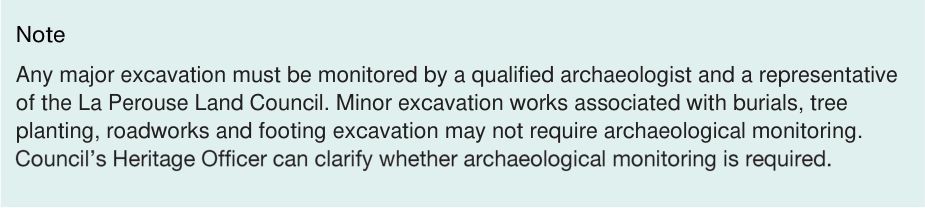

### 4.8. Bunnerong Power Station Heritage Conservation Area

The site retains structures and mature landscape elements dating from its use by the Bunnerong Power Station. The Bunnerong Power Station Heritage Conservation Area is located on the north-western side of Military Road, in Matraville.

> [Picture on page 48: a picture, saved as a picture (images/part-b2-heritage-page-48-6.gif, 150 dpi).]

This section provides objectives and controls for the extension of the Eastern Suburbs Memorial Park into part of the old Bunnerong Power Station Site, in order to safeguard the site’s heritage values. It also provides objectives and controls which should be addressed for the existing Eastern Suburbs Memorial Park, while outside the heritage conservation area.

#### 4.8.1. Character values

The subject site covers an undulating area of broad sandy ridge leading to Bumborah Point on the northern side of Botany Bay. It is bounded on the south and west sides by steep slopes down to, respectively, Yarra Bay and reclaimed land used for port purposes. To the southeast of Military Road is the existing Eastern Suburbs Memorial Park. It includes the Crematorium and surrounding gardens, existing memorial gardens and monumental burial grounds, Pioneer’s Memorial Park, administrative building, funeral home, café and maintena nce compound. Strong visual elements are:

1\. Crematorium

– the most prominent feature on the site; a strong art deco architectural

form with axial vistas east-west and north-south

2\. Cemetery main access road with palm avenue

3\. Bare open character of the cemetery, furnished in dressed stone on a grid layout, with expansive views to the south

4\. Informal tree plantings in memorial gardens and car parking areas. To the northwest of Military Road is part of the former Bunnerong Switching Station site, including the remains of gardens associated with the Switching Station and sub-floor structures of part of the old building. Strong visual elements are:

1\. Site entry, with 1920s garden, palm avenue and vista west to Port Botany and the bay beyond

2\. Platforms of the former Switch House, demolished down to floor slabs

3\. Ponds and terraced gardens

4\. Paperbark grove

5\. Retaining walls. Although only partially screened from Military Road by boundary planting of mature figs, the site orients itself to the west because of its dramatic position, presenting as a series of terraces overlooking Port Botany and the Bay. The predominant character is of the garden setting, with formal and informal elements of the former buildings. Views out are framed by mature tree plantings and at the southern end, screened by shrubs. Negative elements are:

1\. The mixture of styles and forms in gardens surrounding the Crematorium

2\. The separation of the two sites by Military Road

3\. Some over mature trees.

#### 4.8.2. Guidelines for change

Development in the area should maintain and enhance the positive elements of its character and correct negative elements. This will involve:

1\. Maintaining the open landscape character of the area

2\. Achieving a legible and coherent layout

3\. Fitting buildings, structures and the access/circulation system within the landscape and garden framework

4\. Using consistent design language based on: − unifying the two sites − recognising and where appropriate incorporating major elements of the previous use − the major existing site axes − rectangular building forms − solid structural elements in light coloured masonry

5\. Minimising changes to the existing landform, except over the former Switch House platforms, which may be raised to accommodate burial.

#### 4.8.3. Site planning

Objectives

1\. Achieve a coherent site layout that provides a pleasant, attractive, manageable, resource efficient and sustainable cemetery facility

2\. Maximise the positive attributes of the site, correct or mitigate negative attributes and minimise any negative impacts of development

3\. Ensure that local site conditions, constraints and opportunities are taken into account in the design process

4\. Ensure that the relationship of new development to adjoining development is considered in the design process.

Controls

i) Development is to be carried out in accordance with the masterplan

ii) Building, streetscape and landscape design must relate appropriately to the topography, built and landscape character of the locality

iii) Development must include a safe and legible pedestrian and vehicular access and circulation system

iv) The site layout must take into account and, where appropriate, retain and integrate any item or natural feature of identified conservation value

v) The siting and building layout must maximise microclimate opportunities related to solar access and prevailing breezes.

#### 4.8.4. Conservation

Objectives

1\. Ensure development respects the landscape and built significance of the site and surrounds

2\. Ensure development is in keeping with the bulk, scale and character of any identified items of significance.

Controls

i) Ensure that siting does not disrupt views to and from built and landscape elements

ii) New development must be a similar scale and proportion to existing elements to ensure that it does not dominate or overwhelm the heritage items or heritage conservation area

iii) New development is to complement, but not replicate, the design features of the heritage item and heritage conservation area

iv) Building height is limited to two storeys, however, special building features such as spires may exceed the height limit provided that such building features do not dominate or overwhelm the heritage item or heritage conservation area.

> [Picture on page 50: a picture, saved as a picture (images/part-b2-heritage-page-50-30.gif, 150 dpi).]
> Words printed on the picture (title and legend, copied from the PDF):
> Council’s Heritage Officer can clarify whether archaeological monitoring is required.

Note Any major excavation must be monitored by a qualified archaeologist and a representative of the La Perouse Land Council. Minor excavation works associated with burials, tree planting, roadworks and footing excavation may not require archaeological monitoring.
