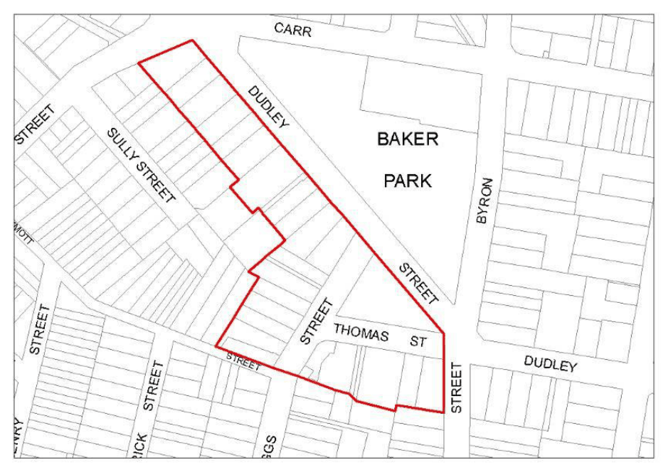

### 4.9. Dudley Street Heritage Conservation Area

Fine quality Federation and Interwar detached houses in an outstanding elevated setting. The Dudley Street heritage conservation area consists of rows of houses on Thomas Street, Higgs Street and Dudley Street Coogee, facing Baker and Leete Parks.

> [Picture on page 51: a picture, saved as a picture (images/part-b2-heritage-page-51-5.gif, 150 dpi).]

#### 4.9.1. Character values

Development must retain and enhance the outcomes expressed in the statement of significance for the HCA and as summarised below.

a. Landscape and public domain elements - Front gardens, steep and undulating topography, and palm, pine and fig tree plantings in the parks contribute to the aesthetic quality of the setting. Maintain historic landscape elements and schemes. Maintain the historic aesthetic/character of the item and area (e.g. front gardens, paint scheme, materiality, style, landscape elements).  Sandstone street kerbing and gutter should be retained in situ, where at risk salvaged for reuse

b. Subdivision - Subdivisions in the area are of varying width and depth with front gardens, steep and undulating topography and palm, pine and fig tree plantings in the parks

c. Scale and Form - Predominantly large, detached houses, single storey and two storey

d. Siting and Setbacks - Houses generally well set back from and elevated above street. Maintain the existing setting of the heritage and contributory items and the HCA, informed by the historic pattern, form, scale, bulk, setback, and height

e. Roofs - Traditional pitched roofs, includes a number of steeply pitched gabled roofs

f. Materials - Walls predominantly face brickwork, some stucco. Terracotta tiles and slate roofing. Original fabric is highly significant and should be retained and maintained

p) Detailing - Predominantly timber decoration to verandahs, gables etc. Protect inlaid concrete footpath signage and encourage provision for street names embedded in footpaths

g. Verandahs and Balconies - Verandahs are integral to each of the architectural styles which are represented in the area

h. Carparking - Steep topography allows for garages to be provided within a retaining wall, below the level of the house. Double garages and/or additional driveway and parking spaces are not supported, prevailing single garage streetscape character must be retained

i. Fences - Fence design varies according to style of dwelling and contributes to the quality of the setting. Many sandstone fences.

#### 4.9.2. Guidelines for change

Alterations and additions Alterations and additions should respond to the existing pattern of development, with careful consideration of the setting (form, scale, bulk, setback and height). New alterations and additions should respect the historic aesthetic/character of the item and area (e.g. paint scheme, materiality, style, landscape elements). Future uses for the item should be compatible with its historical functions/associations. Rear additions should not be prominent in the streetscape nor compromise the integrity of the original roof. As the dwellings are on generous blocks, it is generally feasible to increase the floor space with a single storey rear addition, without detracting from its garden setting of the dwelling. Unsympathetic additions at the street frontage within the HCA and removal of historic features i.e. verandahs, timber trim elements, painting of face brickwork are not supported Carparking Most of the properties within the conservation area have rear lane access allowing for carparking at the rear of the site. Where rear lane access is available, carparking to the front or side of the property will not be supported. Development must not incorporate new driveways, garages, carports, or carspaces across the front boundary, forward of the front building line, where these elements are not supported by historic evidence and uncharacteristic of the area’s established streetscape.
