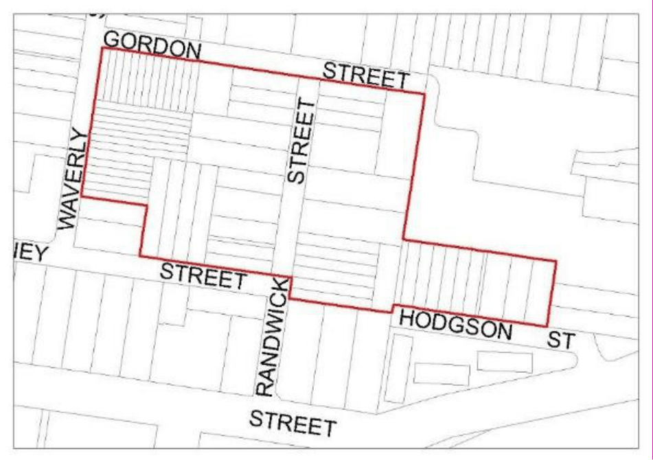

### 4.10. Gordon Square Heritage Conservation Area

A unique precinct of nineteenth century workers housing including several fine terraces. Located in the suburb of Randwick, it comprises a rectangular area generally bounded by Gordon Street in the north, Waverley Street in the west, and Sydney and Hodgson Streets in the south.

> [Picture on page 53: a picture, saved as a picture (images/part-b2-heritage-page-53-6.gif, 150 dpi).]

#### 4.10.1. Character values

Development must retain and enhance the outcomes expressed in the statement of significance for the HCA and as summarised below.

a. Subdivision - Unusual street and subdivision layout with narrow streets and small lots. The subdivision and street layout of the HCA should be preserved. Future uses for this HCA should be compatible with its historical functions/ associations

b. Scale and Form - Single storey and two storeys. Mixture of small and large terraced dwellings, as well as detached and semi-detached cottages

c. Siting and Setbacks - Minimal or zero front setbacks. Maintain the existing setting of the heritage item, informed by the historic pattern of neighbouring development (form, scale, bulk, setback and height)

d. Roofs and Chimneys - Includes both pitched roof forms and skillion roofs with parapets

e. Materials - Walls are painted stucco, originally in consistent colour schemes, some face brickwork. Generally corrugated iron roofs. Original fabric is highly significant and should be maintained

q) Detailing - Cast iron decoration to verandahs and balconies. Maintain the historic aesthetic/character of the item and area (e.g. paint scheme, materiality, style, landscape elements). Maintain heritage landscape elements and schemes.  Sandstone street

kerbing and gutters should be retained in situ, where at risk salvaged for reuse. Protect inlaid concrete footpath signage and encourage provision for street names embedded in footpaths

f. Verandahs and Balconies - Projecting upper floor balconies contribute to an impressive streetscape

g. Carparking - Narrow lots without rear lanes are not allowed for on-site carparking

h. Fences - A number of the terraces are built to the street alignment, so that dwellings do not have front fences and front gardens. Where fencing exists, it is predominantly open metal or timber fencing.

#### 4.10.2. Guidelines for change

The HCA is considered to have high integrity. The residences within the centre block in particular are highly intact. The residences along Hodgson Street have substantial rear extensions, but the streetscape retains its period character. Alterations and additions should respond to the existing pattern of development, with careful consideration of the setting (form, scale, bulk, setback and height). New alterations and additions should respect the historic aesthetic/character of the item and area (e.g. paint scheme, materiality, style, landscape elements). The Gordon Square heritage conservation area includes both single storey and two storey buildings. Rear additions should not be prominent in the streetscape nor compromise the integrity of the original roof. The attached dwellings were originally of modest size and have generally been subject to subsequent rear additions. Further changes should be consistent with the scale and form of surrounding rear wings. In order to maintain the aesthetic significance of Gordon Square HCA, it is recommended that no additional large apartment blocks are built within this HCA. New medium to high rise buildings in this HCA have the potential to adversely impact upon the aesthetic significance of the HCA. New development must consider the historic setback, form and materiality in the new design to achieve a development that is responsive and sensitive to the heritage character of the Gordon Square HCA. Scale should be considered for all future development to ensure internal vistas are protected and maintained. Where houses have front fences in disrepair, including but not limited to, on Gordon Street and Hodgson Street, these should be maintained. Carparking Most of the properties within the conservation area have rear lane access allowing for carparking at the rear of the site. Where rear lane access is available, carparking to the front or side of the property will not be supported. Development must not incorporate new driveways, garages, carports, or carspaces across the front boundary, forward of the front building line, where these elements are not supported by historic evidence and uncharacteristic of the area’s established streetscape.
