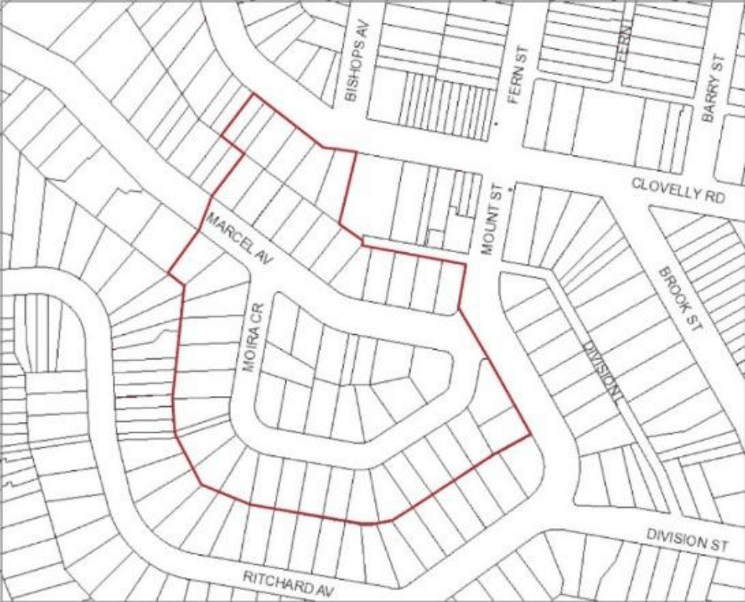

### 4.11. Moira Crescent Heritage Conservation Area

Randwick’s best grouping of Inter -War residential flat buildings. A hilltop heritage conservation area (partly within the suburb of Clovelly and partly within the suburb of Coogee) includes Moira Crescent as well as part of Marcel Avenue and several lots fronting Clovelly Road.

> [Picture on page 55: a picture, saved as a picture (images/part-b2-heritage-page-55-6.gif, 150 dpi).]

#### 4.11.1. Character values

Development must retain and enhance the outcomes expressed in the statement of significance for the HCA and as summarised below.

a. Subdivision - Curved streets and wide nature strips. Streetscapes have a strong landscape quality. Future uses for this HCA should be compatible with its historical functions/associations

b. Landscape and public domain elements - Streetscapes have a strong landscape quality

c. Scale and Form - Consistency of scale, generally two and three storeys

d. Siting and Setbacks - Main rooms and balconies of individual apartments oriented to the street. Maintain the existing setting of the heritage and contributory items, informed by the historic pattern, form, scale, bulk, setback and height

e. Roofs - Includes both traditional hipped roofs and flat roofs with parapets

f. Materials - Walls of red or liver coloured face brickwork. Red terracotta tiles. Original fabric is highly significant and should be maintained

r) Detailing - Decorative elements in stone, brickwork and cement render. Maintain the historic aesthetic/character of the item and area (e.g. paint scheme, materiality, style, landscape elements). Protect inlaid concrete footpath signage and encourage provision for street names embedded in footpaths

g. Verandahs and Balconies - Recessed verandas and balconies a design feature of the front elevation

h. Garages, carports, car spaces and driveways - Garages often incorporated to the rear of buildings

i. Fences - Dwarf pierced face brick front boundary fences allow front gardens to become part of the streetscape

j. Gardens and garden elements - Private rear garden accessed by back stairs. Maintain heritage landscape elements and schemes.

#### 4.11.2. Guidelines for change

Alterations and additions Alterations and additions should respond to the existing pattern of development, with careful consideration of the setting (form, scale, bulk, setback and height). New alterations and additions should respect the historic aesthetic/character of the item and area (e.g. paint scheme, materiality, style, landscape elements). Balcony additions to residential flat buildings can be provided to the rear of residential flat buildings to provide outdoor living areas and take advantage of views. Additional balconies should not be provided to the front or visible side elevations of buildings. Additional balconies should be part of a comprehensive scheme for the whole rear elevation, rather than for a single apartment in isolation. The current streetscape and landscape amenity of this HCA should be preserved and enhanced, where possible, including the street names embedded in the concrete footpath. The subdivision and street layout of the HCA should be preserved. Any new development should be of a similar scale and form. This is supported by the heigh limits within the precinct. Scale should also be considered for all future development to ensure internal vistas are protected and maintained. Unsympathetic additions or alterations to dwellings are not permitted. The relationship between the Clovelly Road shopping district and this HCA should be further explored, with values identified to exemplify why this connection is important. Carparking Most of the properties within the conservation area have rear lane access allowing for carparking at the rear of the site. Where rear lane access is available, carparking to the front or side of the property will not be supported. New development must not incorporate new driveways, garages, carports, or carspaces across the front boundary, forward of the front building line, where these elements are not supported by historic evidence and uncharacteristic of the area’s established streetscape.
