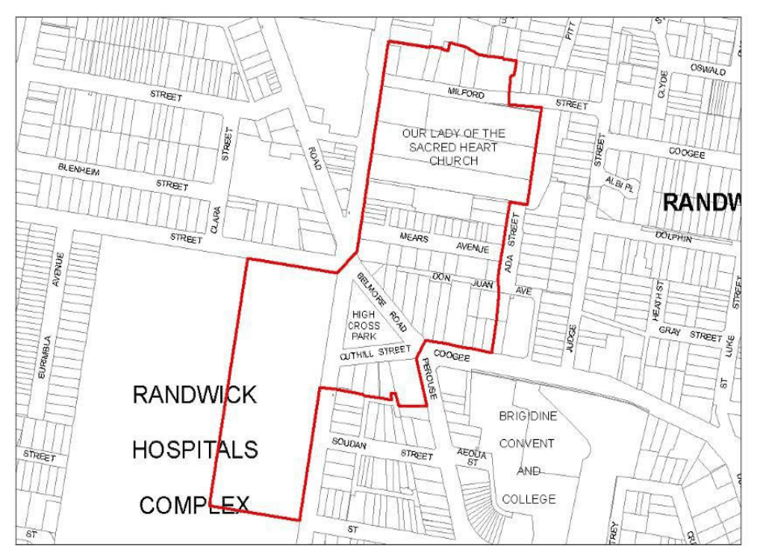

### 4.12. High Cross Heritage Conservation Area

A major urban space providing a focus for nearby institutional buildings with many important religious and residential buildings in the surrounding area.

> [Picture on page 57: a picture, saved as a picture (images/part-b2-heritage-page-57-4.gif, 150 dpi).]

The High Cross Conservation Area, within the suburb of Randwick, includes High Cross Park, as well as urban areas to the north-east and south, and part of the Prince of Wales Hospital to the west.

#### 4.12.1. Character values

Development must retain and enhance the outcomes expressed in the statement of significance for the HCA and as summarised below.

a. Landscape and public domain elements - Maintain heritage landscape elements and schemes. Avenue plantings of fig trees within the Sacred Heart Church make a major contribution to the streetscape character of Avoca St

b. Subdivision - Avenue plantings of fig trees within the Sacred Heart Church make a major contribution to the streetscape character of Avoca St

c. Scale and Form - Dominated by the imposing scale of the buildings of the former Destitute Children’s Asylum, the Royal Hotel and the Lady of the Sacred Heart Church. Also, a number of grand two storey houses. Housing predominantly two storeys

d. Siting and Setbacks - Wide range of block sizes result in a wide variation in setbacks. Views of the large Victorian period buildings from the streets, across their forecourts and gardens. Maintain the existing setting of the heritage item, informed by the historic pattern form, scale, bulk, setback and height

e. Roofs - Traditional pitched roofs

f. Materials - Walls of sandstone, stucco, some face brickwork. Slate roofs. Original fabric is highly significant and should be maintained

s) Detailing - Decorative metalwork to verandahs and balconies, cement render detailing. Protect inlaid concrete footpath signage and encourage provision for street names embedded in footpaths. Maintain the historic aesthetic/character of the item and area (e.g. paint scheme, materiality, style, landscape elements)

g. Verandahs and Balconies - Front verandahs integral to each of the architectural styles which are represented in the area

h. Carparking - Generous setbacks generally allow for carparking to rear

i. Fences - Victorian metal palisade fencing.

#### 4.12.2. Guidelines for change

This HCA has been well-maintained and is considered highly intact. Significant views and vistas of the HCA should continue to be maintained. Any alterations and additions within the HCA should be consistent with the existing character values, or sympathetic with heritage items in the vicinity. Any new development in the HCA or in the surrounding streets, should adhere to the character of the HCA, with a specific focus on sympathetic design especially built scale, use of materials, and colour scheme. A CMP should be prepared if any major development is planned for the grounds of the Sacred Heart Church and Primary School. The CMP should develop policies for preservation of significant tree specimens and vistas, as well as the period fabric of the site. Alterations and additions Alterations and additions should respond to the existing pattern of development, with careful consideration of the setting (form, scale, bulk, setback and height). New alterations and additions should respect the historic aesthetic/character of the item and area (e.g. paint scheme, materiality, style, landscape elements). Future uses for this item should be compatible with its historical functions/ associations. Rear additions should not be prominent in the streetscape nor compromise the integrity of the original roof. Additions to terraced buildings should not compromise the integrity of relatively intact rear wings and should be consistent with the scale and form of surrounding rear wings. Carparking Most of the properties within the conservation area have rear lane access allowing for carparking at the rear of the site. Where rear lane access is available, carparking to the front or side of the property will not be supported. New development must not incorporate new driveways, garages, carports, or carspaces across the front boundary, forward of the front building line, where these elements are not supported by historic evidence and uncharacteristic of the area’s established streetscape.
