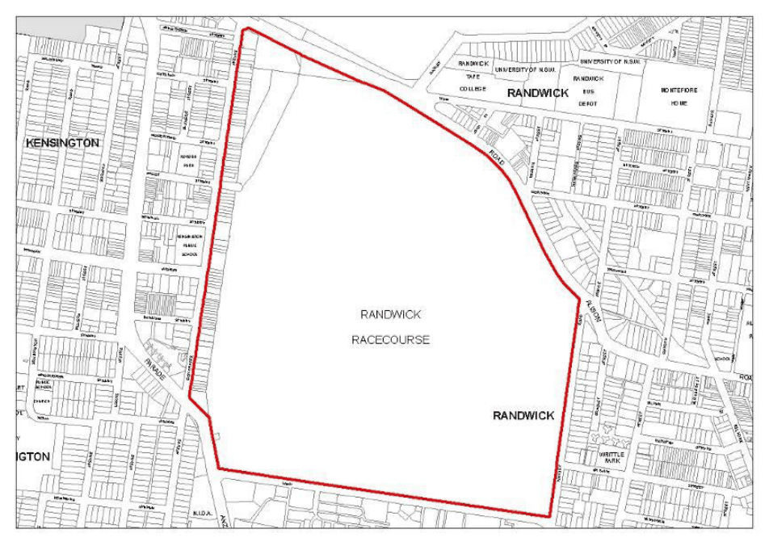

### 4.13. Racecourse Precinct Heritage Conservation Area

A number of early buildings surround the historic track itself, while Doncaster Avenue includes some fine groups of nineteenth and twentieth century houses. The Racecourse Precinct includes Royal Randwick Racecourse and all properties on the eastern side of Doncaster Avenue., Kensington, which adjoin the racecourse at the rear.

> [Picture on page 59: a picture, saved as a picture (images/part-b2-heritage-page-59-6.gif, 150 dpi).]

#### 4.13.1. Character values

Development must retain and enhance the outcomes expressed in the statement of significance for the HCA and as summarised below.

a. Subdivision - The subdivision consists of narrow lots bordering the Randwick Racecourse. Maintain front gardens, and landscape elements and schemes

b. Scale and Form - Major built features are the stands within the Racecourse. Single storey detached and semi-detached cottages, two storey detached houses and terraces, some intrusive 3 storey buildings. Historic significance of stable buildings at the rear of sites

c. Siting and Setbacks - Consistent setbacks. Maintain the existing setting of the heritage item, informed by the historic pattern form, scale, bulk, setback and height

d. Roofs - Traditional pitched roofs, many with gabled forms

e. Materials - Walls predominantly face brickwork, some painted stucco. Walls that are painted stucco, originally in consistent colour schemes. Terracotta tiles and slate roofing. Original fabric is highly significant and should be maintained

t) Detailing - Predominantly timber decoration to verandahs and gable screens. Protect inlaid concrete footpath signage and encourage provision for street names embedded in

footpaths. Maintain the historic aesthetic/character of the item and area (e.g. paint scheme, materiality, style, landscape elements)

f. Verandahs and Balconies - Federation detailing of front verandahs contributes to the character of the area

g. Carparking - Narrow lots without rear lanes generally do not allow for onsite carparking

h. Fences

– Low/dwarf brick fences and simple picket fences typical.

#### 4.13.2. Guidelines for change

These key values and characteristics, and the guidelines for change that follow, need to be considered in addition to the general guidelines and controls contained in this DCP, and the site-specific controls for Royal Randwick Racecourse in Part E. A CMP has been prepared for the Randwick Racecourse and should be addressed in any development proposal for the site. Any new development in the HCA or in the surrounding streets, should adhere to the character of the HCA, with a specific focus on sympathetic design especially built scale, use of materials, and colour scheme. Alterations and additions Alterations and additions should respond to the existing pattern of development, with careful consideration of the setting (form, scale, bulk, setback and height). New alterations and additions should respect the historic aesthetic/character of the item and area (e.g. paint scheme, materiality, style, landscape elements). Future uses for this HCA should be compatible with its historical functions/ associations. Rear additions should not be prominent in the streetscape nor compromise the integrity of the original roof. Rear additions to attached and semi-detached cottages should be consistent with the scale and form of surrounding rear wings. Original stables There are a number of original stables building in the area, associated with the racecourses which were located in the vicinity. These should be retained and conserved wherever possible. Carparking Most of the properties within the conservation area have rear lane access allowing for carparking at the rear of the site. Where rear lane access is available, carparking to the front or side of the property will not be supported. New development must not incorporate new driveways, garages, carports, or carspaces across the front boundary, forward of the front building line, where these elements are not supported by historic evidence and uncharacteristic of the area’s established streetscape.
