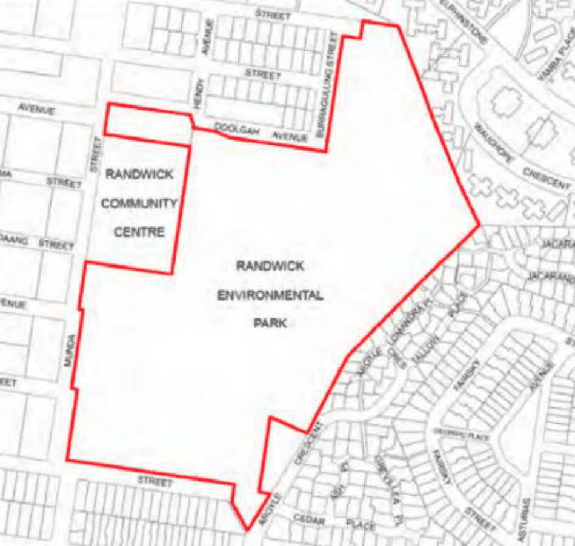

### 4.14. Randwick Environment Park Heritage Conservation Area

Comprises 13 hectares of parkland, bushland and wetland containing 92 species of indigenous plants. It includes the endangered Sunshine Wattle and 3.6 hectares of Eastern Suburbs Banksia Scrub, which is an endangered ecological community. The bushland and wetland provide valuable habitat for a range of fauna.

> [Picture on page 61: a picture, saved as a picture (images/part-b2-heritage-page-61-6.gif, 150 dpi).]

#### 4.14.1. Character values and controls

Randwick City Council manages its remnant areas of Eastern Suburbs Banksia Scrub, including that within Randwick Environment Park, in accordance with relevant management documents, in order to restore remnant vegetation and to enhance and expand native fauna habitat. These documents include a Recovery Plan for the Conservation of Eastern Suburbs Banksia Scrub; and the Best Practice Guidelines for the Management of Eastern Suburbs Banksia Scrub, both published by the NSW Department of Planning and Environment. Volunteer Bushcare maintenance works are carried out in accordance with the Recovery Plan and Management Guidelines.
