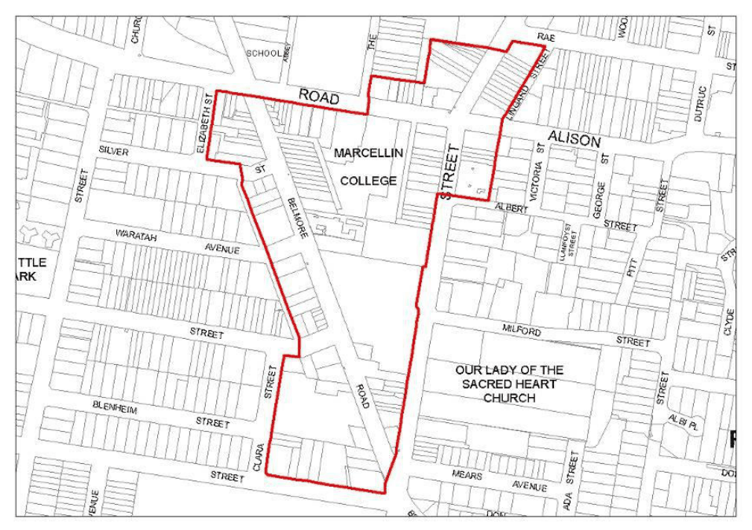

### 4.15. Randwick Junction Heritage Conservation Area

A largely intact traditional commercial centre with many good examples of buildings from the Victorian, Federation and Inter-War period. The Randwick Junction heritage conservation area is centred on the Randwick Junction commercial centre. It is generally bounded by Belmore Road, Alison Road and Avoca Street, Randwick.

> [Picture on page 62: a picture, saved as a picture (images/part-b2-heritage-page-62-7.gif, 150 dpi).]

#### 4.15.1. Character values

Development must retain and enhance the outcomes expressed in the statement of significance for the HCA and as summarised below.

a. Landscape and public domain elements - Randwick Junction HCA remains a good and generally intact example of a typical “High Street” style commercial strip/centre, particularly along Belmore Road. The HCA is predominately commercial with some residential areas along the outskirts of the HCA which feature a mix of single-storey dwellings, and two and three storey apartments

b. Subdivision - Linear streetscape with no obvious landscape elements

c. Scale and form: Diversity of scale and form with two-storey and three-storey terraces and semi-detached shop fronts common in the area

d. Siting and setbacks: Residential buildings generally have a deeper setback than the commercial shopfronts

e. Roofs: Parapet façades

f. Materials: Walls predominantly face brickwork, some painted stucco. Walls that are painted stucco, originally in consistent colour schemes. Terracotta tiles and slate roofing. Original fabric is highly significant and should be retained and maintained

g. Detailing: Predominately timberwork and metal work detailing

h. Verandahs and balconies: Victorian detailing to front verandahs and balconies contributes to the character of the area

i. Carparking: Narrow lots on a commercial strip generally do not allow for onsite carparking

j. Fences: Metal palisade fences set into sandstone is the typical fence.

#### 4.15.2. Guidelines for change

Further unsympathetic additions above the roofline within this HCA should be minimised. Any new development in the HCA or in the surrounding streets, should adhere to the character of the HCA, with a specific focus on sympathetic design especially built scale, use of materials, and colour scheme. As per the Randwick DCP it is agreed that for fut ure development, ‘Only sites with non-contributory buildings are suitable for new development. New development is instead expected to be consistent with the existing built form and character’. Refer to the site-specific controls in Part D of this DCP.
