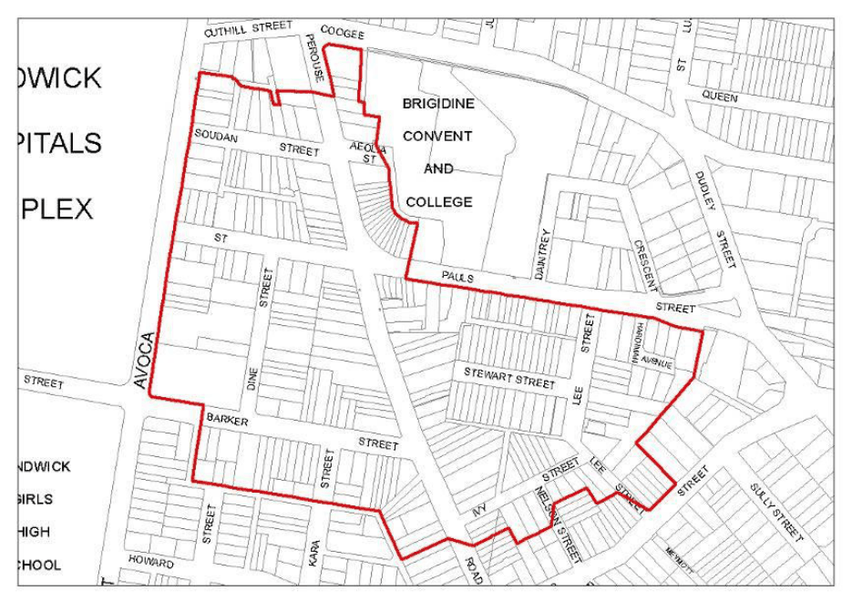

### 4.16. The Spot Heritage Conservation Area

Groupings of nineteenth and twentieth century residential and commercial buildings including the outstanding Art Deco Ritz cinema. Located within the suburb of Randwick, The Spot heritage conservation area consists of the commercial centre on Perouse Road and St Pauls Street, and surrounding residential areas.

> [Picture on page 64: a picture, saved as a picture (images/part-b2-heritage-page-64-6.gif, 150 dpi).]

#### 4.16.1. Character values

Development must retain and enhance the outcomes expressed in the statement of significance for the HCA and as summarised below.

a. Landscape and public domain elements - Character of some streets enhanced by sandstone retaining walls, urban canopies and mature private and street planting. Maintain front garden, landscape elements and schemes

b. Scale and Form - Diversity of scale including single storey detached cottages and villas, single storey and two storey semi-detached houses and two or three storey residential flat buildings

c. Siting and Setbacks - Diversity of setbacks including smaller setbacks for cottages and larger setbacks for villas. Maintain the existing setting of the heritage item, informed by the historic pattern form, scale, bulk, setback and height

d. Roofs - Traditional pitched roofs

e. Materials - Walls are stucco for Victorian buildings, face brickwork for Federation and Interwar buildings. Terracotta tiles and slate roofing. Original fabric is highly significant and should be retained and maintained. Maintain the historic aesthetic/character of the item and area (e.g. paint scheme, materiality, style, landscape elements)

u) Detailing - Decorative metalwork and timberwork. Protect inlaid concrete footpath signage and encourage provision for street names embedded in footpaths. Maintain the historic aesthetic/character of the item and area (e.g. paint scheme, materiality, style, landscape elements)

f. Verandahs and Balconies - Verandahs and balconies integral to each of the architectural styles which are represented in the area

g. Carparking - Wider lots provide access for parking to the rear. Narrower lots do not allow for onsite carparking, unless a rear lane is available

h. Fences - Front fencing is sympathetic to the style of the dwelling.

#### 4.16.2. Guidelines for change

Alterations and additions Any new development in the HCA or in the surrounding streets, should respect and adhere to enhance the character of the HCA, with a specific focus on sympathetic design especially built scale, use of materials, and colour scheme. Alterations and additions should respond to the existing pattern of development, with careful consideration of the setting (form, scale, bulk, setback and height). New alterations and additions should respect the historic aesthetic/character of the item and area (e.g. paint scheme, materiality, style, landscape elements). Future uses for this item should be compatible with its historical functions/ associations. The Spot heritage conservation area comprises a range of building types including single storey detached cottages and villas, single storey and two storey semi-detached houses and two or three storey residential flat buildings. Rear additions should not be prominent in the streetscape nor compromise the integrity of the original roof. Rear additions to attached and semi-detached cottages should be consistent with the scale and form of surrounding rear wings. Outbuildings to the Rear The scale and bulk of outbuildings to the rear should not dominate the main building on the site. Outbuildings should be of a 1 ½ storey scale with upper floor accommodation within available attic space. The maximum wall height of outbuildings is to be 3.5m and roof pitch is to be consistent with that of the main building on the site. Carparking Most of the properties within the conservation area have rear lane access allowing for carparking at the rear of the site. Where rear lane access is available, carparking to the front or side of the property will not be supported. New development must not incorporate new driveways, garages, carports, or carspaces across the front boundary, forward of the front building line, where these elements are not supported by historic evidence and uncharacteristic of the area’s established streetscape.
