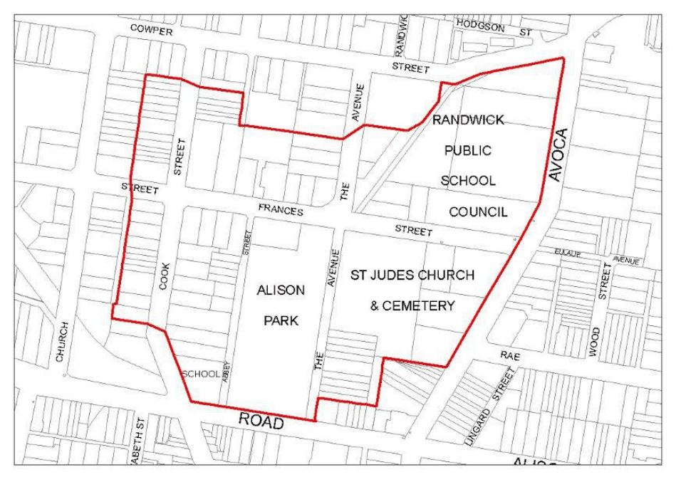

### 4.17. St Judes Heritage Conservation Area

Randwick’s earliest church and civic buildings together with some fine groups of nineteenth and twentieth century houses. Located within the suburb of Randwick, this area falls into two distinct precincts. One is the historic St Judes grouping. The other is the residential precinct centred on Alison Park and the intersection of Cook and Frances Streets.

> [Picture on page 66: a picture, saved as a picture (images/part-b2-heritage-page-66-7.gif, 150 dpi).]

#### 4.17.1. Character values

Development must retain and enhance the outcomes expressed in the statement of significance for the HCA and as summarised below.

a. Subdivision - Diversity of scale including landmark church buildings, three storey terraces, two storey villas and single storey detached and semi-detached cottages

b. Landscape and public domain elements - Alison Park provides a landscape focus for the area. Retain and maintain front gardens, landscape elements and schemes

c. Scale and Form - Diversity of scale including landmark church buildings, three storey terraces, two storey villas and single story detached and semi-detached cottages

d. Siting and Setbacks - Diversity of setbacks including smaller setbacks for terraces and larger setbacks for villas. Maintain the existing setting of the heritage item, informed by the historic pattern, form, scale, bulk, setback and height

e. Roofs - Traditional pitched roofs

f. Materials - Walls are stucco for Victorian buildings, face brickwork for Federation and Interwar buildings, stone for the church group. Terracotta tiles, slate roofing. Original fabric is highly significant and should be maintained

v) Detailing - Decorative elements in stone, metal, timber and brick. Protect inlaid concrete footpath signage and encourage provision for street names embedded in footpaths. Maintain the historic aesthetic/character of the item and area (e.g. paint scheme, materiality, style, landscape elements). Retain existing decorative elements and colour schemes. Removal of timber trim elements or painting of face brickwork is not permitted

g. Verandahs and Balconies - Verandahs and balconies integral to each of the architectural styles which are represented in the area

h. Carparking - Wider lots provide access for carparking to rear. Narrower lots do not allow for onsite carparking

i. Fences - Front fencing is sympathetic to style of dwelling.

#### 4.17.2. Guidelines for change

Alterations and additions Alterations and additions should respond to the existing pattern of development, with careful consideration of the setting (form, scale, bulk, setback and height). New alterations and additions should respect the historic aesthetic/character of the item and area (e.g. paint scheme, materiality, style, landscape elements). Future uses for this HCA should be compatible with its historical functions/ associations. The St Judes heritage conservation area comprises a range of building types including single storey and two storey villas, two storey terraces and attached and semi-detached cottages. Rear additions should not be prominent in the streetscape nor compromise the integrity of the original roof. Rear additions to attached and semi-detached cottages should be consistent with the scale and form of surrounding rear wings. Outbuildings to the rear The scale and bulk of outbuildings to the rear should not dominate the main building on the site. Outbuildings should be of a 1 ½ storey scale with upper floor accommodation within available attic space. The maximum wall height of outbuildings is to be 3.5m and roof pitch is to be consistent with that of the main building on the site. Carparking Most of the properties within the conservation area have rear lane access allowing for carparking at the rear of the site. Where rear lane access is available, carparking to the front or side of the property will not be supported. New development must not incorporate new driveways, garages, carports, or carspaces across the front boundary, forward of the front building line, where these elements are not supported by historic evidence and uncharacteristic of the area’s established streetscape.
