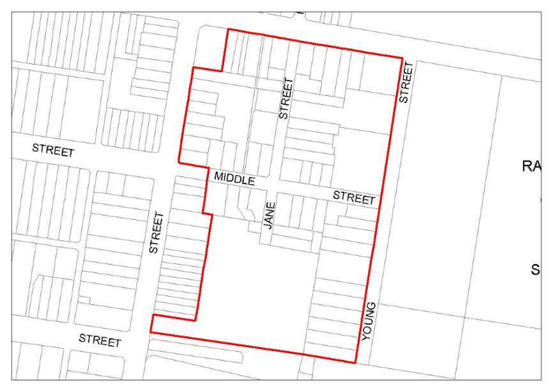

### 4.19. Struggletown Heritage Conservation Area

One of the earliest settlements in Randwick, it includes a number of mid nineteenth cottages and stables buildings associated with the horse racing industry. The Struggletown heritage conservation area consists of several street blocks of housing and stables between Young Street, Barker Street and Botany Street in Randwick.

> [Picture on page 70: a picture, saved as a picture (images/part-b2-heritage-page-70-6.gif, 150 dpi).]

#### 4.19.1. Character values

Development must retain and enhance the outcomes expressed in the statement of significance for the HCA and as summarised below.

a. Landscape and public domain elements - Trees on the Newmarket site and sandstone kerb and guttering contribute to the amenity and character of the area.  Sandstone kerbing and gutter should be retained in situ, where at risk salvaged for reuse. Maintain heritage landscape elements and schemes. The streetscape character of this HCA should be preserved

b. Subdivision - Rectilinear layout of narrow sites. Trees on the Newmarket site and sandstone kerb and guttering contribute to the amenity and character of the area

c. Scale and Form - Two storey shops on the corner of Barker St and Jane St, but otherwise modest single storey cottages. Stables buildings at the rear of sites

d. Siting and Setbacks - Minimal front setbacks. Maintain the existing setting of the heritage item, informed by the historic pattern, form, scale, bulk, setback and height

e. Roofs - Simple pitched roofs constructed of corrugated iron roofs

f. Materials - Walls of weatherboard, stone or brick. Generally corrugated iron roofs. Original fabric is highly significant and should be maintained

g. Detailing - Plainly detailed metalwork and timberwork. Protect inlaid concrete footpath signage and encourage provision for street names embedded in footpaths. Maintain the historic aesthetic/character of the item and area (e.g. paint scheme, materiality, style, landscape elements)

j. Verandahs and Balconies - Early buildings incorporate a simple verandah across the entire front of the cottage. Verandahs and balconies integral to each of the architectural styles which are represented in the area

h. Carparking - Narrow lots without rear lanes do not allow for onsite carparking

i. Fences - Traditional fencing probably low timber pickets.

#### 4.19.2. Guidelines for change

Alterations and additions Alterations and additions should respond to the existing pattern of development, with careful consideration of the setting (form, scale, bulk, setback and height). New alterations and additions should respect the historic aesthetic/character of the item and area (e.g. paint scheme, materiality, style, landscape elements). Future uses for this item should be compatible with its historical functions/ associations. Key existing character values of contributory buildings, such as materials, detailing and roofs should be protected and maintained. Unsympathetic additions should be discouraged. The dwellings are generally modest workers cottages on small blocks, and in order to increase the size of the dwelling, may be necessary to provide some upper-level floor space. The bulk and prominence of any upper-level addition should be minimised however. Any upper-level addition should be set well to the rear to minimise streetscape visibility and retain the integrity of the original roof. As the dwellings are generally of quite early construction, they should be subject to careful and timely maintenance and repair. Carparking Most of the properties within the conservation area have rear lane access allowing for carparking at the rear of the site. Where rear lane access is available, carparking to the front or side of the property will not be supported. New development must not incorporate new driveways, garages, carports, or carspaces across the front boundary, forward of the front building line, where these elements are not supported by historic evidence and uncharacteristic of the area’s established streetscape.
