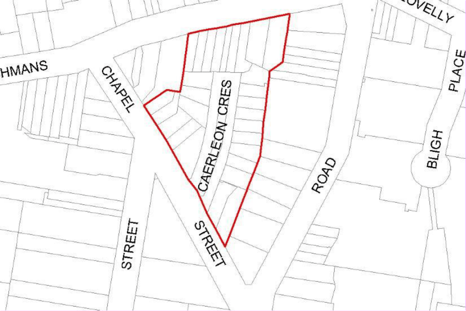
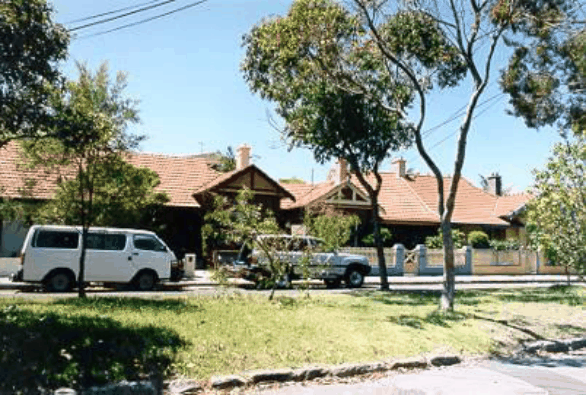

### 4.20. Caerleon Crescent Heritage Conservation Area

An unusual cul-de-sac subdivision with a wide planted median, featuring dwellings from the turn of the nineteenth century. The area covers Caerleon Crescent properties and also includes a number of properties in Frenchmans Road and Chapel Street, Randwick.

> [Picture on page 72: a picture, saved as a picture (images/part-b2-heritage-page-72-6.gif, 150 dpi).]

#### 4.20.1. Character values

Development must retain and enhance the outcomes expressed in the statement of significance for the HCA and as summarised below.

a. Landscape and public domain elements - Planted median provides focus for the precinct. Pedestrian passageway to Frenchmans Road. Contributory street tree planting. Maintain heritage landscape elements and schemes

b. Subdivision - Historical value as a substantially intact example of subdivision in Randwick City at the turn of the nineteenth century. Planted median provides focus for the precinct

c. Scale and Form - Intimately scaled, contained precinct. Consistency of single storey scale and semi-detached form of the contributory buildings. Federation Queen Anne style, featuring face brickwork, hipped and gabled roofs in terracotta tiles and timber trim

d. Siting and Setbacks - Consistent narrow setback from street boundary. Minimal setbacks from street. Maintain the existing setting of the heritage item, informed by the historic pattern, form, scale, bulk, setback and height

e. Roofs - Consistent roofscape of traditional pitched roofs, hipped and gabled forms

f. Materials - Face brickwork walls. Terracotta tiled roofs. Original fabric is highly significant and should be maintained

g. Detailing - Timber trim contributes to Federation Queen Anne character. Protect inlaid concrete footpath signage and encourage provision for street names embedded in

footpaths. Maintain the historic aesthetic/character of the item and area (e.g. paint scheme, materiality, style, landscape elements)

h. Verandahs and Balconies

– Characteristic Queen Anne and Federation style verandahs

and balconies

i. Carparking - Minimal side setbacks do not allow parking to side or rear of dwelling

j. Fences - Original/early front fences.

Figure 12: Example of character values

> [Picture on page 73: a picture, saved as a picture (images/part-b2-heritage-page-73-9.gif, 150 dpi).]

#### 4.20.2. Guidelines for change

Alterations and additions Alterations and additions should respond to the existing pattern of development, with careful consideration of the setting (form, scale, bulk, setback and height). New alterations and additions should respect the historic aesthetic/character of the item and area (e.g. paint scheme, materiality, style, landscape elements). Future uses for this HCA should be compatible with its historical functions/ associations. Changes should not be made to front elevations of semi-detached dwellings which detract from the integrity of the pair. Rear additions should not be prominent in the streetscape nor compromise the integrity of the original roof. Rear additions to attached and semi-detached cottages should be consistent with the scale and form of surrounding rear wings. Carparking Most of the properties within the conservation area have rear lane access allowing for carparking at the rear of the site. Where rear lane access is available, carparking to the front or side of the property will not be supported. New development must not incorporate new driveways, garages, carports, or carspaces across the front boundary, forward of the front building line, where these elements are not supported by historic evidence and uncharacteristic of the area’s established streetscape.
